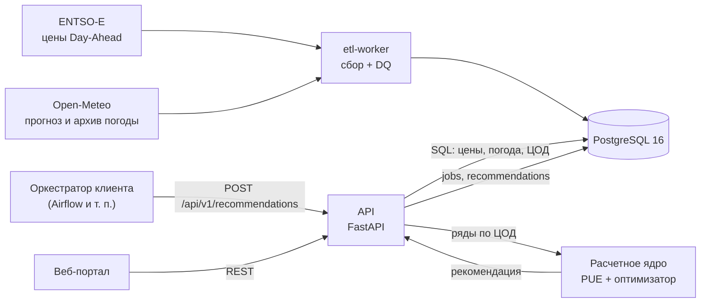

# Архитектура EcoGrid Flow

Как устроена система сейчас: из каких частей она состоит, как между ними идут данные, кто за что отвечает и где лежат контракты между частями. Документ описывает текущее состояние и обновляется в том же PR, что и код.

**Что делает система.** По ценам на электроэнергию на сутки вперед (ENTSO-E), прогнозу погоды (Open-Meteo) и справочнику ЦОД подбирает для вычислительной задачи клиента ЦОД и окно запуска, при которых задача обойдется дешевле всего и успеет к дедлайну. Сервис разворачивается целиком внутри контура клиента (On-Premise): наружу ходят только загрузчики данных.

---

## 1. Компоненты и поток данных

| Компонент | Что делает | Где в репозитории | Владелец | Состояние |
| :--- | :--- | :--- | :---: | :--- |
| **etl-worker** | Загружает погоду и цены, проверяет качество данных, пишет в БД | `services/etl/` | Богдан | Погода работает (прогноз раз в 3 ч, архив разовым запуском). Цены — ждем токен ENTSO-E. DQ-проверки еще нет |
| **PostgreSQL** | Хранит цены, погоду, справочник ЦОД, задачи и рекомендации | `infra/db/init.sql` | Богдан | 6 таблиц, представление почасовых цен, сид 3 ЦОД |
| **API** | Принимает запрос, собирает данные из БД, вызывает ядро, сохраняет и возвращает рекомендацию | — (будет `services/api/`) | Александр | Не начат |
| **Расчетное ядро** | Модель PUE и поиск самого дешевого окна и ЦОД под дедлайн | — | Арина | Не начато |
| **Веб-портал** | Форма задачи и график стоимости по часам | `web/` (статический прототип формы) | Максим | Прототип верстки |
| **Тесты и DQ** | Тестовые данные, автотесты, правила проверки данных | — | Гриша | Не начаты |
| **Инфраструктура** | Docker Compose, CI | `docker-compose.yml` | Александр | В Compose — `postgres` и `etl-worker`; CI нет |

---

## 2. Как проходит запрос рекомендации

1. **Клиент** (оркестратор или веб-портал) отправляет параметры задачи в **API**.
2. **API** проверяет запрос — некорректный отклоняется без записи в БД — и сохраняет задачу в `jobs`.
3. **API** собирает из БД почасовые ряды по каждому допустимому ЦОД: цены, температуру, `base_pue`.
4. **Ядро** по этим рядам выбирает ЦОД и окно запуска и считает базовую стоимость и экономию.
5. **API** сохраняет результат в `recommendations` и возвращает его клиенту.

Правила расчета — в [требованиях](REQUIREMENTS.md) (`FR-ENG-01…05`) и [ADR-001](adr/ADR-001-engine-input-data.md); формат запроса, ответа и ошибок — в контракте API.

---

## 3. Контракты между частями

Контракт — договоренность о формате данных между тем, кто данные отдает, и тем, кто их получает. Пока контракт не меняется, обе стороны работают независимо. Контракт пишет поставщик, ревьюит потребитель; меняется он только через PR (см. [CONTRIBUTING](../CONTRIBUTING.md)).

| Контракт | Между кем | Пишет | Ревьюит | Где лежит | Состояние |
| :--- | :--- | :---: | :---: | :--- | :--- |
| **K1. Внешние источники** | ENTSO-E, Open-Meteo → etl-worker | Богдан | Гриша | [S2T-маппинги](data/s2t/) | Open-Meteo — готово; ENTSO-E — после токена |
| **K2. Схема БД** | etl-worker → БД → API | Богдан | Александр, Гриша | `infra/db/init.sql`, [ERD](data/ERD.md) | Готово (v1) |
| **K3. Вход и выход ядра** | API ↔ ядро | Арина | Александр | [contracts/](contracts/) | Не начато |
| **K4. REST API** | API ↔ веб-портал, клиент | Александр | Максим, Гриша | [contracts/](contracts/) | Не начато; требования — `FR-API-01…05` |

---

## 4. Принятые решения

| Решение | Документ |
| :--- | :--- |
| Время — UTC; ядро на почасовой сетке; цены для ядра — из `v_entsoe_prices_hourly`; горизонт — известные цены; без прогноза погоды — `base_pue`; ряды собирает API, ядро не обращается к БД | [ADR-001](adr/ADR-001-engine-input-data.md) |
| Проверки диапазонов значений — в Python до записи, а не `CHECK` в БД | [ERD, п. 4](data/ERD.md) |
| Цены хранятся в исходном шаге (`PT60M` / `PT15M`), ключ включает `resolution` | [ERD, п. 3](data/ERD.md) |

Новое решение, которое затрагивает несколько частей системы, оформляется как ADR в `docs/adr/`.

---

## 5. Окружение и запуск

* **Стек:** Python 3.11, PostgreSQL 16, Docker Compose; API — FastAPI; веб-портал — React + TypeScript.
* **Энергозоны MVP:** `DE-LU`, `FI`, `SE3`; по одному синтетическому ЦОД в каждой.
* **Сеть:** в интернет обращается только `etl-worker` и только к ENTSO-E и Open-Meteo; данные клиента наружу не уходят (`NFR-SEC-01`, `NFR-SEC-02`).
* **Секреты:** только через `.env` (в Git не попадает), образец — `.env.example`.
* **Локальный запуск** — в [README](../README.md#локальный-запуск).

---

## 6. Карта документации

| Документ | О чем |
| :--- | :--- |
| [REQUIREMENTS.md](REQUIREMENTS.md) | Требования: FR, NFR, DR, ASR, приоритеты |
| [adr/](adr/) | Архитектурные решения |
| [data/ERD.md](data/ERD.md) | Схема БД: диаграмма, ключи, описание полей |
| [data/sources.md](data/sources.md) | Источники данных и правила загрузки |
| [data/s2t/](data/s2t/) | Маппинг полей источник → таблица |
| [contracts/](contracts/) | Контракты ядра и API |
| [research/](research/) | Исследования: рынок, параметры модели PUE |
| [status/](status/) | Еженедельные статусы |
| [archive/](archive/) | Учебные материалы (семинары, ТКУ1) — не источник истины |
