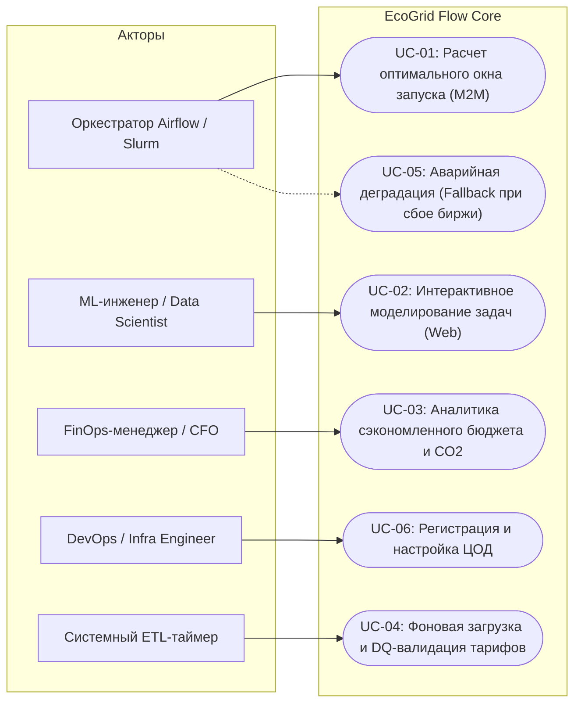
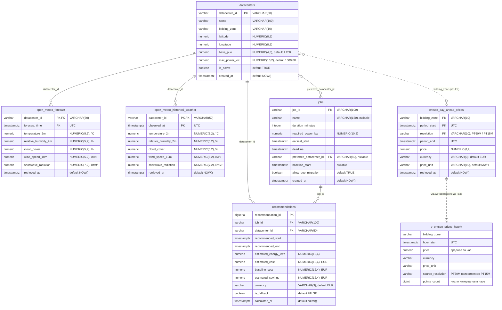
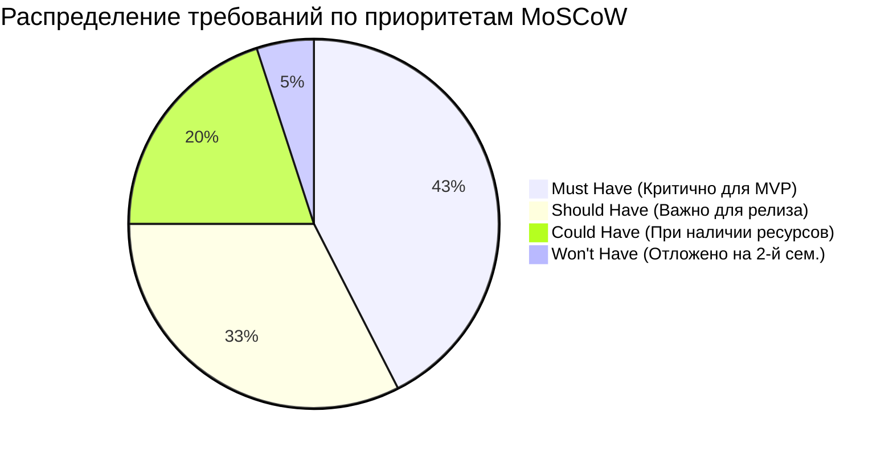
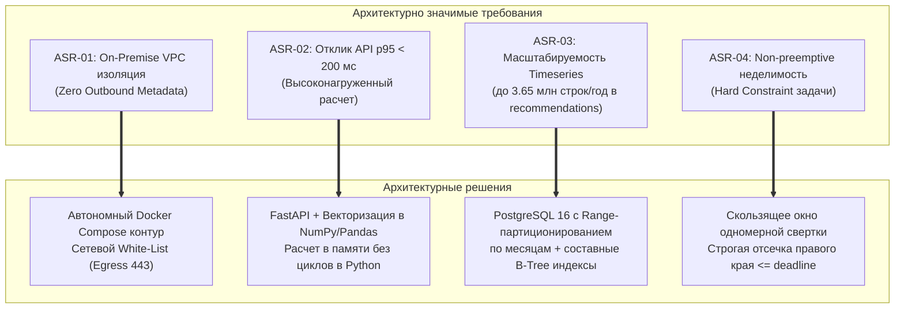
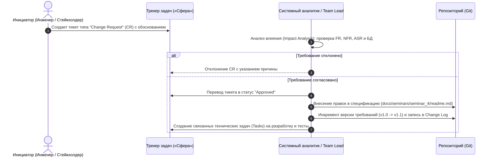

# Семинар 4. Спецификация требований EcoGrid Flow (v1.0)

**Версия документа:** `v1.1.0` (07.10.2026)  
**Статус:** Согласовано (Approved)  

---

## 🎯 Цель работы
Сформировать проверяемую инженерную спецификацию требований к аналитическому сервису **EcoGrid Flow**, включая функциональные требования (**FR**), нефункциональные требования (**NFR**) с количественными метриками, требования к данным и качеству данных (**Data Requirements & DQ**), сценарии приёмки в нотации **Given/When/Then (BDD)**, архитектурно значимые требования (**ASR**), а также формализовать процесс управления изменениями требований.

---

## 📋 Содержание
1. [Базис и ключевые пользовательские сценарии (Use Cases & User Stories)](#1-базис-и-ключевые-пользовательские-сценарии-use-cases--user-stories)
2. [Спецификация функциональных требований (Functional Requirements — FR)](#2-спецификация-функциональных-требований-functional-requirements--fr)
3. [Нефункциональные требования с измеримыми метриками (NFR)](#3-нефункциональные-требования-с-измеримыми-метриками-nfr)
4. [Требования к данным и качеству данных (Data Requirements & DQ)](#4-требования-к-данным-и-качеству-данных-data-requirements--dq)
5. [Критерии приёмки и BDD-сценарии (Given / When / Then)](#5-критерии-приёмки-и-bdd-сценарии-given--when--then)
6. [Приоритизация требований (MoSCoW Matrix)](#6-приоритизация-требований-moscow-matrix)
7. [Архитектурно значимые требования (ASR)](#7-архитектурно-значимые-требования-asr)
8. [Процесс управления изменениями и связь с Backlog («Сфера»)](#8-процесс-управления-изменениями-и-связь-с-backlog-сфера)
9. [Журнал изменений требований (Change Log)](#9-журнал-изменений-требований-change-log)

---

## 1. Базис и ключевые пользовательские сценарии (Use Cases & User Stories)

На основе анализа стейкхолдеров, бизнес-процессов AS-IS / TO-BE и C4-контекста (результаты Семинара 3) выделено **6 сквозных пользовательских сценариев**, охватывающих машинное взаимодействие (M2M), интерактивную аналитику и фоновые процессы.



---

### UC-01: Автоматический запрос и расчет оптимального окна запуска (Machine-to-Machine)
* **Актор:** Корпоративный оркестратор (Apache Airflow / Slurm / Dagster).
* **Пользовательская история (User Story US-01):**
  > **Как** DataOps-инженер,  
  > **я хочу**, чтобы оркестратор Airflow автоматически запрашивал у сервиса EcoGrid Flow оптимальное время и площадку выполнения ночного batch-пайплайна,  
  > **чтобы** снизить затраты на электроэнергию без риска сорвать утренний дедлайн готовности DWH-витрин (SLA 09:00 UTC).
* **Предусловие:** В БД `entsoe_day_ahead_prices` и `open_meteo_forecast` есть актуальные данные на глубину горизонта планирования.
* **Основной поток (Main Flow):**
  1. Оркестратор отправляет HTTP POST-запрос на эндпоинт `/api/v1/recommendations` с метаданными задачи: длительность (`duration_minutes`), мощность (`required_power_kw`), крайний срок (`deadline`), допустимые локации (`allowed_zones`).
  2. Сервис выполняет структурную валидацию входного JSON через Pydantic-схему.
  3. Сервис проверяет физическую достижимость SLA: `deadline - earliest_start >= duration_minutes` (если `earliest_start` не передан, он равен `now()`).
  4. Движок оптимизации извлекает из PostgreSQL спотовые цены и рассчитывает динамический $PUE(T)$ для каждого доступного ЦОД.
  5. Алгоритм скользящего окна вычисляет непрерывную интегральную стоимость выполнения задачи во всех допустимых временных интервалах и находит глобальный минимум:
     $$\min_{t, \, dc} \sum_{i=0}^{N-1} P \cdot PUE(T_{t+i, dc}) \cdot \text{Price}_{dc}(t+i) \quad \text{при} \quad t + \text{duration} \le \text{deadline}$$
  6. Результат расчета сохраняется в таблицу `recommendations`.
  7. API возвращает ответ со статусом `200 OK` и телом: `{recommended_start, recommended_end, target_datacenter, estimated_cost, baseline_cost, estimated_savings, is_fallback: false}`.
  8. Airflow планирует запуск вычислений на назначенное время и направляет задачу в выбранный ЦОД.
* **Альтернативные потоки / Исключения:**
  * **1a. Недостижимый дедлайн:** Если `deadline - earliest_start < duration_minutes`, система возвращает `422 Unprocessable Entity` с описанием ошибки: `«Detail: Task duration (<duration> min) exceeds available window until deadline (<window> min)»`.
  * **1b. Неизвестная ценовая зона:** Если в `allowed_zones` передана зона, отсутствующая в `datacenters`, система возвращает `400 Bad Request`.
* **Постусловие:** В таблице `recommendations` зафиксирована выданная рекомендация с уникальным `recommendation_id`.

---

### UC-02: Интерактивное моделирование и выбор ЦОД в Web-симуляторе
* **Актор:** MLOps-инженер / Data Scientist.
* **Пользовательская история (User Story US-02):**
  > **Как** MLOps-инженер,  
  > **я хочу** смоделировать стоимость обучения LLM/CV-модели в различных дата-центрах через интерактивный веб-интерфейс перед запуском,  
  > **чтобы** выбрать наиболее дешевую и углеродно-нейтральную площадку с учетом сетевых накладных расходов.
* **Предусловие:** Пользователь открыл React Web Portal в корпоративном браузере.
* **Основной поток:**
  1. Инженер указывает параметры обучающей сессии: требуемая мощность (кВт), продолжительность (часы), дедлайн и объем весов модели (ГБ).
  2. Веб-интерфейс отправляет запрос в API Gateway.
  3. Движок рассчитывает сравнительную таблицу затрат для всех доступных ЦОД компании (Германия `DE-LU`, Финляндия `FI`, Швеция `SE3`).
  4. Движок проверяет бизнес-правило **BR-06**: экономия на электроэнергии в удаленном ЦОД должна превышать накладные расходы на перекачку данных (Egress Network Cost).
  5. Фронтенд отображает диаграмму сравнения затрат, динамику PUE и рекомендуемый ЦОД с максимальной чистой экономией.
* **Постусловие:** Инженер копирует параметры слота или нажимает кнопку «Сформировать Airflow Trigger Task».

---

### UC-03: Анализ финансовой эффективности и углеродного следа (FinOps Dashboard)
* **Актор:** FinOps-менеджер / CFO / ESG-директор.
* **Пользовательская история (User Story US-03):**
  > **Как** финансовый контролер IT-инфраструктуры,  
  > **я хочу** видеть сводный отчет по сэкономленным бюджетам и сокращению выбросов $CO_2$ в сравнении со статическим расписанием cron,  
  > **чтобы** подтверждать окупаемость внедрения сервиса (ROI) перед топ-менеджментом.
* **Основной поток:**
  1. Пользователь заходит в раздел «FinOps Аналитика» веб-портала.
  2. Выбирает отчетный период (текущий месяц, квартал) и фильтр по командам/проектам.
  3. API выполняет агрегацию исторических записей из `recommendations` и `jobs`:
     $$\text{Total Savings (€)} = \sum (\text{baseline\_cost} - \text{estimated\_cost})$$
  4. Система рассчитывает сокращение углеродных выбросов на основе данных таблицы `entsoe_day_ahead_generation` (доля ВИЭ в энергозонах в часы выполнения задач).
  5. На дашборде формируются графики: накопленная экономия в евро, процент снижения OPEX и выгружаемый PDF/CSV-отчет для бухгалтерии.

---

### UC-04: Фоновая загрузка и валидация рыночных данных (Ingestion & DQ Gate)
* **Актор:** Системный планировщик ETL (APScheduler / Celery Beat).
* **Пользовательская история (User Story US-04):**
  > **Как** системный ETL-воркер,  
  > **я хочу** ежедневно в 13:00–14:00 CET автоматически загружать спотовые цены ENTSO-E и проводить валидацию качества данных,  
  > **чтобы** наполнять хранилище PostgreSQL проверенными котировками до начала планирования ночных вычислений.
* **Основной поток:**
  1. Таймер ETL инициирует задачу загрузки опубликованных Day-Ahead тарифов на следующие сутки.
  2. Воркер отправляет HTTPS GET-запрос к API платформы прозрачности ENTSO-E с корпоративным security-токеном.
  3. Полученный XML-документ (`Publication_MarketDocument`) парсится во внутреннюю модель.
  4. Модуль Data Quality Gate проверяет:
     * Полноту временного ряда (ровно 24 точки при шаге 60 мин или 96 точек при шаге 15 мин на зону);
     * Допустимый диапазон цен: от -500.00 до +4000.00 EUR/MWh;
     * Валюту (`EUR`) и единицы измерения (`MWh`).
  5. Очищенные данные пакетом вставляются в партиционированную таблицу `entsoe_day_ahead_prices` методом `ON CONFLICT (bidding_zone, period_start, resolution) DO UPDATE`.
  6. В системный лог записывается метрика успешности загрузки.
* **Альтернативный поток (Ошибка DQ):** При обнаружении пропусков или недопустимых значений воркер делает до 3 повторных попыток (exponential backoff) и генерирует алерт дежурному инженеру.

---

### UC-05: Аварийная деградация (Fallback при сбое внешних сервисов)
* **Актор:** Оркестратор Airflow / Движок оптимизации.
* **Пользовательская история (User Story US-05):**
  > **Как** оркестратор Airflow,  
  > **я хочу** гарантированно получить рекомендацию слота запуска даже при полном отказе внешних серверов ENTSO-E или метеосервиса,  
  > **чтобы** производственные вычисления не останавливались и не блокировали бизнес-процессы компании.
* **Основной поток:**
  1. Оркестратор отправляет запрос на расчет задачи в API EcoGrid Flow.
  2. Оптимизационный движок фиксирует, что свежие биржевые котировки на дату планирования отсутствуют (сбой внешнего API).
  3. В соответствии с бизнес-правилом **BR-05** система активирует аварийный режим **Fallback**:
     * Извлекаются исторические данные котировок за аналогичные дни недели предыдущих 3 недель для тех же часов;
     * Рассчитывается скользящий синтетический профиль тарифа;
     * PUE принимается равным базовому значению площадки `base_pue`.
  4. Алгоритм находит минимум по синтетическому профилю с гарантией дедлайна.
  5. В теле ответа API обязательно выставляется предупреждающий признак: `"is_fallback": true`, `"warning": "ENTSO-E data unavailable. Slot calculated using historical 3-week median profile."`.
  6. Оркестратор принимает рекомендацию и выполняет задачу в штатном режиме.

---

### UC-06: Регистрация и настройка характеристик площадки ЦОД
* **Актор:** Инфраструктурный инженер / DevOps / Admin.
* **Пользовательская история (User Story US-06):**
  > **Как** системный администратор инфраструктуры,  
  > **я хочу** добавлять новые серверные площадки и обновлять базовые параметры PUE через защищенный API или конфигурационный файл,  
  > **чтобы** алгоритм пространственного арбитража учитывал новые вычислительные мощности компании без перезапуска всей системы.
* **Основной поток:**
  1. Инженер отправляет PUT/POST-запрос в `/api/v1/datacenters` с указанием параметров: `datacenter_id`, `name`, `bidding_zone`, `latitude`, `longitude`, `base_pue`, `max_power_kw`.
  2. Система проверяет валидность: `base_pue >= 1.0`, координаты в пределах физических границ, `bidding_zone` входит в реестр ENTSO-E.
  3. Запись вносится в таблицу `datacenters`.
  4. Кэш оптимизационного движка инвалидируется; последующие расчеты учитывают новую площадку.

---

## 2. Спецификация функциональных требований (Functional Requirements — FR)

Каждое функциональное требование имеет уникальный идентификатор, привязано к сценариям использования, проверяемо тестами и сформулировано в стандарте RFC 2119 (ДОЛЖНА / SHALL).

| Идентификатор | Сценарий | Категория | Описание требования |
| :--- | :---: | :--- | :--- |
| **FR-API-01** | UC-01, UC-02 | API Gateway | Система ДОЛЖНА предоставлять эндпоинт `POST /api/v1/recommendations`, принимающий параметры задачи: `job_id` (UUID/str), `duration_minutes` (int > 0), `required_power_kw` (float > 0), `deadline` (ISO 8601 UTC), `earliest_start` (ISO 8601 UTC, опционально, default: now), `allowed_zones` (список строк), а также опциональные параметры базового сценария `preferred_datacenter_id` (default: ЦОД первой зоны из `allowed_zones`) и `baseline_start` (ISO 8601 UTC, default: `earliest_start`). Если `preferred_datacenter_id` не входит в `allowed_zones` или `baseline_start` выходит за интервал [`earliest_start`; `deadline − duration_minutes`], запрос отклоняется с `422 Unprocessable Entity`. |
| **FR-API-02** | UC-01 | API Gateway | Система ДОЛЖНА выполнять валидацию дедлайна и отклонять запрос с HTTP-статусом `422 Unprocessable Entity`, если `deadline < earliest_start + duration_minutes`. |
| **FR-API-03** | UC-01, UC-05 | API Gateway | Ответ эндпоинта рекомендаций ДОЛЖЕН содержать: `recommendation_id`, `job_id`, `target_datacenter`, `recommended_start`, `recommended_end`, `estimated_cost_eur`, `baseline_cost_eur`, `estimated_savings_eur`, `estimated_savings_percent`, `is_fallback` (boolean). **Базовая стоимость** `baseline_cost_eur` — стоимость выполнения той же задачи в ЦОД `preferred_datacenter_id` со старта в `baseline_start`, рассчитанная по тем же ценам и модели PUE, что и рекомендация. Оркестратор вызывает API в момент, когда задача стартовала бы по своему cron, поэтому по умолчанию базовый сценарий — это текущее расписание клиента (AS-IS). `estimated_savings_eur = baseline_cost_eur − estimated_cost_eur`, `estimated_savings_percent = estimated_savings_eur / baseline_cost_eur × 100`. |
| **FR-API-04** | UC-03 | API Gateway | Система ДОЛЖНА предоставлять эндпоинт `GET /api/v1/analytics/savings`, возвращающий агрегированные показатели сэкономленных средств (€) и сокращения выбросов $CO_2$ с группировкой по дням, неделям и месяцам за указанный диапазон дат. |
| **FR-API-05** | UC-06 | API Gateway | Система ДОЛЖНА предоставлять административные эндпоинты `GET, POST, PUT /api/v1/datacenters` для управления реестром дата-центров компании. |
| **FR-ENG-01** | UC-01, UC-02 | Optimization Core | Система ДОЛЖНА рассчитывать динамический PUE площадки на каждый час интервала как функцию уличной температуры: $PUE(T) = \text{base\_pue}$ при $T \le 15^\circ\text{C}$ (*Free Cooling*); $PUE(T) = \text{base\_pue} + 0.015 \times (T - 15)$ при $T > 15^\circ\text{C}$ (*Chiller Cooling*). |
| **FR-ENG-02** | UC-01 | Optimization Core | Алгоритм оптимизации ДОЛЖЕН осуществлять поиск окна методом непрерывного скользящего окна (*Non-preemptive Hard Constraint*): дробление задачи на части запрещено. |
| **FR-ENG-03** | UC-01, UC-02 | Optimization Core | Алгоритм ДОЛЖЕН строго гарантировать выполнение условия дедлайна: $\text{recommended\_end} \le \text{deadline}$. Запрещается предлагать более дешевое окно, выходящее за рамки дедлайна. |
| **FR-ENG-04** | UC-02 | Optimization Core | Система ДОЛЖНА учитывать накладные расходы на межрегиональную передачу данных (*Egress Cost*) и рекомендовать миграцию в удаленный ЦОД только при соблюдении правила: $\text{Savings}_{\text{EUR}} > \text{Data\_Volume}_{\text{GB}} \times \text{Network\_Tariff}_{\text{EUR/GB}}$. |
| **FR-ENG-05** | UC-05 | Optimization Core | При отсутствии свежих Day-Ahead котировок на дату расчета система ДОЛЖНА автоматически формировать рекомендацию на основе скользящей медианы цен за аналогичные дни предшествующих 3 недель с установкой флага `is_fallback = true`. |
| **FR-ETL-01** | UC-04 | Ingestion Layer | Система ДОЛЖНА выполнять автоматический опрос ENTSO-E API не реже одного раза в сутки в интервале 13:00–14:00 CET для загрузки котировок Day-Ahead на следующие сутки. |
| **FR-ETL-02** | UC-04 | Ingestion Layer | Модуль сбора ДОЛЖЕН выполнять периодическую синхронизацию метеопрогноза Open-Meteo каждые 3 часа с шагом горизонта 48 часов для географических координат всех активных ЦОД. |
| **FR-ETL-03** | UC-04 | Ingestion Layer | Система ДОЛЖНА поддерживать пакетный режим первичной ретроспективной загрузки архива цен и генерации ENTSO-E, а также метеоархива за 3–5 лет для задач EDA и ML. |
| **FR-ETL-04** | UC-04 | Data Quality | Модуль Data Quality Gate ДОЛЖЕН проверять каждую входящую партию цен: полнота интервалов 100%, отсутствие дубликатов таймстемпов, нахождение цен в границах от -500.00 до +4000.00 EUR/MWh. |
| **FR-ETL-05** | UC-04 | Storage Layer | Запись данных в таблицы PostgreSQL ДОЛЖНА выполняться идемпотентно с использованием механизма `ON CONFLICT (primary_keys) DO UPDATE`. |
| **FR-UI-01** | UC-02 | Web Interface | Пользовательский интерфейс ДОЛЖЕН отображать интерактивную цветовую карту энергозон присутствия компании с индикацией текущих биржевых цен. |
| **FR-UI-02** | UC-02 | Web Interface | Веб-портал ДОЛЖЕН содержать форму симулятора задач с возможностью ввода мощности, длительности, дедлайна и наглядным графиком почасового распределения затрат. |
| **FR-UI-03** | UC-03 | Web Interface | Дашборд ДОЛЖЕН отображать динамику сэкономленных средств в валюте евро и процент экономии относительно базовой стоимости `baseline_cost_eur` (определение — `FR-API-03`). |

---

## 3. Нефункциональные требования с измеримыми метриками (NFR)

> [!IMPORTANT]
> **Критерий соответствия правилу контроля:** в требованиях полностью исключены субъективные формулировки (*«быстро», «надежно», «высокая масштабируемость»*). Каждое требование содержит явную инженерную метрику, методику замера и граничное пороговое значение.

### 3.1. Производительность (Performance & Latency)
* **NFR-PERF-01 (API Latency):** Время отклика REST API на запрос расчета рекомендаций (`POST /api/v1/recommendations`) при горизонте планирования до 48 часов и числе площадок до 5 не должно превышать **200 миллисекунд** на 95-м перцентиле (p95) и **350 миллисекунд** на 99-м перцентиле (p99) при постоянной нагрузке 50 RPS.
* **NFR-PERF-02 (ETL Ingestion Throughput):** Процесс парсинга, валидации и вставки суточного пакета спотовых цен ENTSO-E (до 5 энергозон, 480 записей) в базу данных PostgreSQL должен занимать не более **15 секунд**.
* **NFR-PERF-03 (Web UI Responsiveness):** Время отрисовки ключевых дашбордов и карты тарифов в браузере (First Contentful Paint, FCP) не должно превышать **1.2 секунды** при скорости клиентского соединения от 10 Мбит/с.
* **NFR-PERF-04 (Database Query Optimization):** Аналитические выборки цен и динамического PUE за скользящее окно 48 часов должны выполняться за время не более **10 миллисекунд** за счет использования партиционирования по диапазонам дат и составных B-Tree индексов `(bidding_zone, period_start)`.

### 3.2. Надежность и доступность (Reliability & Availability)
* **NFR-REL-01 (Service Availability):** Доступность API Gateway и расчетного движка должна составлять не менее **99.9%** (Uptime) в режиме 24/7/365, что допускает суммарный внеплановый простой не более **43 минут в месяц**.
* **NFR-REL-02 (Recovery Time Objective — RTO):** При аварийном завершении контейнера сервиса время автоматического перезапуска средствами Docker Restart Policy (`unless-stopped`) и возврата в состояние готовности обрабатывать трафик (healthcheck `HTTP 200 /health`) не должно превышать **30 секунд**.
* **NFR-REL-03 (Graceful Degradation):** При полной недоступности внешних сетевых зависимостей (ENTSO-E, Open-Meteo) сервис не должен прекращать обработку входящих запросов Airflow. Доля успешных ответов (в режиме Fallback) должна составлять **100%**, при этом погрешность расчетной стоимости относительно факта не должна превышать **15%**.

### 3.3. Информационная безопасность (Security & Privacy)
* **NFR-SEC-01 (Zero Outbound Metadata Leaks):** Во внешнюю сеть (Интернет) категорически запрещена передача любых идентифицирующих данных клиента: идентификаторов задач `job_id`, параметров вычислительного кластера, внутренних сетевых адресов и имен серверов. Объем утечки корпоративных метаданных — **строго 0 байт**.
* **NFR-SEC-02 (Egress Network Filtering):** Сетевой трафик из Docker-контейнеров во внешнюю сеть должен быть строго ограничен белым списком FQDN-имен (`transparency.entsoe.eu` и `api.open-meteo.com`) исключительно по протоколу HTTPS (порт 443). Любые другие исходящие соединения должны блокироваться сетевым фильтром.
* **NFR-SEC-03 (Authentication & Authorization):** Все входящие HTTP-запросы к API Gateway должны быть авторизованы с использованием статического Bearer API-токена в заголовке `Authorization: Bearer <TOKEN>`. Запросы без токена или с недействительным токеном должны отклоняться со статусом `401 Unauthorized` за время не более **15 мс**.

### 3.4. Сопровождаемость и переносимость (Maintainability & Portability)
* **NFR-MAINT-01 (Deployment Portability):** Сервис должен полностью разворачиваться из репозитория одной командой `docker compose up -d` на сервере под управлением ОС Linux (Ubuntu 22.04 LTS / Debian 12) или macOS без ручной установки системных зависимостей, кроме Docker Engine 24+ и Docker Compose v2+.
* **NFR-MAINT-02 (Test Coverage):** Покрытие ядра бизнес-логики (модули расчета PUE, алгоритм скользящего окна, Data Quality Gate) модульными и интеграционными тестами (`pytest`) должно составлять не менее **80%** по метрике line coverage.
* **NFR-MAINT-03 (Structured Logging):** 100% системных и прикладных логов должны выводиться в стандартный поток `stdout` в формате JSON Lines (JSONL), содержать поля `timestamp` (ISO 8601 UTC), `level` (`INFO/WARNING/ERROR`), `trace_id`, `component` и `execution_time_ms`.

---

## 4. Требования к данным и качеству данных (Data Requirements & DQ)

Спецификация фиксирует требования ко всем **7 таблицам системы** в соответствии с каталогом источников данных и описанием схем `PreColumns.md`.

Диаграмма ниже соответствует текущему DDL [`infra/db/init.sql`](../../../../infra/db/init.sql) (6 таблиц и представление почасовых цен); таблица `entsoe_day_ahead_generation` (`DR-02`) пока не создана. Ключи, связи и план по схеме — в [ER-диаграмме](../../../data/ERD.md).



### Сводная спецификация параметров и качества данных

Каждой таблице присвоен идентификатор требования к данным (`DR-01`…`DR-07`), на который ссылаются критерии приёмки и матрица приоритетов.

| ID | Имя таблицы в БД | Режим и частота загрузки | Ожидаемый объем | Формат и схема | Срок хранения (TTL) | Полнота (Completeness) | Допустимый диапазон (Accuracy) | Максимальная задержка (Freshness) | Регламент при пропусках |
| :---: | :--- | :--- | :--- | :--- | :---: | :---: | :---: | :---: | :--- |
| **DR-01** | **`entsoe_day_ahead_prices`** | **1. Backfill:** разово за 3 года.<br>**2. Daily:** 1 раз в сутки (13:00–14:00 CET) | ~105–175 тыс. строк/год (для 3–5 зон) | PostgreSQL table, partitioned by month (`RANGE` по `period_start`). Типы: `text, timestamptz, numeric(8,2)` | 5 лет | **100%** (24 записи/день на зону при шаге PT60M, 96 при PT15M) | Цена от -500.00 до +4000.00 EUR/MWh; Currency = 'EUR' | До 14:00 CET дня $D-1$ на сутки $D$ | При отсутствии данных до 14:30 CET переключение на Fallback (скользящая 3-нед. медиана) |
| **DR-02** | **`entsoe_day_ahead_generation`** | **1. Backfill:** разово за 3 года.<br>**2. Daily:** 1–4 раза в сутки | ~300–600 тыс. строк/год | Партиционированная таблица PostgreSQL по месяцам. Поля: `bidding_zone, period_start, production_type, generation_mw` | 5 лет | $\ge 98\%$ по типам генерации | `generation_mw >= 0.0`. Допустимые типы: `solar, wind_onshore, wind_offshore, nuclear, gas, hydro` и др. | До 6 часов с момента публикации | Линейная интерполяция единичных пропусков до 2 часов |
| **DR-03** | **`open_meteo_forecast`** | Регулярно каждые 3 часа | ~200–500 строк в сутки на 3–5 ЦОД | Партиционированная таблица PostgreSQL по месяцам. Поля: `datacenter_id, forecast_time, temperature_2m, relative_humidity_2m` | 3 месяца (ротация скользящим окном) | $\ge 99\%$ точек прогнозного горизонта | Температура: $[-50^\circ\text{C} \dots +50^\circ\text{C}]$; Влажность: $[0 \dots 100\%]$ | Прогноз обновлен не более 3.5 часов назад | Заполнение из смежного погодного прогноза ближайшего узла сетки |
| **DR-04** | **`open_meteo_historical_weather`** | Разовый исторический архив за 3–5 лет + ежемесячный догруз | ~130–220 тыс. строк на 3–5 ЦОД | Партиционированная таблица PostgreSQL по годам. Поля: `datacenter_id, observed_at, temperature_2m, wind_speed_10m` | Бессрочно (для обучения ML) | $\ge 99.5\%$ | Физические границы климата Европы: $T \in [-45^\circ\text{C} \dots +45^\circ\text{C}]$, ветер $\le 60$ м/с | Ретроспективный архив | Линейная сплайн-интерполяция пропусков $\le 3$ часов |
| **DR-05** | **`datacenters`** | Редко (при добавлении/изменении инфраструктуры) | 5–50 записей | Реляционный справочник PostgreSQL. Поля: `datacenter_id, name, bidding_zone, latitude, longitude, base_pue, max_power_kw` | Бессрочно | **100%** обязательных атрибутов | `base_pue >= 1.00`, `max_power_kw > 0`, широта $[-90 \dots 90]$, долгота $[-180 \dots 180]$ | Актуализация при изменении в течение 5 минут | Запрет сохранения невалидной записи (Check Constraint в БД) |
| **DR-06** | **`jobs`** | По событию (при каждом запросе к API `/recommendations`) | 1 000 – 10 000 записей в сутки | Реляционная таблица PostgreSQL. Поля: `job_id, name, duration_minutes, required_power_kw, earliest_start, deadline, preferred_datacenter_id, baseline_start` | 1 год | **100%** валидность входящего payload | `duration_minutes > 0`, `required_power_kw > 0`, `deadline > earliest_start` | Real-time (момент поступления запроса) | Возврат ошибки `422 Unprocessable Entity` клиенту, запись в БД не создается |
| **DR-07** | **`recommendations`** | По факту генерации рекомендации движком | ~365 тыс. – 3.65 млн записей в год | Партиционированная таблица PostgreSQL по месяцам. Поля: `recommendation_id, job_id, datacenter_id, recommended_start, savings` | 3 года | **100%** целостность | `recommended_end <= deadline`, `estimated_savings_percent >= 0.0`, `estimated_cost > 0` | Real-time (формируется до отправки ответа API) | Откат транзакции при ошибке генерации рекомендации |

---

## 5. Критерии приёмки и BDD-сценарии (Given / When / Then)

Критерии приемки формализованы на языке Gherkin для обеспечения прямой связки между системными требованиями и автоматизированными приемочными тестами (QA / E2E).

### Сценарий 1 (Happy Path): Успешный выбор дешевого ЦОД под жесткий дедлайн
* **Связанные требования:** `FR-API-01`, `FR-API-03`, `FR-ENG-01`, `FR-ENG-03`, `NFR-PERF-01`
```gherkin
Feature: Расчет оптимального окна запуска вычислительной задачи

  Scenario: Выбор энергозоны с минимальной ценой и соблюдением SLA
    Given в базе данных доступны спотовые цены на следующие 24 часа:
      | bidding_zone | period_start         | price         |
      | DE-LU        | 2026-11-10T02:00:00Z | 145.00        |
      | FI           | 2026-11-10T02:00:00Z | 22.50         |
      | SE3          | 2026-11-10T02:00:00Z | 35.00         |
    And дата-центр "FI-HELSINKI-01" имеет базовый PUE 1.15 и температуру воздуха 4°C
    And дата-центр "DE-FRANKFURT-01" имеет базовый PUE 1.25 и температуру воздуха 18°C
    When оркестратор отправляет POST-запрос на "/api/v1/recommendations" с телом:
      """
      {
        "job_id": "job-spark-agg-771",
        "duration_minutes": 180,
        "required_power_kw": 100.0,
        "earliest_start": "2026-11-10T00:00:00Z",
        "deadline": "2026-11-10T08:00:00Z",
        "allowed_zones": ["DE-LU", "FI", "SE3"]
      }
      """
    Then сервер возвращает HTTP-статус 200 в течение менее чем 200 миллисекунд
    And в JSON-ответе поле "target_datacenter" равно "FI-HELSINKI-01"
    And значение "recommended_end" не превышает "2026-11-10T08:00:00Z"
    And значение "baseline_cost_eur" равно стоимости запуска в "DE-FRANKFURT-01" с "2026-11-10T00:00:00Z"
    And значение "estimated_savings_percent" строго больше 50.0
    And поле "is_fallback" равно false
    And в таблице "recommendations" появляется запись с "job_id" = "job-spark-agg-771"
```

---

### Сценарий 2 (Negative / Edge Case): Отклонение запроса с недостижимым дедлайном
* **Связанные требования:** `FR-API-02`, `FR-ENG-03`
```gherkin
Feature: Валидация входных параметров вычислительной задачи

  Scenario: Попытка отправки задачи, длительность которой превышает окно до дедлайна
    Given текущее системное время сервиса равно "2026-11-10T04:00:00Z"
    When оркестратор отправляет POST-запрос на "/api/v1/recommendations" с телом:
      """
      {
        "job_id": "job-invalid-sla-01",
        "duration_minutes": 300,
        "required_power_kw": 50.0,
        "earliest_start": "2026-11-10T04:00:00Z",
        "deadline": "2026-11-10T06:00:00Z",
        "allowed_zones": ["DE-LU", "FI"]
      }
      """
    Then сервер возвращает HTTP-статус 422 Unprocessable Entity
    And тело ответа содержит детальное сообщение об ошибке:
      """
      "Detail: Task duration (300 min) exceeds available window until deadline (120 min)"
      """
    And в таблице "recommendations" не создается новых записей
```

---

### Сценарий 3 (Resilience / Fallback): Работа сервиса при недоступности биржи ENTSO-E
* **Связанные требования:** `FR-ENG-05`, `NFR-REL-03`, `BR-05`
```gherkin
Feature: Аварийное переключение на исторический профиль (Fallback Mode)

  Scenario: Расчет рекомендаций при отсутствии опубликованных Day-Ahead цен
    Given в таблице "entsoe_day_ahead_prices" отсутствуют записи на дату "2026-11-15"
    And в базе данных доступны исторические цены за предшествующие 3 недели
    When оркестратор запрашивает рекомендацию для задачи на дату "2026-11-15"
    Then сервер возвращает HTTP-статус 200 OK
    And в JSON-ответе флаг "is_fallback" равен true
    And ответ содержит предупреждение "ENTSO-E data unavailable. Slot calculated using historical 3-week median profile."
    And значение "estimated_cost_eur" рассчитано на основе 3-недельной скользящей медианы
```

---

### Сценарий 4 (Data Quality): Блокировка аномальных цен в ETL Ingestion Gate
* **Связанные требования:** `FR-ETL-04`, `DR-01`, `NFR-PERF-02`
```gherkin
Feature: Контроль качества входящих рыночных котировок (Data Quality Gate)

  Scenario: Обнаружение и фильтрация недопустимого ценового выброса
    Given ETL-воркер получил от внешнего источника XML-пакет с ценой 9999.00 EUR/MWh для зоны "DE-LU"
    When модуль Data Quality производит валидацию пакета перед загрузкой в БД
    Then пакет признается невалидным по критерию диапазона [-500.00, +4000.00]
    And строка с выбросом отсекается и не попадает в таблицу "entsoe_day_ahead_prices"
    And в системный лог записывается ошибка уровня ERROR с кодом "DQ_OUT_OF_BOUNDS_PRICE"
    And инцидент отправляется в систему мониторинга без аварийной остановки ETL-воркера
```

---

## 6. Приоритизация требований (MoSCoW Matrix)

Требования приоритизированы по методологии **MoSCoW** для поэтапного релиза системы в рамках семестрового курса. Приоритет присвоен всем 38 требованиям спецификации: 18 FR, 13 NFR и 7 DR; на диаграмме — количество требований в каждой группе.



| Приоритет | Идентификаторы требований | Обоснование и влияние на архитектуру |
| :--- | :--- | :--- |
| **Must Have (M)**<br>*Критично для сдачи MVP* | `FR-API-01`, `FR-API-02`, `FR-API-03`, `FR-ENG-02`, `FR-ENG-03`, `FR-ETL-01`, `FR-ETL-04`, `FR-ETL-05`, `NFR-PERF-01`, `NFR-SEC-01`, `NFR-SEC-02` (Egress white-list), `NFR-SEC-03` (Bearer-токен), `NFR-MAINT-01`, `DR-01` (Цены), `DR-05` (ЦОД), `DR-06` (Задачи), `DR-07` (Рекомендации) | Формируют минимальный работоспособный скелет сервиса: оркестратор шлет запрос, алгоритм ищет минимум под SLA, данные сохраняются в БД. Без этого система не решает базовую проблему. |
| **Should Have (S)**<br>*Важно для промышленного использования* | `FR-ENG-01` (Dynamic PUE), `FR-ENG-05` (Fallback Mode), `FR-ETL-02` (Погода Open-Meteo), `FR-API-05` (Реестр ЦОД), `FR-UI-02` (Симулятор Web), `NFR-REL-01`, `NFR-REL-02` (RTO), `NFR-REL-03` (Graceful Degradation), `NFR-PERF-02` (ETL), `NFR-PERF-04` (Индексы), `NFR-MAINT-02` (Покрытие тестами), `NFR-MAINT-03` (JSON-логи), `DR-03` (Прогноз погоды) | Обеспечивают заявленную в проекте точность физической модели охлаждения дата-центра, отказоустойчивость и удобство интерактивной валидации для ML-инженеров. |
| **Could Have (C)**<br>*Полезно при наличии ресурсов* | `FR-API-04` (Analytics API), `FR-UI-01` (Интерактивная карта цен), `FR-UI-03` (FinOps Dashboard), `FR-ENG-04` (Учет Egress Cost), `FR-ETL-03` (Backfill архива), `NFR-PERF-03` (FCP UI), `DR-02` (Генерация / CO₂), `DR-04` (Метеоархив) | Аналитическая и визуальная надстройка над работающим расчетным ядром; усиливает демонстрационную ценность для защиты перед бизнес-стейкхолдерами. |
| **Won't Have (W)**<br>*Отложено на 2-й семестр* | `ML-Forecast 7-day` (прогноз цен на 7 дней вперед на базе XGBoost / Prophet), Автоматическое прямое управление серверами (IPMI / Redfish). | Требуют накопления обученных моделей и отдельного контура инфраструктурной интеграции; запланированы на второй семестр дисциплины. |

---

## 7. Архитектурно значимые требования (ASR)

Архитектурно значимые требования (**Architecturally Significant Requirements — ASR**) — это требования, оказывающие фундаментальное влияние на выбор архитектурного стиля, шаблонов проектирования, стек технологий и декомпозицию компонентов.



### Детальное описание ASR и принятых архитектурных решений:

#### ASR-01: Полная сетевая изоляция и запрет передачи корпоративных метаданных (On-Premise Private VPC)
* **Источник требований:** `NFR-SEC-01`, `NFR-SEC-02`, Служба информационной безопасности (InfoSec).
* **Влияние на архитектуру:**  
  Исключает использование любых публичных бессерверных платформ (AWS Lambda, Google Cloud Functions) или внешних облачных баз данных. Система проектируется как строго автономный монолит/микросервисный стек, разворачиваемый через `docker-compose.yml` в закрытом сетевом периметре заказчика. Исходящие запросы разрешены только сервису загрузки публичных данных.

#### ASR-02: Жесткий предел времени ответа API (p95 $\le 200$ мс при 50 RPS)
* **Источник требований:** `NFR-PERF-01`, `FR-API-01`, стейкхолдер DataOps (Airflow).
* **Влияние на архитектуру:**  
  Оркестратор Airflow синхронно опрашивает API перед диспетчеризацией каждого шага пайплайна. Задержка более 500 мс способна замедлить весь конвейер DWH.  
  *Архитектурное решение:* Использование асинхронного веб-фреймворка `FastAPI` (на базе `uvicorn / starlette`), пула соединений к базе данных (`asyncpg`) и векторизованного алгоритма скользящего окна на базе `NumPy / Pandas` в оперативной памяти.

#### ASR-03: Эффективное хранение и выборка временных рядов (Timeseries Scale)
* **Источник требований:** `FR-ETL-03`, `DR-01`, `DR-02`, `DR-07` (до ~0.9 млн строк цен и ~3 млн строк генерации за 5 лет хранения, до ~11 млн рекомендаций за 3 года).
* **Влияние на архитектуру:**  
  При обычном хранении в единой таблице скорость аналитических запросов со временем неминуемо деградирует из-за разрастания B-Tree индексов.  
  *Архитектурное решение:* Обязательное секционирование (партиционирование) таблиц `entsoe_day_ahead_prices`, `open_meteo_forecast` и `recommendations` по временным интервалам (`RANGE` по месяцам). Это обеспечивает Partition Pruning — сканирование только актуальной партиции, что обеспечивает выборку 48-часового окна не более чем за 10 мс (`NFR-PERF-04`).

#### ASR-04: Неделимость вычислительного слота (Non-preemptive Batch Execution)
* **Источник требований:** `FR-ENG-02`, Бизнес-правило `BR-02`.
* **Влияние на архитектуру:**  
  Исключает применение алгоритмов дискретного дробления (квантования времени, round-robin планировщиков ОС). Алгоритм оптимизации строится как расчет непрерывного интеграла скользящего окна фиксированной длины $N$, что снижает алгоритмическую сложность до $O(M)$ (где $M$ — число допустимых стартовых часов до дедлайна) и гарантирует детерминированность вычислений.

---

## 8. Процесс управления изменениями и связь с Backlog («Сфера»)

Для исключения хаотичных правок и обеспечения сквозной трассируемости требований в проекте утвержден формальный регламент **Change Management Process**.

### 8.1. Регламент внесения изменений в спецификацию требований



1. **Инициация:** Любое новое требование или корректировка существующего оформляется запросом на изменение (**Change Request — CR**) в трекере «Сфера» с описанием бизнес-причины.
2. **Анализ влияния (Impact Analysis):** Системный аналитик команды оценивает влияние изменения на согласованные NFR (производительность, безопасность) и совместимость схемы БД.
3. **Согласование:** Изменение принимается только при консенсусе архитектора и лида разработки.
4. **Версионирование спецификации:** Документ требований ведется по принципам семантического версионирования (SemVer):
   * **PATCH (v1.0.1):** Уточнение формулировок, опечатки, расширение описаний без изменения логики;
   * **MINOR (v1.1.0):** Добавление нового сценария (Use Case), нового FR или NFR без нарушения обратной совместимости;
   * **MAJOR (v2.0.0):** Изменение архитектурных принципов (ASR), фундаментальная переработка схемы БД или контрактов API.
5. **Фиксация в коде и репозитории:** Каждое изменение сопровождается коммитом в Git с обязательной ссылкой на номер тикета в «Сфере».

---

### 8.2. Матрица трассируемости требований (Traceability Matrix)

Матрица связывает требования с тикетами бэклога в платформе **«Сфера»**, ветками репозитория и уже существующими артефактами. Для требований в статусе «Запланировано» ветка и артефакт создаются вместе с тикетом на разработку (см. п. 8.1).

| ID требования | Категория | Статус реализации | Тикет в «Сфере» | Ветка репозитория Git | Артефакт в репозитории |
| :--- | :--- | :---: | :--- | :--- | :--- |
| **DR-01…DR-07** | Схемы данных | Спецификация готова | `ID24_EGF-14` | `docs/ID24_EGF-14-sources-tables` | `docs/data ingestion/PreColumns.md`, `docs/data ingestion/data sources.md` |
| **FR-UI-02** | Форма симулятора | В работе | `ID24_EGF-18` | `feature/ID24_EGF-18-init-react-form` | `web/index.html`, `web/style.css` |
| **NFR-MAINT-01** | Развертывание | В работе | `ID24_EGF-16` | `infra/ID24_EGF-16-postgres-docker-compose` | `docker-compose.yml` (PostgreSQL 16) |
| **ASR-01** | Изоляция контура | В работе | `ID24_EGF-16` | `infra/ID24_EGF-16-postgres-docker-compose` | `docker-compose.yml` (egress-фильтрация ещё не настроена) |
| **FR-API-01…05** | API Gateway | Запланировано | `ID24_EGF-10` | — | — |
| **FR-ENG-01…04** | Оптимизатор и модель PUE | Запланировано | `ID24_EGF-11` | — | — |
| **FR-ENG-05** | Fallback | Запланировано | `ID24_EGF-11` | — | — |
| **FR-ETL-01…05** | Сбор данных и DQ | Запланировано | `ID24_EGF-13`, `ID24_EGF-14` | — | — |
| **NFR-PERF-01** | Производительность | Запланировано | `ID24_EGF-10` | — | — |
| **ASR-03** | Партиционирование | Запланировано | `ID24_EGF-15` | — | — |

---

## 9. Журнал изменений требований (Change Log)

| Версия | Дата | Автор изменений | Статус | Краткое описание внесенных изменений |
| :---: | :---: | :--- | :---: | :--- |
| **v0.1** | 15.09.2026 | Команда «Шпингалеты» | Черновик | Первичный сбор пользовательских требований и бизнес-целей стейкхолдеров (Семинар 2). |
| **v0.2** | 22.09.2026 | Команда «Шпингалеты» | Согласовано | Формализация каталога данных, построение контекста C4 и процессов AS-IS / TO-BE (Семинар 3). |
| **v1.0** | 27.09.2026 | Команда «Шпингалеты» | **Утверждено** | **Итоговый релиз Семинара 4:**<br>1. Сформированы 6 сквозных Use Cases и User Stories.<br>2. Разработана спецификация из 18 FR (FR-API-01…FR-UI-03) с однозначными ID.<br>3. Определены измеримые метрики NFR (производительность p95 < 200 мс, RTO < 30 с, Zero Outbound Leaks).<br>4. Зафиксированы Data Requirements для всех 7 таблиц с регламентом DQ.<br>5. Составлены BDD-сценарии приёмки Given/When/Then.<br>6. Сформирована MoSCoW-приоритизация и выделены 4 ключевых ASR.<br>7. Настроен процесс управления изменениями и матрица трассируемости в «Сфере». |
| **v1.0.1** | 01.10.2026 | Команда «Шпингалеты» | **Утверждено** | **PATCH (уточнения без изменения логики):**<br>1. Требованиям к данным присвоены ID DR-01…DR-07.<br>2. Приоритет MoSCoW присвоен всем 38 требованиям (FR, NFR, DR).<br>3. Матрица трассируемости приведена к фактическому состоянию репозитория.<br>4. Согласованы проверка дедлайна (UC-01 ↔ FR-API-02), текст ошибки 422 и предупреждения Fallback, код энергозоны `DE-LU`.<br>5. Удалены формулировки без метрик в ASR-03. |
| **v1.1.0** | 07.10.2026 | Богдан Леонов | **На согласовании** | **MINOR (обратно совместимое расширение):**<br>1. Определена базовая стоимость `baseline_cost_eur` (`FR-API-03`); в `FR-API-01` добавлены опциональные параметры `preferred_datacenter_id` и `baseline_start` с валидацией; `FR-UI-03` ссылается на это определение; в схему добавлены `jobs.preferred_datacenter_id`, `jobs.baseline_start`, `recommendations.baseline_cost` (`DR-06`, ER-диаграмма); в сценарий 1 добавлена проверка `baseline_cost_eur`.<br>2. Из US-01 удалена неподтвержденная оценка «до 50%».<br>3. Матрица трассируемости приведена к бэклогу семинара 2: несуществующие `ID24_EGF-21`, `ID24_EGF-25` и неверные привязки заменены на эпики `EGF-10`, `EGF-11`, `EGF-13`, фичи `EGF-14`, `EGF-15`.<br>4. Согласовано с семинаром 3: описание PUE в глоссарии и правило `BR-05` (медиана) приведены к `FR-ENG-01` и `FR-ENG-05`. |

---

> [!TIP]
> **Контрольный чеклист сдачи артефакта Семинара 4:**
> * [x] 1. Нет слов «быстро/много/качественно» без точной инженерной метрики (см. Раздел 3).
> * [x] 2. Data Requirements проверяемы тестами и правилами валидации (см. Раздел 4).
> * [x] 3. Критерии приемки согласованы с функциями и схемами данных (см. Разделы 2, 4 и 5).
> * [x] 4. Наличие проектных артефактов в репозитории: задачи, схема БД, Docker-окружение и спецификация требований v1.0.