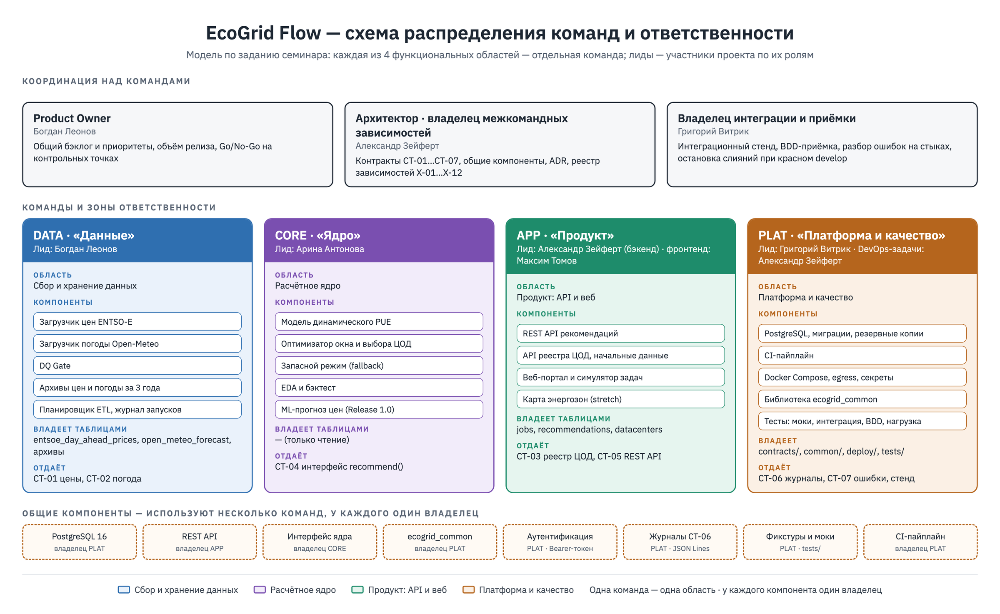
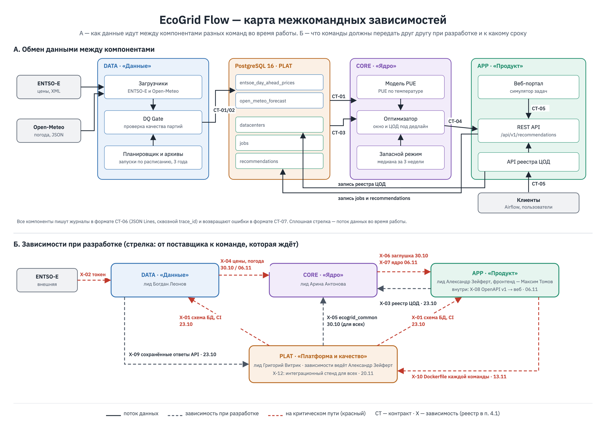
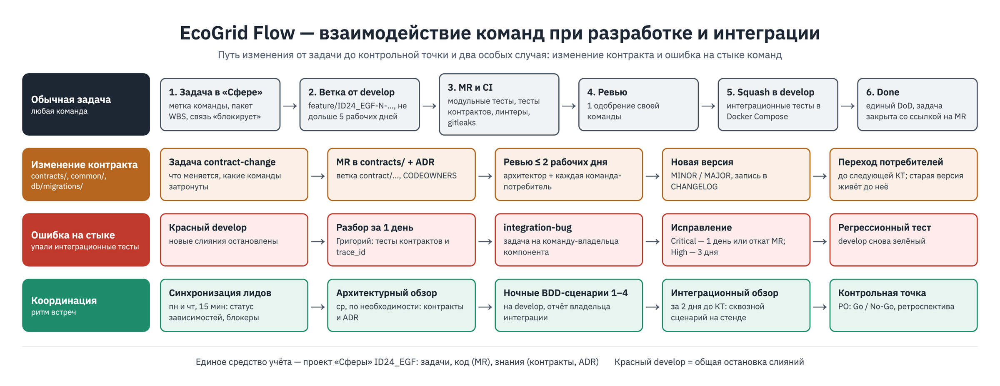

# Семинар 7. Масштабирование разработки EcoGrid Flow: команды, зависимости, правила интеграции

**Версия документа:** `v1.1` (22.10.2026)  
**Статус:** На согласовании (обзор на контрольной точке 23.10.2026)  
**Владелец документа:** Богдан Леонов (Team Lead / PO)

---

## 🎯 Цель работы
Смоделировать, как была бы устроена разработка EcoGrid Flow, если бы над ним работала не одна команда, а несколько: разделить систему на функциональные области, закрепить их за командами, выделить общие компоненты и контракты обмена данными, построить карту межкомандных зависимостей и договориться о единых правилах совместной разработки и интеграции.

**Почему это нужно уже сейчас.** В первом семестре каждую область ведет один человек, но работа уже идет параллельно: схему базы делает Александр, загрузчик цен — Богдан, оптимизатор — Арина, интерфейс — Максим, тесты — Григорий. Компоненты встречаются в базе данных и в API. Если не договориться о форматах заранее, ошибки найдутся только на сборке сквозного сценария 20.11 (риск RISK-5 из [семинара 6](../seminar_6/README.md)). Во втором семестре (Release 1.0: ML-прогноз цен, интеграция с Airflow) объем работ вырастет, и эти правила позволят развивать области параллельно, не мешая друг другу.

**Модель масштабирования.** Это модель по заданию семинара, а не план набора людей: состав команды проекта — 5 человек (устав, [семинар 5](../seminar_5/README.md)).

| Этап | Когда | Как устроена разработка |
| :--- | :--- | :--- |
| **Сейчас** | 1-й семестр, до Release 0.5 (18.12.2026) | Одна команда из 5 человек. Каждый участник — владелец одной функциональной области (п. 1). Контракты и правила из этого документа уже действуют |
| **Модель** | Если проект вырастет до нескольких команд | Каждая функциональная область становится отдельной командой со своим лидом. Лиды — нынешние участники по их ролям из семинара 1. Контракты, правила интеграции и роли координации остаются теми же |

**Обозначения:**

| Обозначение | Что означает |
| :---: | :--- |
| `DATA`, `CORE`, `APP`, `PLAT` | Команды (п. 2) |
| `CT-nn` | Контракт обмена данными между командами (п. 3) |
| `X-nn` | Межкомандная зависимость (п. 4) |
| `x.y` | Пакет работ WBS из [семинара 5](../seminar_5/README.md) |
| `M1…M5`, `R0.5` | Контрольные точки и релиз из семинара 5 |

---

## 📋 Содержание
1. [Функциональные области продукта](#1-функциональные-области-продукта)
2. [Команды и распределение ответственности](#2-команды-и-распределение-ответственности)
3. [Общие компоненты и контракты обмена данными](#3-общие-компоненты-и-контракты-обмена-данными)
4. [Карта межкомандных зависимостей](#4-карта-межкомандных-зависимостей)
5. [Взаимодействие и координация команд](#5-взаимодействие-и-координация-команд)
6. [Единые правила совместной разработки и интеграции](#6-единые-правила-совместной-разработки-и-интеграции)
7. [Схема организационно-технического взаимодействия](#7-схема-организационно-технического-взаимодействия)
8. [Проверка по критериям контроля](#8-проверка-по-критериям-контроля)
9. [Журнал изменений](#9-журнал-изменений)

---

## 1. Функциональные области продукта

Систему делим по тому, **какой результат** дает каждая часть, а не по технологиям. Так у каждой области есть свои данные, свой «вход» и «выход», и ее можно развивать почти независимо. Деление совпадает со слоями архитектуры из [семинара 3](../seminar_3/README.md) и ветками WBS из [семинара 5](../seminar_5/README.md).

| № | Область | Что делает | Вход → выход | Пакеты WBS |
| :---: | :--- | :--- | :--- | :--- |
| **1** | **Сбор и хранение данных** | Загружает цены ENTSO-E и прогноз погоды Open-Meteo, проверяет качество, хранит временные ряды и архивы | Внешние API → проверенные таблицы цен и погоды в PostgreSQL | 2.2, 2.3, 2.4, 2.6, 2.8, 5.3 |
| **2** | **Расчетное ядро** | Считает динамический PUE, выбирает окно запуска и дата-центр под дедлайн, работает в запасном режиме, проверяет гипотезу экономии на истории | Цены, погода, реестр ЦОД, параметры задачи → рекомендация | 2.7, 3.1, 3.2, 3.3 |
| **3** | **Продукт: API и веб** | Принимает запросы оркестраторов и пользователей, ведет реестр ЦОД, хранит задачи и рекомендации, показывает результат в веб-портале | Запрос клиента → ответ API, экран симулятора | 2.5, 3.4, 3.5, 3.6, 3.7, 3.8 |
| **4** | **Платформа и качество** | Общая инфраструктура: база данных, CI, Docker Compose, общая библиотека, безопасность контура, тестовая инфраструктура и приемка | Код всех команд → проверенная сборка, работающий стек | 2.1, 4.1–4.7, 5.1, 5.2, 5.4–5.8 |

Управление проектом (ветка WBS 1) — не отдельная область, а уровень над командами (п. 5).

---

## 2. Команды и распределение ответственности

### 2.1. Состав команд

Одна команда — одна область. Команда владеет своими компонентами целиком: пишет код, тестирует его и ведет документацию. Лиды назначены по ролям из семинара 1; колонка «Сейчас» показывает, кто ведет работу области в первом семестре.

| Команда | Область | Лид | Сейчас (1-й семестр) | Главный результат |
| :---: | :--- | :--- | :--- | :--- |
| **DATA** «Данные» | 1. Сбор и хранение данных | Богдан Леонов | Богдан (цены, планировщик), Арина (погода, архивы), Григорий (DQ Gate) | Полные и проверенные ряды цен и погоды |
| **CORE** «Ядро» | 2. Расчетное ядро | Арина Антонова | Арина | Рекомендация «когда и где», не нарушающая дедлайн |
| **APP** «Продукт» | 3. API и веб | Александр Зейферт (бэкенд); лид фронтенда — Максим Томов | Александр (API), Максим (веб) | Работающий API и веб-портал |
| **PLAT** «Платформа и качество» | 4. Платформа и качество | Григорий Витрик | Григорий (тесты, приемка), Александр (база, CI, стек — как DevOps по семинару 1) | Стек поднимается одной командой, интеграция проверяется автоматически |

**Роли над командами** (подробно — п. 5.1):
* **Богдан Леонов — Product Owner.** Приоритеты общего бэклога, решения по объему, Go/No-Go на контрольных точках.
* **Александр Зейферт — архитектор и владелец межкомандных зависимостей.** Ведет реестр контрактов и карту зависимостей, утверждает изменения общих компонентов.
* **Григорий Витрик — владелец интеграции и приемки.** Интеграционные и приемочные тесты, разбор ошибок на стыках команд, рекомендация к Go/No-Go.

### 2.2. Компоненты и ответственные

У каждого компонента ровно одна команда-владелец. Для каждого компонента назначены ответственные за разработку, тестирование и документацию. Модульные тесты пишет автор кода (DoD, семинар 2); тесты контракта и интеграции — команда PLAT.

| Компонент | Команда | Разработка | Тестирование | Документация |
| :--- | :---: | :--- | :--- | :--- |
| Загрузчик цен ENTSO-E | DATA | Богдан | Богдан (модульные), Григорий (на сохраненных ответах API) | Описание полей, README модуля — Богдан |
| Загрузчик погоды Open-Meteo | DATA | Арина | Арина, Григорий | README модуля — Арина |
| DQ Gate (проверка качества) | DATA | Григорий | Богдан (взаимная проверка) | Правила проверок и коды ошибок — Григорий |
| Архивы цен и погоды за 3 года | DATA | Арина | Григорий (SQL-отчет полноты) | Журнал DQ — Арина |
| Планировщик ETL и журнал запусков | DATA | Богдан | Григорий | Раздел runbook — Богдан |
| Модель PUE | CORE | Арина | Арина, Григорий (граничные температуры) | Формула и параметры — Арина |
| Оптимизатор окна и выбора ЦОД | CORE | Арина | Арина, Григорий (1000 случайных задач, дни перевода часов — RT-03) | Описание алгоритма, ADR — Арина |
| Запасной режим (fallback) | CORE | Арина | Григорий (BDD-сценарий 3) | Описание в README ядра — Арина |
| EDA и бэктест | CORE | Арина | Богдан (проверка методики GOAL-2) | Отчет бэктеста — Арина |
| API рекомендаций | APP | Александр | Александр, Григорий (контракт, BDD 1–2) | OpenAPI-спецификация — Александр |
| API реестра ЦОД и начальные данные | APP | Александр | Григорий | OpenAPI — Александр |
| Веб-портал и симулятор | APP | Максим | Максим (UI smoke e2e) | Руководство пользователя — Максим |
| PostgreSQL, миграции, резервные копии | PLAT | Александр | Григорий (восстановление из копии) | Схема БД, runbook — Александр |
| CI-пайплайн | PLAT | Александр | Григорий | README раздела CI — Александр |
| Стек Docker Compose, egress-фильтр, секреты | PLAT | Александр | Григорий (egress-проверка, gitleaks) | Инструкция развертывания — Максим |
| Общая библиотека `ecogrid_common` | PLAT | Александр (модели, авторизация), Богдан (журналирование) | Григорий | Справочник по библиотеке — Александр |
| Тестовая инфраструктура и приемка | PLAT | Григорий | Григорий | Тест-план — Григорий |

### 2.3. Границы ответственности

Чтобы работа не дублировалась, действуют четыре правила:
1. **Одна таблица — один владелец.** Таблицы цен и погоды пишет только DATA, таблицы `jobs`, `recommendations`, `datacenters` — только APP. Остальные команды их читают. Изменить структуру таблицы может только владелец, через миграцию (п. 6.2).
2. **Логика расчета — только в ядре.** API и веб не считают стоимость и не выбирают окно: они вызывают интерфейс ядра (`CT-04`). Если интерфейсу нужна новая величина, ее добавляет CORE.
3. **Инфраструктура — только у платформы.** Команды не создают свои базы, CI-конфигурации или способы логирования: они используют общие (п. 3.1). Нужно новое — запрос в PLAT.
4. **Общая библиотека не содержит бизнес-логики.** В `ecogrid_common` только модели данных, работа со временем, журналирование и авторизация. Код загрузки, расчета и API живет в модулях своих команд.

Структура репозитория повторяет эти границы:

```text
ecogrid_repo/
├── contracts/          # PLAT (архитектор): CT-01…CT-07, OpenAPI, CHANGELOG контрактов
├── common/             # PLAT: библиотека ecogrid_common
├── db/migrations/      # PLAT ведет инструмент, файлы таблиц пишут их владельцы
├── ingestion/          # DATA: загрузчики, DQ Gate, планировщик
├── core/               # CORE: PUE, оптимизатор, fallback, бэктест
├── api/                # APP: FastAPI
├── web/                # APP: веб-портал
├── tests/              # PLAT: интеграционные, приемочные и нагрузочные тесты, фикстуры
├── deploy/             # PLAT: Docker Compose, egress, резервные копии
└── docs/               # общая документация, семинары
```

---

## 3. Общие компоненты и контракты обмена данными

### 3.1. Общие компоненты

Компоненты, которыми пользуются несколько команд. У каждого — один владелец; изменение проходит через согласование (п. 5.3).

| Компонент | Владелец | Кто использует | Что это | Правило изменения |
| :--- | :---: | :--- | :--- | :--- |
| **База данных PostgreSQL 16** | PLAT | Все | Один экземпляр в Docker Compose; 7 таблиц из [описания полей](../../../data/ERD.md) | Таблицу меняет только ее владелец (п. 2.3); миграцию проверяет PLAT |
| **REST API** (`/api/v1/…`) | APP | Веб-портал, оркестраторы клиента, тесты PLAT | Эндпоинты рекомендаций и реестра ЦОД (`FR-API-01…05`) | Описан в `contracts/openapi.yaml`; изменение — через `CT-05` |
| **Интерфейс ядра** | CORE | APP | Python-функция расчета рекомендации (`CT-04`) | Изменение сигнатуры — только с согласия APP |
| **Библиотека `ecogrid_common`** | PLAT | Все | Модели данных (Pydantic), работа со временем в UTC, логгер, проверка Bearer-токена | Версионируется отдельно; обновление — в отдельном MR |
| **Аутентификация** | PLAT (код), APP (применение) | API, тесты | Статический Bearer-токен (`NFR-SEC-03`); токен в `.env`, не в коде | Новый способ авторизации — через ADR |
| **Журналирование** | PLAT | Все сервисы | JSON Lines в stdout (`NFR-MAINT-03`), формат `CT-06` | Новое обязательное поле — через ADR |
| **Тестовые фикстуры и моки** | PLAT | Все | Сохраненные ответы ENTSO-E и Open-Meteo, набор из 3 ЦОД, заглушки API | Команды добавляют свои фикстуры, PLAT проверяет |
| **CI-пайплайн** | PLAT | Все | Линтеры, тесты, сборка образов, gitleaks | Новая проверка — через PLAT |

### 3.2. Контракты обмена данными

Контракт — это письменная договоренность «кто, что и в каком виде передает». Все контракты лежат в папке `contracts/` репозитория, у каждого есть версия.

| ID | Контракт | Поставщик → потребитель | Канал | Основа |
| :---: | :--- | :--- | :--- | :--- |
| **CT-01** | Цены на сутки вперед | DATA → CORE | Таблица `entsoe_day_ahead_prices` | `DR-01`, описание полей |
| **CT-02** | Прогноз погоды | DATA → CORE | Таблица `open_meteo_forecast` | `DR-03`, описание полей |
| **CT-03** | Реестр дата-центров | APP → CORE, DATA | Таблица `datacenters` | `DR-05`, `FR-API-05` |
| **CT-04** | Интерфейс расчета рекомендации | CORE → APP | Вызов Python-функции | `FR-ENG-01…05` |
| **CT-05** | REST API рекомендаций | APP → клиенты, веб | HTTP + JSON | `FR-API-01…03` |
| **CT-06** | Формат журналов | Все → PLAT | stdout, JSON Lines | `NFR-MAINT-03` |
| **CT-07** | Формат ошибок | Все | Ответы API, журналы | п. 3.4 |

### 3.3. Общие правила для данных

| Что | Правило |
| :--- | :--- |
| **Время** | Только UTC. В базе — `timestamptz`, в JSON — ISO 8601 с `Z` (`2026-11-10T02:00:00Z`). Местное время и переход на летнее/зимнее время обрабатываются только в `ecogrid_common` (снижает RISK-11) |
| **Интервалы** | Полуоткрытые: `[period_start; period_end)`. Шаг цены — `PT15M` или `PT60M`, хранится в поле `resolution` |
| **Энергозоны** | Только коды ENTSO-E: `DE-LU`, `FI`, `SE3` |
| **Деньги и цены** | Цена — `numeric(8,2)` в EUR/MWh, стоимость задачи — `numeric(12,4)` в EUR, валюта — код ISO 4217 (`varchar(3)`). Не `float` |
| **Идентификаторы** | `job_id` — строка от клиента; `recommendation_id` — целое число (`bigserial`); `datacenter_id` — строка вида `FI-HELSINKI-01` |
| **Имена полей** | `snake_case`, на английском, единица измерения в суффиксе: `_kw`, `_eur`, `_minutes`, `_percent` |
| **Запись** | Идемпотентная: `INSERT … ON CONFLICT … DO UPDATE` (`FR-ETL-05`) |

### 3.4. Структура контрактов

**CT-01. Цены** (`entsoe_day_ahead_prices`). Ключ — (`bidding_zone`, `period_start`, `resolution`).

| Поле | Тип | Обязательно | Правило |
| :--- | :--- | :---: | :--- |
| `bidding_zone` | `varchar(10)` | да | Одно из `DE-LU`, `FI`, `SE3` |
| `period_start` | `timestamptz` | да | UTC, начало интервала |
| `period_end` | `timestamptz` | да | `period_start` + шаг |
| `price` | `numeric(8,2)` | да | От −500.00 до 4000.00 (DQ Gate) |
| `currency` | `varchar(3)` | да | `EUR` (ISO 4217) |
| `price_unit` | `varchar(10)` | да | `MWH` |
| `resolution` | `varchar(10)` | да | `PT15M` или `PT60M` |
| `retrieved_at` | `timestamptz` | да | Время загрузки в БД |

Ядро читает не саму таблицу, а представление `v_entsoe_prices_hourly` — почасовой ряд: 15-минутные цены усредняются до часа, при наличии обоих шагов берется `PT60M`. Схема — в [ER-диаграмме](../../../data/ERD.md).

Гарантия поставщика: в таблицу попадают только партии, прошедшие DQ Gate; за сутки — 24 значения при `PT60M` или 96 при `PT15M`; цены на завтра появляются до 14:30 CET.

**CT-02. Погода** (`open_meteo_forecast`). Ключ — (`datacenter_id`, `forecast_time`). Поля: `datacenter_id` (`varchar(50)`, ссылка на `datacenters`), `forecast_time` (`timestamptz`, шаг 1 ч), `temperature_2m` (`numeric(5,2)`, °C), `relative_humidity_2m`, `cloud_cover`, `wind_speed_10m`, `shortwave_radiation`, `retrieved_at` (`timestamptz`). Повторная загрузка перезаписывает прогноз на тот же час (`ON CONFLICT … DO UPDATE`), поэтому в таблице всегда самый свежий прогноз, а `retrieved_at` показывает, когда он получен.

**CT-03. Реестр ЦОД** (`datacenters`): `datacenter_id`, `name`, `bidding_zone`, `latitude`, `longitude`, `max_power_kw`, `base_pue`, `is_active`, `created_at`. Ядро учитывает только ЦОД с `is_active = true`.

**CT-04. Интерфейс ядра.** Одна функция, модели — из `ecogrid_common`:

```python
def recommend(job: JobSpec, now: datetime) -> Recommendation:
    """Выбирает окно и ЦОД. Читает CT-01, CT-02, CT-03 из БД сам."""
```

| Модель | Поля |
| :--- | :--- |
| `JobSpec` (вход) | `job_id`, `duration_minutes`, `required_power_kw`, `earliest_start`, `deadline`, `allowed_zones`, `preferred_datacenter_id`, `baseline_start` |
| `Recommendation` (выход) | `recommendation_id`, `job_id`, `target_datacenter`, `recommended_start`, `recommended_end`, `estimated_cost_eur`, `baseline_cost_eur`, `estimated_savings_eur`, `estimated_savings_percent`, `is_fallback`, `warning` |

> [!NOTE]
> Решение изменено [ADR-001](../../../adr/ADR-001-engine-input-data.md): ядро не читает БД — цены, погоду и параметры ЦОД собирает в почасовые ряды API-слой и передает ядру на вход.

Ошибки ядра — исключения из `ecogrid_common.errors`: `DeadlineUnreachable` (API отвечает 422), `InvalidBaseline` (422), `NoDataAvailable` (503, если нет даже данных для запасного режима). Отсутствие свежих цен — **не ошибка**: ядро считает в запасном режиме и возвращает `is_fallback = true` и текст `warning` (`FR-ENG-05`).

**CT-05. REST API.** `POST /api/v1/recommendations`, заголовок `Authorization: Bearer <token>`. Запрос и ответ — как в `FR-API-01` и `FR-API-03` [семинара 4](../seminar_4/readme.md); полный формат — в `contracts/openapi.yaml`. Пример ответа:

```json
{
  "recommendation_id": 1042,
  "job_id": "job-spark-agg-771",
  "target_datacenter": "FI-HELSINKI-01",
  "recommended_start": "2026-11-10T02:00:00Z",
  "recommended_end": "2026-11-10T05:00:00Z",
  "estimated_cost_eur": 8.21,
  "baseline_cost_eur": 47.13,
  "estimated_savings_eur": 38.92,
  "estimated_savings_percent": 82.58,
  "is_fallback": false,
  "warning": null
}
```

*Цифры в примере условные.*

**CT-06. Журналы.** Одна строка JSON на событие. Обязательные поля: `timestamp` (ISO 8601 UTC), `level`, `trace_id`, `component` (например, `ingestion.entsoe`, `core.optimizer`, `api.recommendations`), `event`, `message`, `execution_time_ms`. Запрещено писать в журнал токены и параметры задач клиента в открытом виде (`NFR-SEC-01`). `trace_id` создается в API и передается дальше, чтобы по одному запросу найти записи всех команд.

**CT-07. Ошибки.** Ответ API с ошибкой всегда имеет одинаковый вид:

```json
{ "detail": "Task duration (180 min) exceeds the window before deadline", "code": "DEADLINE_UNREACHABLE", "trace_id": "a1b2c3d4" }
```

| Код | HTTP | Когда | Кто порождает |
| :--- | :---: | :--- | :--- |
| `UNAUTHORIZED` | 401 | Нет токена или токен неверный | PLAT (библиотека), APP |
| `VALIDATION_ERROR` | 422 | Неверные типы или пропущены поля | APP |
| `DEADLINE_UNREACHABLE` | 422 | Задача не успевает до дедлайна (`FR-API-02`) | CORE → APP |
| `INVALID_BASELINE` | 422 | Базовый ЦОД или старт вне допустимых значений | CORE → APP |
| `NO_DATA_AVAILABLE` | 503 | Нет данных даже для запасного режима | CORE → APP |
| `INTERNAL_ERROR` | 500 | Непредвиденная ошибка; подробности только в журнале | Любая |
| `DQ_OUT_OF_BOUNDS_PRICE` и другие `DQ_*` | — | Партия данных отклонена проверкой качества (только журнал, не API) | DATA |

### 3.5. Версии контрактов

* Номер версии — `MAJOR.MINOR` (как у спецификации требований). Добавить необязательное поле — `MINOR`, удалить или переименовать поле, сменить тип — `MAJOR`.
* При `MAJOR`-изменении старая версия поддерживается до следующей контрольной точки, чтобы потребители успели перейти.
* Все изменения записываются в `contracts/CHANGELOG.md` со ссылкой на задачу в «Сфере».
* Каждый контракт покрыт автотестом у поставщика (проверка формата) и у потребителя (проверка, что он умеет прочитать пример из контракта).

---

## 4. Карта межкомандных зависимостей

### 4.1. Реестр зависимостей

Зависимость — это то, без чего команда не может закончить свою работу. **Владелец всех межкомандных зависимостей — Александр Зейферт** (архитектор): он ведет этот реестр, следит за сроками и поднимает проблему на встрече лидов, если поставщик не успевает. В «Сфере» зависимость оформляется связью «блокирует» между задачами и меткой `dependency`.

| ID | Кто ждет | От кого | Что нужно | Тип | Срок | Условие начала интеграции | Влияние на сроки |
| :---: | :---: | :---: | :--- | :--- | :---: | :--- | :--- |
| **X-01** | DATA, APP | PLAT | Схема БД v1 и миграции (2.1), CI на `develop` (5.1) | Техническая | 23.10 | Миграции создают 7 таблиц на пустой БД, CI зеленый | 🔴 На критическом пути: без схемы загрузчик не пишет данные |
| **X-02** | DATA | Внешняя (ENTSO-E) | Рабочий токен API (DEP-1, RT-01) | Организационная | 23.10 | Тестовый запрос цен по 3 зонам прошел | 🔴 Без токена нет данных |
| **X-03** | CORE | APP | Реестр из 3 ЦОД (`CT-03`, 2.5) | Техническая | 23.10 | Начальные данные загружены миграцией | 🟢 Мало работы, риск низкий |
| **X-04** | CORE | DATA | Цены и погода (`CT-01`, `CT-02`): месяц истории к 30.10, архив за 3 года к 06.11 | Техническая | 30.10 / 06.11 | Данные прошли DQ, SQL-отчет полноты зеленый | 🔴 На критическом пути (2.2 → 3.2). До 30.10 CORE работает на фикстурах |
| **X-05** | все | PLAT | `ecogrid_common` v0.1: модели, время UTC, логгер, авторизация | Техническая | 30.10 | Библиотека собирается в CI, есть примеры использования | 🟡 Без нее команды пишут свои версии — дублирование |
| **X-06** | APP | CORE | Заглушка `recommend()` с правильной сигнатурой (`CT-04`) | Техническая | 30.10 | Заглушка возвращает пример из контракта | 🟡 Позволяет APP начать API раньше ядра |
| **X-07** | APP | CORE | Рабочий оптимизатор и fallback | Техническая | 06.11 / 13.11 | Тест оптимизатора на сценарии 1 выбирает `FI-HELSINKI-01` | 🔴 На критическом пути (3.2 → 3.4) |
| **X-08** | APP (веб) | APP (API) | OpenAPI v1 зафиксирован, мок-сервер | Техническая | 06.11 | `contracts/openapi.yaml` с тегом `v1.0`, мок отвечает | 🟡 Веб ждет API; запас — одна неделя (почти критическая цепочка 3.4 → 3.7) |
| **X-09** | PLAT | DATA | Сохраненные настоящие ответы ENTSO-E и Open-Meteo (RT-08) | Техническая | 23.10 | Не меньше 5 ответов на каждый источник в `tests/fixtures/` | 🟡 Нужны для тестов DQ и интеграции |
| **X-10** | PLAT | все | Dockerfile каждого сервиса | Техническая | 13.11 | Образ собирается в CI | 🔴 Нужен для полного стека к 20.11 (5.2) |
| **X-11** | все | все | Ревью изменений контрактов в течение 2 рабочих дней | Организационная | постоянно | — | 🟡 Долгое ревью тормозит всех |
| **X-12** | все | PLAT (QA) | Интеграционный стенд и ночной прогон приемочных тестов | Техническая | 20.11 | Стек поднят, BDD-сценарии запускаются в CI | 🟡 Без него ошибки на стыках находят поздно (RISK-5) |

### 4.2. Порядок разработки и предоставления интерфейсов

Работаем по принципу **«сначала контракт, потом код»**: поставщик публикует контракт и заглушку раньше, чем делает реализацию, и потребитель может начать работу, не дожидаясь готового компонента.

| Шаг | Срок | Что происходит | Кто |
| :---: | :---: | :--- | :--- |
| 1 | до 23.10 (M1) | Контракты `CT-01…CT-03` зафиксированы (они уже есть в описании полей и семинаре 4); схема БД и CI готовы | Архитектор, DATA, APP, PLAT |
| 2 | до 30.10 | Контракты `CT-04…CT-07` и `ecogrid_common` v0.1; заглушка ядра; месяц реальных цен в БД | Архитектор, CORE, PLAT, DATA |
| 3 | до 06.11 (M2) | Ядро считает на реальных данных; OpenAPI v1 и мок-сервер для веба; архив за 3 года | CORE, APP, DATA |
| 4 | до 13.11 | API вызывает настоящее ядро; Dockerfile всех сервисов | APP, все |
| 5 | до 20.11 (M3) | Полный стек в Docker Compose, интеграционные тесты в CI | PLAT, все |
| 6 | до 04.12 (M4) | Веб работает через настоящий API; нагрузочный тест | APP, PLAT |

**Условия начала интеграции** двух компонентов (все четыре):
1. Контракт имеет версию и лежит в `contracts/`.
2. Тест контракта у поставщика зеленый в CI.
3. Компонент поставщика влит в `develop`.
4. Для проверки есть данные: настоящие или фикстуры из `tests/fixtures/`.

### 4.3. Зависимости, влияющие на сроки

Критический путь из семинара 5: **2.1 → 2.2 → 3.2 → 3.4 → 5.2 → 4.6 → 1.4.** Он проходит через все четыре команды, поэтому межкомандные зависимости на нем (**X-01, X-04, X-07, X-10**) отслеживаются отдельно:
* статус этих зависимостей — в каждом еженедельном отчете (раздел «Риски»);
* если поставщик видит, что опаздывает больше чем на 2 рабочих дня, он сообщает владельцу зависимостей в тот же день;
* у каждой критической зависимости есть план Б: CORE работает на фикстурах (X-04), APP — на заглушке ядра (X-06/X-07), веб — на мок-сервере (X-08).

---

## 5. Взаимодействие и координация команд

### 5.1. Ответственные за координацию

| Роль | Кто | За что отвечает | Решает сам | Выносит на обсуждение |
| :--- | :--- | :--- | :--- | :--- |
| **Product Owner** | Богдан Леонов | Общий бэклог, приоритеты, объем релиза, Go/No-Go | Приоритеты задач, перенос функций в R1.0 | Изменение сроков релиза (с преподавателем) |
| **Архитектор, владелец межкомандных зависимостей** | Александр Зейферт | Контракты, общие компоненты, ADR, реестр зависимостей | Технические споры между командами | Изменения, которые ломают сроки, — PO |
| **Владелец интеграции и приемки** | Григорий Витрик | Интеграционный стенд, приемочные тесты, разбор ошибок на стыках | Кому из команд передать ошибку, остановка слияний при красном `develop` | Готовность к Go/No-Go — PO |
| **Лиды команд** | Богдан (DATA), Арина (CORE), Александр (APP, бэкенд; фронтенд — Максим), Григорий (PLAT) | План и качество своей области, выполнение обязательств перед другими командами | Как делать работу внутри области | Все, что меняет контракт или срок для других |

### 5.2. Совместные встречи

| Встреча | Когда | Кто | Длительность | Результат |
| :--- | :--- | :--- | :---: | :--- |
| **Синхронизация лидов** (Scrum of Scrums) | Пн и чт, после пар | Лиды, архитектор, PO | 15 мин | Обновленный статус зависимостей, список блокеров |
| **Архитектурный обзор** | Ср, по необходимости | Архитектор + лиды затронутых команд | 30 мин | Решение по изменению контракта или ADR |
| **Интеграционный обзор** | Раз в 2 недели, за 2 дня до контрольной точки | Все | 30 мин | Сквозной сценарий показан на стенде, список дефектов |
| **Обзор контрольной точки** | 23.10, 06.11, 20.11, 04.12, 11.12 | Все + преподаватель | 30 мин | Решение Go/No-Go |
| **Ретроспектива** | После каждой контрольной точки | Все | 20 мин | 1–2 улучшения процесса |

В первом семестре синхронизация лидов совпадает с общими встречами команды (семинар 2, п. 8).

### 5.3. Согласование изменений

Изменение общего компонента или контракта проходит пять шагов:
1. **Запрос.** Автор заводит задачу в «Сфере» с меткой `contract-change`: что меняется, зачем, какие команды затронуты.
2. **Черновик.** Автор открывает MR с изменением в `contracts/` (и ADR, если меняется архитектура).
3. **Ревью.** MR одобряют архитектор и все команды-потребители. Срок ответа — 2 рабочих дня (X-11); молчание не считается согласием, архитектор напоминает на синхронизации лидов.
4. **Решение.** Изменение влито, номер версии повышен, запись в `contracts/CHANGELOG.md`.
5. **Внедрение.** Потребители обновляются до следующей контрольной точки; для `MAJOR` старая версия поддерживается до тех пор.

### 5.4. Разрешение технических противоречий

| Уровень | Кто решает | Срок | Пример |
| :---: | :--- | :---: | :--- |
| 1 | Лиды двух команд договариваются сами | 1 рабочий день | Кто добавляет поле в таблицу |
| 2 | Архитектор принимает решение и записывает ADR | 2 рабочих дня | Хранить погоду в UTC или в местном времени |
| 3 | PO решает, если спор касается объема или сроков | на ближайшей синхронизации | Делать ли карту энергозон до релиза |

### 5.5. Единое средство учета задач

Все команды работают в **одном проекте «Сферы» `ID24_EGF`**:
* **Задачи** — одна доска со статусами из семинара 2; у задачи метка команды (`team:data`, `team:core`, `team:app`, `team:plat`), номер пакета WBS и при необходимости `dependency` или `contract-change`. Связь «блокирует» показывает зависимости.
* **Код** — один репозиторий `ecoGrid_repo`; MR ссылается на задачу (`ID24_EGF-<номер>`).
* **Знания** — общие документы: контракты, ADR, семинары, статус-отчеты.

---

## 6. Единые правила совместной разработки и интеграции

### 6.1. Единый Definition of Done

Задача любой команды считается выполненной, когда выполнены **все** пункты. Это расширение DoD из семинара 2 для нескольких команд.

| № | Критерий | Как проверить |
| :---: | :--- | :--- |
| 1 | **Код написан** и лежит в общем репозитории, в ветке по правилам п. 6.2 | Ссылка на MR в задаче |
| 2 | **Код проверен:** 1 одобрение от своей команды; если затронут контракт или общий компонент — еще архитектор и каждая команда-потребитель | Одобрения в MR |
| 3 | **Код протестирован:** модульные тесты автора; покрытие ядра ≥ 80% (`NFR-MAINT-02`); тесты затронутых контрактов зеленые | Отчет CI |
| 4 | **CI зеленый:** линтеры, тесты, сборка образа, gitleaks | Статус пайплайна |
| 5 | **Интеграция не сломана:** после слияния в `develop` интеграционные тесты проходят | Прогон после слияния |
| 6 | **Документация обновлена:** OpenAPI, контракт, README модуля, runbook или ADR — то, что затронуто | Изменения в MR |
| 7 | **Работает в стеке:** сервис поднимается в Docker Compose, healthcheck зеленый | Прогон в CI |
| 8 | **Задача закрыта в «Сфере»** со ссылкой на MR | Карточка задачи |

### 6.2. Работа с ветками Git

| Ветка | Назначение | Кто сливает |
| :--- | :--- | :--- |
| `master` | Только релизы: тег `v0.5.0`, `v1.0.0` | PO после Go |
| `develop` | Интеграционная ветка: здесь всегда собирается рабочий стек | Автор MR после одобрений и зеленого CI |
| `feature/ID24_EGF-<N>-<кратко>` | Новая функция | → `develop` |
| `fix/ID24_EGF-<N>-<кратко>` | Исправление ошибки | → `develop` |
| `infra/…`, `docs/…` | Инфраструктура и документация (как в репозитории сейчас) | → `develop` |
| `contract/ID24_EGF-<N>-<кратко>` | Изменение контракта или общего компонента | → `develop` после согласования (п. 5.3) |
| `release/0.5` | Подготовка релиза после M4: только исправления | → `master` и `develop` |

**Правила:**
* Ветка создается от свежего `develop` и живет **не больше 5 рабочих дней**; большую задачу делим на части.
* Перед MR ветка обновляется из `develop`; конфликты решает автор.
* Слияние — **squash**, сообщение: `ID24_EGF-<N>: <что сделано>`.
* Прямые коммиты в `master` и `develop` запрещены.
* Папки `contracts/`, `common/`, `db/migrations/` закреплены в файле `CODEOWNERS`: без одобрения архитектора MR в них не сливается.

### 6.3. Интеграционное тестирование

| Уровень | Когда запускается | Что проверяет | Владелец |
| :--- | :--- | :--- | :--- |
| Модульные тесты | Каждый коммит в MR | Логику внутри компонента | Команда компонента |
| Тесты контрактов | Каждый MR | Формат таблиц, интерфейса ядра, API, журналов, ошибок (`CT-01…CT-07`) | Поставщик контракта, PLAT |
| Интеграционные тесты | После слияния в `develop` | API + ядро + БД в Docker Compose на фикстурах | PLAT (Григорий) |
| Приемочные BDD-сценарии 1–4 | Каждую ночь на `develop`, перед КТ | Сквозные сценарии из семинара 4 | PLAT (Григорий) |
| Нагрузочный тест | Перед M4 | p95 ≤ 200 мс при 50 RPS (`NFR-PERF-01`) | PLAT |

### 6.4. Устранение ошибок, найденных при совместной работе

1. **Красный `develop` — общая остановка.** Если после слияния упали интеграционные тесты, новые MR в `develop` не сливаются, пока сборку не починят.
2. **Разбор за 1 рабочий день.** Владелец интеграции (Григорий) по тестам контрактов и журналам (`trace_id`) определяет, на чьей стороне ошибка, и заводит задачу в «Сфере» с меткой `integration-bug` на команду-владельца компонента.
3. **Сроки исправления:**

| Критичность | Пример | Срок |
| :--- | :--- | :--- |
| Critical | Стек не поднимается, сценарий 1 не проходит, рекомендация нарушает дедлайн | 1 рабочий день; если не успеваем — откат MR |
| High | Неверный код ошибки, fallback не включается | 3 рабочих дня или до ближайшей КТ |
| Medium / Low | Неточность в журнале, косметика интерфейса | В общий бэклог по приоритету |

4. **Спорные ошибки** (обе стороны считают, что код верен) решаются по контракту: кто его нарушил, тот и исправляет. Если контракт неоднозначен — архитектор уточняет его (п. 5.3).
5. **После исправления** — регрессионный тест, чтобы ошибка не вернулась.

---

## 7. Схема организационно-технического взаимодействия

### 7.1. Схема распределения команд и ответственности



*Рисунок 1. Четыре команды, их компоненты и зоны ответственности. Над командами — роли координации: PO, архитектор (владелец межкомандных зависимостей), владелец интеграции.*

### 7.2. Карта межкомандных зависимостей и обмена данными



*Рисунок 2. Сплошные стрелки — потоки данных между компонентами во время работы системы (с номерами контрактов). Пунктирные стрелки — зависимости при разработке: что одна команда должна передать другой и к какому сроку (номера из п. 4.1). Красным выделены зависимости на критическом пути.*

### 7.3. Взаимодействие команд при разработке и интеграции



*Рисунок 3. Путь изменения от задачи до контрольной точки: команды работают в своих ветках, общие компоненты меняются через согласование, интеграция проверяется автоматически.*

---

## 8. Проверка по критериям контроля

| Критерий | Где выполнен |
| :--- | :--- |
| **1. Команды разделены по устойчивым зонам ответственности** | 4 команды по 4 функциональным областям (п. 1, 2.1); у каждого компонента одна команда-владелец (п. 2.2); правила границ и структура репозитория (п. 2.3) |
| **2. Согласованные требования к структуре и общие компоненты явно выделены** | 8 общих компонентов с владельцами (п. 3.1); 7 контрактов с полями, типами и форматом ошибок (п. 3.2–3.4); правила версий (п. 3.5) |
| **3. Есть владелец межкомандных зависимостей** | Александр Зейферт ведет реестр из 12 зависимостей (п. 4.1) и согласует изменения контрактов (п. 5.3) |

**Что сдает команда:** схема масштабирования (рисунок 1, п. 2), карта зависимостей (рисунок 2, п. 4), правила интеграции (п. 6).

---

## 9. Журнал изменений

| Версия | Дата | Автор | Статус | Изменения |
| :---: | :---: | :--- | :--- | :--- |
| **v1.0** | 21.10.2026 | Богдан Леонов | На согласовании | Первая версия: 4 функциональные области и 4 команды, 17 компонентов с ответственными, 8 общих компонентов, контракты CT-01…CT-07, реестр зависимостей X-01…X-12, порядок координации, единый DoD, правила Git и интеграции, 3 схемы |
| **v1.1** | 22.10.2026 | Богдан Леонов | На согласовании | Лиды команд приведены к ролям из семинара 1: «Продукт» (API и веб) ведет Александр Зейферт, фронтенд — Максим Томов; «Платформа и качество» ведет Григорий Витрик. Убрана численность команд при росте: модель масштабирования — гипотетическая, по заданию семинара, состав проекта — 5 человек |
