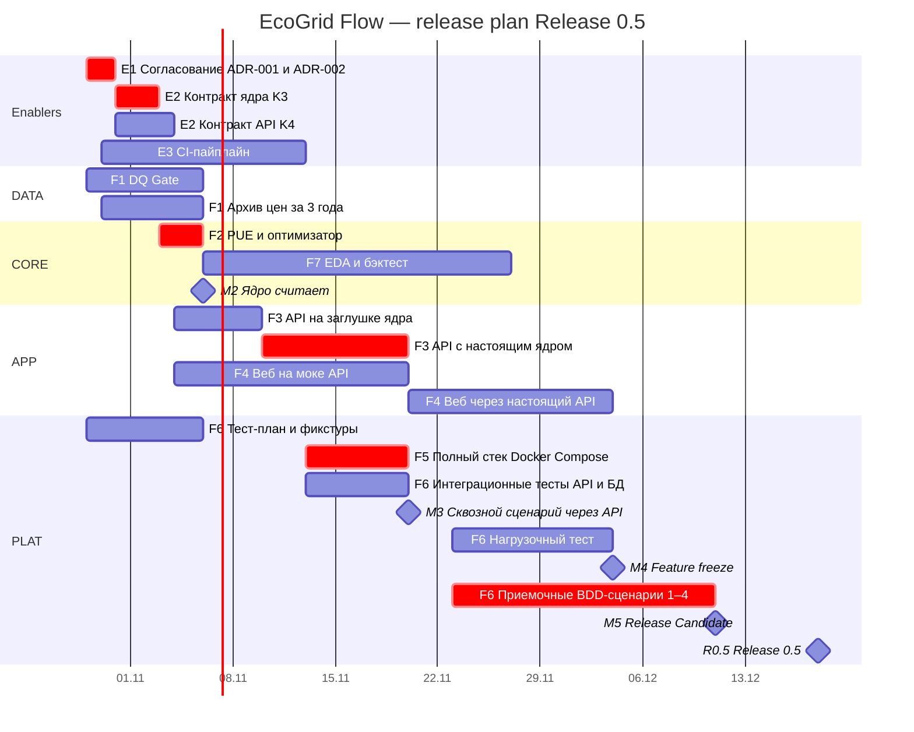
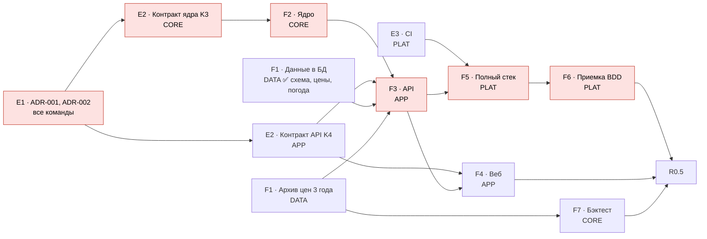

# Семинар 8. Масштабирование управления разработкой EcoGrid Flow: модель координации, release plan, общие решения

**Версия документа:** `v1.0` (29.10.2026)  
**Статус:** На согласовании (обзор на контрольной точке M2, 06.11.2026)  
**Владелец документа:** Богдан Леонов (Team Lead / PO)

---

## 🎯 Цель работы
Выбрать для EcoGrid Flow модель координации нескольких команд, сравнив SAFe, LeSS и Nexus, и привязать ее к проекту: общий бэклог, план релиза Release 0.5 с крупными features, зависимости и критический путь интеграции, решения, которые нельзя принимать внутри одной команды.

**Исходная модель команд** — из [семинара 7](../seminar_7/README.md): четыре команды по функциональным областям. Это модель по заданию, а не план найма: сейчас каждую область ведет один-два человека из пятерых, но работа уже идет параллельно, и все механизмы ниже уже действуют.

| Команда | Область | Лид | Сейчас (1-й семестр) |
| :---: | :--- | :--- | :--- |
| **DATA** | Сбор и хранение данных | Богдан Леонов | Богдан, Григорий (DQ) |
| **CORE** | Расчетное ядро | Арина Антонова | Арина |
| **APP** | API и веб-портал | Александр Зейферт (бэкенд), Максим Томов (веб) | Александр, Максим |
| **PLAT** | Платформа и качество | Григорий Витрик | Григорий (тесты, приемка), Александр (CI, стек) |

**Обозначения:**

| Обозначение | Что означает |
| :---: | :--- |
| `F1…F7` | Крупная feature релиза (п. 3) |
| `E1…E3` | Enabler — работа, которая не дает функции пользователю, но открывает работу другим командам (п. 3) |
| `K1…K4` | Контракты между частями системы ([ARCHITECTURE, п. 3](../../../ARCHITECTURE.md#3-контракты-между-частями)) |
| `ADR-nnn` | Архитектурное решение в [`docs/adr/`](../../../adr/) |
| `M2…M5`, `R0.5` | Контрольные точки и релиз из [семинара 5](../seminar_5/README.md) |
| `RISK-nn` | Риск из реестра [семинара 6](../seminar_6/README.md) |

---

## 📋 Содержание
1. [Сравнение SAFe, LeSS и Nexus](#1-сравнение-safe-less-и-nexus)
2. [Выбор модели координации](#2-выбор-модели-координации)
3. [Общий backlog / portfolio view](#3-общий-backlog--portfolio-view)
4. [Release plan Release 0.5](#4-release-plan-release-05)
5. [Зависимости и критический путь интеграции](#5-зависимости-и-критический-путь-интеграции)
6. [Решения, которые нельзя принимать локально](#6-решения-которые-нельзя-принимать-локально)
7. [Факторы успеха и риски масштабирования](#7-факторы-успеха-и-риски-масштабирования)
8. [Вывод](#8-вывод)
9. [Где зафиксировано в проекте](#9-где-зафиксировано-в-проекте)
10. [Проверка по критериям контроля](#10-проверка-по-критериям-контроля)
11. [Журнал изменений](#11-журнал-изменений)

---

## 1. Сравнение SAFe, LeSS и Nexus

Все три фреймворка решают одну задачу — как нескольким командам выпускать один продукт, — но с разным масштабом и ценой внедрения.

| Проблема | SAFe | LeSS | Nexus | Применимость к EcoGrid Flow (4 команды) |
| :--- | :--- | :--- | :--- | :--- |
| **Как согласовать цели многих команд** | Portfolio, Lean-бюджеты, Agile Release Train (ART) из 5–12 команд | Один Product Owner и один Product Backlog на весь продукт | Один Product Owner и один Product Backlog на Nexus из 3–9 Scrum-команд | Один PO и один бэклог у нас уже есть (Богдан, «Сфера» `ID24_EGF`). Portfolio-уровень SAFe не нужен: продукт один |
| **Как планировать совместно** | PI Planning — двухдневная встреча всех команд раз в 8–12 недель | Общий Sprint Planning (часть 1 — все команды вместе) | Nexus Sprint Planning по общему бэклогу | Достаточно одного совместного планирования на релиз (этот документ) и пересмотра на контрольных точках. PI Planning на 4 команды и 7 недель — избыточен |
| **Как управлять зависимостями** | Program Board с нитками зависимостей, RTE (Release Train Engineer) | Зависимости устраняют, переходя на feature-команды; координация «просто разговором» | Cross-Team Refinement: зависимости выявляются при уточнении бэклога | Наши команды компонентные (DATA, CORE, APP, PLAT), зависимости неизбежны и проходят через 4 контракта. Подходит механизм Nexus: выявлять зависимости заранее и закрывать их контрактом |
| **Как интегрировать работу** | System Demo в конце каждой итерации, System Team | Один потенциально поставляемый инкремент в конце общего спринта | Nexus Integration Team отвечает за интегрированный инкремент каждый спринт | Нужен владелец интеграции и регулярный интегрированный результат. У нас — PLAT (Григорий) и сквозной сценарий на каждой контрольной точке |
| **Как принимать архитектурные решения** | System Architect, Architectural Runway | Архитектура — общая ответственность команд, Communities of Practice | Решают сами команды в Nexus; NIT помогает | Нужен легкий механизм: ADR с обязательным согласованием затронутых команд. Отдельная роль архитектора с полномочиями SAFe — избыточна |
| **Как улучшать процесс** | Inspect & Adapt раз в PI | Общая ретроспектива (Overall Retrospective) | Nexus Sprint Retrospective | Ретроспектива после каждой контрольной точки (раз в 2 недели) уже есть |
| **Цена внедрения** | Высокая: 10+ ролей, обучение, жесткий календарь | Средняя: реорганизация в feature-команды, общий Scrum | Низкая-средняя: надстройка над Scrum | Мы работаем по Kanban с контрольными точками; переход на Scrum-спринты или реорганизация команд не окупятся за 7 недель до релиза |
| **Для какого масштаба создан** | 50–125 человек в ART и больше | 2–8 команд (LeSS), больше — LeSS Huge | 3–9 команд | 4 команды по 2–5 человек — нижняя граница LeSS и Nexus |

**Главное различие** — где фреймворк ищет источник проблем масштабирования:
* **SAFe** — в согласовании бизнеса и множества команд; лечит иерархией планирования и ролями.
* **LeSS** — в самих зависимостях; лечит тем, что делает команды сквозными (feature teams), чтобы зависимостей стало меньше.
* **Nexus** — в интеграции; лечит отдельной ответственностью за интегрированный инкремент и ранним выявлением зависимостей.

У EcoGrid Flow основная сложность — **интеграция четырех компонентов через контракты** (данные → ядро → API → веб), а не согласование бизнеса. Поэтому ближе всего Nexus.

---

## 2. Выбор модели координации

**Решение: формальный фреймворк не внедряем. Берем четыре механизма — из Nexus, LeSS и SAFe — поверх нашего Kanban с контрольными точками раз в 2 недели.**

| Механизм | Откуда | Как работает у нас | Где уже действует |
| :--- | :--- | :--- | :--- |
| **Один PO и один бэклог** | LeSS, Nexus | Богдан ведет общий бэклог в «Сфере»; у задачи метка команды; приоритеты — только у PO | Проект `ID24_EGF` в «Сфере» |
| **Контракт раньше кода** | Nexus (Cross-Team Refinement) | Зависимость между командами закрывается контрактом K1–K4 до начала реализации; потребитель работает на заглушке или моке | [ARCHITECTURE, п. 3](../../../ARCHITECTURE.md#3-контракты-между-частями), [contracts/](../../../contracts/) |
| **Владелец интеграции и интегрированный результат** | Nexus (Nexus Integration Team) | PLAT (Григорий) отвечает за сквозной сценарий; на каждой контрольной точке показывается работающий стек, а не отчеты команд | Контрольные точки M2–M5 из семинара 5 |
| **Совместное планирование релиза** | SAFe (PI Planning, облегченно) | Один раз на релиз: features, зависимости, критический путь (этот документ); пересмотр — на каждой контрольной точке | п. 4–5 |

**Чего сознательно не берем:**

| Механизм | Почему не берем |
| :--- | :--- |
| Роли SAFe (RTE, System Architect, Business Owners), ART, Lean Portfolio | Продукт один, команд четыре, людей пять: роли будут на бумаге, а нагрузка — реальной |
| PI Planning раз в 8–12 недель | До релиза 7 недель — это один PI; достаточно одного совместного планирования |
| Реорганизация в feature-команды (LeSS) | Области требуют разной экспертизы (ML/оптимизация, бэкенд, фронтенд, данные), а горизонт — один семестр. Компонентные команды плюс контракты дешевле |
| Общие Scrum-спринты (LeSS, Nexus) | Kanban с WIP-лимитами и контрольными точками раз в 2 недели уже дает общий ритм интеграции; смена процесса за 7 недель до релиза — риск без выгоды |

**Почему именно так — на примере реального решения проекта.** Решение о fallback и оценочном варианте рекомендации ([ADR-001](../../../adr/ADR-001-engine-input-data.md)) затронуло сразу CORE (ядро считает по оценкам), APP (медиана цен и блок `estimated_alternative` в API) и веб (показ второго варианта). Ни одна команда не могла принять его сама. Его провели не через совещание всех команд, а через ADR в PR с обязательным approve всех затронутых — это и есть наш механизм координации вместо формальных церемоний.

---

## 3. Общий backlog / portfolio view

Один бэклог на все команды. Уровни: **Release 0.5 → features (F) и enablers (E) → задачи в «Сфере»**. Эпики «Сферы» `EGF-9…17` из [семинара 2](../seminar_2/README.md) сгруппированы в features. Состояние — на 29.10.2026.

| ID | Feature / enabler | Команда | Эпики «Сферы» | Что входит | Состояние |
| :---: | :--- | :---: | :---: | :--- | :--- |
| **E1** | Согласованные архитектурные решения | все (PO) | — | ADR-001 (входные данные ядра, fallback, оценочный вариант), ADR-002 (контракт БД ↔ API) | 🟡 PR на согласовании |
| **E2** | Контракты ядра и API | CORE, APP | `EGF-10`, `EGF-11` | K3 — вход и выход ядра; K4 — запрос и ответ API (pydantic → OpenAPI) | ⚪ Не начато |
| **E3** | Платформа разработки | PLAT | `EGF-16` | Репозиторий на GitHub с зеркалом в «Сфере», защита `develop`, правила PR; CI | 🟡 Репозиторий и правила готовы, CI нет |
| **F1** | Данные поступают | DATA | `EGF-13`, `EGF-14`, `EGF-15` | Схема БД v1, загрузка погоды и цен по событию публикации, DQ Gate, архив цен за 3 года | 🟡 Схема, погода, цены — готовы ([PR #1](https://github.com/Isnob/ecogrid_flow/pull/1)); DQ Gate и архив цен — нет |
| **F2** | Ядро считает рекомендацию | CORE | `EGF-11` | Модель PUE, оптимизатор окна и ЦОД, расчет по оценочным ценам | 🟡 Ресерч параметров PUE готов ([PR #2](https://github.com/Isnob/ecogrid_flow/pull/2)); ядро не начато |
| **F3** | API рекомендаций | APP | `EGF-10` | Эндпоинт рекомендаций, авторизация, сборка рядов из БД, медиана цен, запись одной транзакцией, реестр ЦОД | ⚪ Не начато |
| **F4** | Веб-симулятор | APP | `EGF-9`, `EGF-17` | Форма задачи, рекомендация, график стоимости по часам, оценочный вариант | 🟡 Статический прототип формы |
| **F5** | Сервис разворачивается одной командой | PLAT | `EGF-12`, `EGF-16` | Полный стек Docker Compose, egress-фильтр, резервное копирование, runbook | 🟡 В стеке `postgres` и `etl-worker` |
| **F6** | Приемка релиза | PLAT | — | Тест-план, фикстуры, интеграционные тесты API + БД, BDD-сценарии 1–4, нагрузочный тест | ⚪ Не начато |
| **F7** | Подтверждение экономии (GOAL-2) | CORE | `EGF-11` | EDA и бэктест на архиве цен | ⚪ Ждет архив цен (F1) |

**Правила бэклога для нескольких команд:**
1. Приоритет задаче ставит только PO; команда сама решает, *как* делать.
2. У каждой задачи — метка команды и связь с feature; межкомандная зависимость — связь «блокирует» в «Сфере».
3. Enablers (E1–E3) идут впереди features: они разблокируют другие команды.
4. Работа, которая меняет контракт или общее решение, без ADR или PR с ревью потребителя в бэклог «В работе» не берется.

---

## 4. Release plan Release 0.5

Релиз 18.12.2026, контрольные точки — из [семинара 5](../seminar_5/README.md). План учитывает фактическое состояние на 29.10: данные (F1) опережают план, а ядро и API начинаются только после согласования контрактов.

| Контрольная точка | Дата | Интегрированный результат (что показываем работающим) |
| :---: | :---: | :--- |
| **M2** | 06.11 | ADR приняты; контракты K3, K4 в `develop`; ядро на сценарии 1 выбирает `FI-HELSINKI-01`; DQ Gate отклоняет цену 9999 EUR/MWh; архив цен за 3 года загружен |
| **M3** | 20.11 | `docker compose up` поднимает БД, ETL и API; `POST /api/v1/recommendations` отвечает по реальным данным из БД; интеграционные тесты зеленые в CI |
| **M4** | 04.12 | Веб строит рекомендацию через API, показывает оценочный вариант; нагрузочный тест пройден; после M4 — только исправления |
| **M5** | 11.12 | BDD-сценарии 1–4 проходят в CI; восстановление из резервной копии проверено |
| **R0.5** | 18.12 | Релиз `v0.5.0`, демо, отчет бэктеста (GOAL-2) |

---

## 5. Зависимости и критический путь интеграции

**Критический путь интеграции:** **E1 → K3 → F2 (ядро) → F3 (API с настоящим ядром) → F5 (полный стек) → F6 (приемка) → R0.5.**

По сравнению с семинаром 5 путь сместился: схема БД и загрузка цен (бывшие 2.1 → 2.2) уже сделаны, теперь путь начинается с **согласования решений и контрактов**. Задержка ADR на день сдвигает весь релиз на день.

**Почти критическая цепочка:** K4 → F4 (веб) → M4. Запас — неделя между M4 и M5.

| Зависимость | Кто ждет | От кого | Как разблокируем раньше готовности поставщика | Риск |
| :--- | :---: | :---: | :--- | :---: |
| Решения о fallback и оценочном варианте (E1) | CORE, APP, веб | все | Обсуждение в PR, встреча 30 мин, если комментарии не сходятся | 🔴 |
| Контракт ядра K3 | APP | CORE | API пишется на заглушке ядра, возвращающей пример из контракта | 🔴 |
| Контракт API K4 | веб | APP | Веб работает на моке ответа по контракту | 🟡 |
| Архив цен ≥ 3 недель | APP (медиана для fallback), CORE (бэктест) | DATA | Ядро тестируется на ценах из тестов; медиана — на сохраненной выборке | 🟡 |
| CI | все | PLAT | До CI проверка идет локально; Docker-образ ETL уже собирается | 🟡 |
| Полный стек | PLAT (приемка) | APP, DATA | Сервисы проверяются по отдельности на тестовой БД, как при приемке загрузки цен | 🔴 |

**Правила для критического пути:**
* статус зависимостей критического пути — в каждом еженедельном статусе;
* поставщик, который опаздывает больше чем на 2 рабочих дня, сообщает PO в тот же день;
* у каждой зависимости есть «план Б» из таблицы выше — потребитель не простаивает.

---

## 6. Решения, которые нельзя принимать локально

Решение общее, если от него зависят хотя бы две команды. Такие решения фиксируются в ADR, контракте или правилах репозитория и меняются только через PR с approve всех затронутых команд.

| Решение | Почему не может принять одна команда | Кого затрагивает | Где зафиксировано |
| :--- | :--- | :---: | :--- |
| **Время — только UTC**, ядро считает на почасовой сетке | Ошибка в часовом поясе у одной команды сдвигает расчет у всех | все | [ADR-001](../../../adr/ADR-001-engine-input-data.md) |
| **Основная рекомендация — по реальным ценам; оценочный вариант до дедлайна; fallback по медиане** | Меняет алгоритм ядра, сборку рядов в API, ответ API и экран веба | CORE, APP | ADR-001, [`FR-API-03`](../../../REQUIREMENTS.md#fr-api-03) |
| **Источник оценочных цен заменяемый** (медиана → ML во 2-м семестре) | От этой точки расширения зависит, сколько команд придется трогать при внедрении ML | CORE, APP | ADR-001 |
| **Кто пишет и кто читает какие таблицы**; цены — только через `v_entsoe_prices_hourly` | Два писателя одной таблицы ломают друг другу данные | DATA, APP | [ADR-002](../../../adr/ADR-002-db-api-contract.md) |
| **Задача и рекомендация пишутся одной транзакцией**; основная рекомендация — через `v_primary_recommendations` | Аналитика экономии и API должны одинаково понимать, что «рекомендовано» | APP, CORE (бэктест) | ADR-002 |
| **Схема БД меняется только через PR с ревью потребителя** | Изменение колонки ломает SQL у другой команды | DATA, APP | ADR-002, [CONTRIBUTING](../../../../CONTRIBUTING.md) |
| **Деньги — `NUMERIC`, валюта — ISO 4217, цены в EUR/MWh** | Несогласованные единицы дают неверную экономию | DATA, CORE, APP | [ERD](../../../data/ERD.md) |
| **Проверка диапазонов — в Python до записи, не `CHECK` в БД**; запись идемпотентная | Определяет, где ловить выбросы и как повторять загрузку | DATA, PLAT | ERD, п. 4 |
| **Модель PUE и ее параметры** | Одна формула нужна ядру, бэктесту и объяснению в вебе | CORE, APP | [`FR-ENG-01`](../../../REQUIREMENTS.md#fr-eng-01), [ресерч PUE](../../../research/pue.md) |
| **Энергозоны MVP: DE-LU, FI, SE3** | Список зон определяет загрузку цен, справочник ЦОД и валидацию запроса | DATA, APP | [README](../../../../README.md), сид в `init.sql` |
| **Секреты — только в `.env`; токен ENTSO-E не попадает в логи** | Утечка у одной команды компрометирует всех (`RISK-20`) | все | Коллектор цен, `.env.example` |
| **Ветки, PR, правила merge и согласования ADR** | Без общих правил `develop` ломается от несогласованных слияний | все | CONTRIBUTING, защита `develop` на GitHub |

---

## 7. Факторы успеха и риски масштабирования

### 7.1. Факторы успеха

| Фактор | Почему важен при нескольких командах | Как обеспечен в проекте |
| :--- | :--- | :--- |
| Контракты раньше кода | Команды работают параллельно, не дожидаясь друг друга | K1–K4, заглушка ядра, мок API |
| Один PO и один бэклог | Нет конкурирующих приоритетов между командами | «Сфера» `ID24_EGF`, приоритеты — у Богдана |
| Решения фиксируются письменно | Через месяц не спорят заново; новая команда понимает «почему» | ADR со статусами «Предложено» / «Принято» |
| Интеграция проверяется автоматически и часто | Ошибки на стыках находятся за дни, а не перед релизом | Интегрированный результат на каждой контрольной точке, CI (E3) |
| Правила репозитория защищены технически | Договоренности не зависят от памяти людей | Защита `develop`: PR и approve; «Request changes» блокирует merge |
| Общие правила данных | Одинаковые время, единицы и ключи у всех команд | UTC, NUMERIC, ISO 4217, идемпотентная запись |

### 7.2. Риски масштабирования

| Риск | Связь с реестром | Признак | Ответ |
| :--- | :--- | :--- | :--- |
| **Узкое место в согласовании.** Все ADR и контракты ждут одних и тех же людей (PO, лидов) | `RISK-8` | PR с ADR или контрактом открыт дольше 2 рабочих дней | Срок ревью 2 дня; при молчании — встреча 30 мин; владельцы по папкам (CODEOWNERS) вместо одного ревьюера на всё |
| **Поздняя интеграция компонентных команд.** Каждая часть работает отдельно, а вместе — нет | `RISK-5` | К M3 стек не поднимается целиком | Интегрированный результат на каждой контрольной точке; заглушки и моки по контрактам; интеграционные тесты в CI |
| **Дрейф контрактов.** Поставщик меняет формат «чуть-чуть» без согласования | `RISK-14` (по аналогии с внешними источниками) | Тест у потребителя падает после чужого merge | Контракты — код (pydantic, DDL) с ревью потребителя; изменение только через PR |
| **Знания у одного человека в каждой команде** | `RISK-10` | Задача стоит, пока владелец области недоступен | Ревью кода человеком из другой команды; документация в `docs/`; ADR вместо устных договоренностей |
| **Два репозитория (GitHub и «Сфера») расходятся** | новый | Ветка в «Сфере» отличается от GitHub | GitHub — основной; «Сфера» обновляется двойным push; при расхождении источник правды — GitHub |
| **Церемонии съедают время** | `RISK-2` | Встречи занимают больше 10% времени команды | Синхронизация лидов 15 мин дважды в неделю; решения — асинхронно в PR; встреча — только если PR не сходится |
| **Ошибки времени на стыках** (UTC, переход часов) | `RISK-11` | Ряд цен или погоды сдвинут на час у одной из команд | UTC в ADR-001; загрузка цен проверена на днях перехода часов (весна 2025, осень 2026), автотесты на эти дни — в F6 |
| **Нестабильный CI блокирует все команды** | `RISK-24` | Красный CI не по вине кода | Владелец CI — PLAT; проверка локально до починки; CI на GitHub Actions как запасной вариант |

---

## 8. Вывод

**Формальный фреймворк EcoGrid Flow не нужен — ни сейчас, ни в модели из четырех команд.** Причины привязаны к проекту:

1. **Масштаб.** Четыре команды и один продукт — нижняя граница LeSS и Nexus и на порядок меньше масштаба SAFe. Роли и церемонии SAFe дали бы нагрузку без пользы: продукт один, бюджет один, PO один.
2. **Источник сложности — интеграция, а не согласование бизнеса.** Почти все межкомандные зависимости проходят через четыре контракта: данные → ядро → API → веб. Их закрывают контракты, ADR и регулярный интегрированный результат — механизмы Nexus, которые работают и без Scrum-спринтов.
3. **Компонентные команды оправданы.** Области требуют разной экспертизы, а горизонт — один семестр. Реорганизация в feature-команды по LeSS стоила бы дороже, чем координация через контракты.
4. **Процесс уже дает ритм.** Kanban с контрольными точками раз в 2 недели — это и есть общая каденция интеграции; переход на спринты за 7 недель до релиза — риск без выгоды.
5. **Это уже проверено на практике.** Решение о fallback и оценочном варианте затронуло три команды и было проведено через ADR в PR с approve всех затронутых, без отдельной церемонии. Так же согласуется контракт БД ↔ API (ADR-002).

**Когда пересмотреть решение.** Если команд станет больше шести, появятся несколько продуктов или несколько PO, либо интеграция начнет регулярно ломаться на контрольных точках — переходить к Nexus целиком (с Nexus Integration Team и общими спринтами), а при нескольких продуктах — смотреть в сторону SAFe.

---

## 9. Где зафиксировано в проекте

| Артефакт | Где |
| :--- | :--- |
| Архитектура, контракты K1–K4, общие решения | [docs/ARCHITECTURE.md](../../../ARCHITECTURE.md) |
| ADR-001, ADR-002 (на согласовании) | [docs/adr/](../../../adr/) |
| Правила PR, merge и согласования ADR | [CONTRIBUTING.md](../../../../CONTRIBUTING.md) |
| Требования с якорями для ссылок | [docs/REQUIREMENTS.md](../../../REQUIREMENTS.md) |
| Схема БД и правила данных | [docs/data/ERD.md](../../../data/ERD.md), `infra/db/init.sql` |
| Слитые PR по процессу (PR → approve → merge) | [PR #1 — загрузка цен](https://github.com/Isnob/ecogrid_flow/pull/1), [PR #2 — ресерч PUE](https://github.com/Isnob/ecogrid_flow/pull/2) |
| Защита `develop` | GitHub, Settings → Rules → Rulesets |
| Release plan и общий бэклог | Этот документ, п. 3–4; задачи — в «Сфере» `ID24_EGF` |

---

## 10. Проверка по критериям контроля

| Критерий | Где выполнен |
| :--- | :--- |
| Вывод не сводится к пересказу терминов | п. 8: пять причин, каждая — со ссылкой на устройство проекта, плюс условия пересмотра |
| Модель привязана к своему проекту | п. 1 (колонка «Применимость»), п. 2 (механизмы и где уже действуют), пример ADR-001 |
| Есть общие правила данных и архитектуры между командами | п. 6: 12 решений с причиной, затронутыми командами и местом фиксации |
| Сравнение SAFe / LeSS / Nexus | п. 1: «проблема → механизм → применимость» |
| Release plan с крупными features и зависимостями | п. 3–5: features F1–F7, enablers E1–E3, диаграмма Ганта, граф зависимостей, критический путь |

---

## 11. Журнал изменений

| Версия | Дата | Автор | Изменения |
| :---: | :---: | :--- | :--- |
| v1.0 | 29.10.2026 | Богдан Леонов | Первая версия: сравнение фреймворков, модель координации, общий бэклог, release plan, критический путь, общие решения, факторы успеха и риски, вывод |
