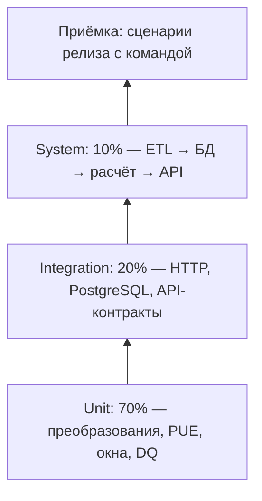

# Семинар 9. Стратегия тестирования EcoGrid Flow

Учебные материалы семинара хранятся только в этой папке. Документ описывает план проверок и не заменяет рабочие требования и контракты проекта.

Дата: 05.11.2026. Статус: проект на ревью для Release 0.5. Владелец тестирования — Григорий; ожидаемые результаты согласуют владельцы соответствующих компонентов.

## 1. Объект и риски

По целевой архитектуре EcoGrid Flow должен загружать цены ENTSO-E и погоду Open-Meteo, хранить их в PostgreSQL и выбирать непрерывное окно выполнения вычислительной задачи до дедлайна. Ошибка данных может дать ложную экономию; нарушение дедлайна делает рекомендацию непригодной. Поэтому стратегия охватывает код, контракты между компонентами, целостность данных и пользовательский результат.

Основание: [требования](../../../REQUIREMENTS.md), [архитектура](../../../ARCHITECTURE.md), [схема БД](../../../../infra/db/init.sql), [ERD](../../../data/ERD.md), [ADR-001](../../../adr/ADR-001-engine-input-data.md), [маппинг прогноза](../../../data/s2t/S2T_open_meteo.md). Документ описывает целевое покрытие; наличие строки в матрице не означает, что функция уже реализована или тест пройден. Все тест-кейсы ниже имеют статус «спроектирован»: выполнение и автоматизация запланированы по мере реализации компонентов. Этот семинар фиксирует проект тестирования, а не отчёт о прогонах.

### Состояние реализации и база проверки

Сверка выполнена 05.11.2026 с рабочей веткой семинаров (`0cf320e`) и локальным `develop` (`f5da56f`). Изменения из develop ещё не перенесены в эту ветку. Пути новых контрактов ниже относятся к указанному снимку develop; старые файлы ветки семинаров не доказывают отсутствие контрактов в проекте.

| Компонент | Подтверждённое состояние | Как это влияет на стратегию |
| :--- | :--- | :--- |
| ETL | Есть загрузчики ENTSO-E и Open-Meteo, нормализация, планировщик, UPSERT | Можно готовить тесты существующих функций; диапазоны и полнота не гарантируются текущим кодом |
| PostgreSQL | Есть init.sql: PK, FK и v_entsoe_prices_hourly; CHECK диапазонов нет | Проверять реальную PostgreSQL; верифицировать points_count, не считать любой возвращённый час полным |
| API | В develop есть services/api/schemas.py и docs/contracts/api.md; HTTP-обработчик и доступ к БД ещё не реализованы | Валидацию моделей можно тестировать отдельно; HTTP 401/422/503 и транзакции — после реализации API |
| Ядро | В develop есть services/engine/contracts.py и docs/contracts/engine.md; recommend содержит заглушку | Проверки моделей отделять от тестов вычисления; результат заглушки не является расчётом |
| Веб | Статический прототип в web/ | Полноценную проверку пользовательского пути выполнять после интеграции |
| Тесты и CI | Версионируемого набора автотестов и CI в проверенных деревьях нет | Здесь спецификация проверок, без утверждения об успешном прогоне |

ADR-001 и ADR-002 в develop имеют статус «Предложено». Сценарии по ним и контрактам — кандидаты для согласования с потребителями, а не новые решения, принятые этим документом. Стратегия не меняет правила API, расчётов или хранения.

### Основные риски и приоритет проверок

| Риск | Последствие | Проверки |
| :--- | :--- | :--- |
| Неверная структура или неполная партия | Расчёт по неполным данным | TC-01, TC-02, TC-05 |
| Повторная загрузка или неизвестный ЦОД | Дубли либо нарушение связей | TC-03, TC-06 |
| Ошибочная обработка отрицательной цены или PUE | Неверная стоимость | TC-04, TC-07, TC-10 |
| Выход за дедлайн | Невыполнимое расписание | TC-08, TC-10 |
| Оценочная цена выдана за подтверждённую | Ненадёжная рекомендация | TC-09 |

## 2. Уровни и пирамида



70/20/10 — ориентир по числу автоматических тестов, не измеренный состав и не процент покрытия строк. Дешёвые unit-тесты перебирают границы; интеграционные обнаруживают ошибки протокола и транзакций; системные подтверждают связность сервисов. Приёмочные сценарии оценивают пригодность релиза и не заменяют автоматизацию.

| Уровень | Что проверяем | Среда и критерий |
| :--- | :--- | :--- |
| Модульный | Формулы PUE/стоимости, дедлайн, неделимость окна, fallback, нормализация, DQ | Фиксированные входы, без сети и БД; точные значения или обоснованный допуск |
| Интеграционный | HTTP-статусы/JSON провайдера, контракт API, UPSERT, FK, rollback | Локальный HTTP-стенд и отдельная PostgreSQL 16; реальные клиент и драйвер |
| Системный | Загрузка фикстур → сохранение → запрос рекомендации → ответ | Изолированный Compose; сверка результата с ручным расчётом |
| Приёмочный | UC-01, UC-02, UC-04, UC-05 и демонстрация экономии | PLAT проводит, PO принимает; выполнение Must-требований |

Ответственность: DATA — фикстуры и качество; CORE — формулы и окна; APP — API и интерфейс; PLAT — воспроизводимый прогон, дефекты, сводный отчёт. Перед интеграцией изменения проходят unit-проверки; перед релизом — все уровни. Планируемый инструмент — pytest, измерение покрытия — pytest-cov; это соответствует NFR-MAINT-02, но зависимости и конфигурация пока не добавляются.

## 3. Проверки качества данных

| Проверка | Правило и реакция |
| :--- | :--- |
| Структура и типы | Обязательные поля, timestamp с понятной зоной, числа без NaN/Infinity; отклонить неразбираемую партию до записи |
| Согласованность массивов | В прогнозе time и все запрошенные метрики непустые и равной длины; иначе явная ошибка структуры, партия не передаётся на сохранение |
| Пропуски | Цены: 100% интервалов; прогноз: ≥99%; архив: ≥99.5%. Отсутствие всего набора не считать успехом. NULL не заменять нулём. Проверять регламент заполнения по DR-03/04; если температуры для часа всё равно нет, ядро использует base_pue и предупреждение по ADR-001 |
| Диапазоны | Цена [-500;4000] EUR/MWh включительно, прогноз T [-50;50], влажность [0;100]; архив T [-45;45], ветер ≤60. Диапазоны проверять в Python до записи; не ожидать CHECK-ошибки от текущей БД |
| Уникальность и дубли | Проверять бизнес-ключи внутри партии до UPSERT: цены (зона, начало, разрешение), погода (ЦОД, время). Повторная загрузка допустима, конфликтующие дубли внутри одной партии требуют отклонения |
| Ссылочная целостность | Погода и рекомендации ссылаются на существующие ЦОД/задачи; неизвестный FK — ошибка и rollback |
| Полнота | Сверять множество фактических интервалов с ожидаемой UTC-сеткой, а не только COUNT. Учитывать PT60M/PT15M и длительность суток поставщика при переходе времени |
| Актуальность | Проверять retrieved_at и покрытие горизонта: цены следующих суток до 14:30 CET; прогноз обновляется каждые 3 часа. Отсутствующие подтверждённые цены не выдавать за реальные |
| Единицы | EUR/MWh и UTC на входе расчёта; стоимость = kW × часы × PUE × EUR/MWh / 1000 |
| Атомарность | Для отвергнутой партии цен и при ошибке записи — rollback. Для погодных выбросов S2T допускает отбраковку строк с журналированием и запись валидной части; затем отдельно проверяется порог полноты DR-03. Для jobs и recommendations требуется одна транзакция API |

Проверки структуры (ось времени, длины массивов) не заменяют проверку допустимых NULL в отдельных метриках. Короткая фикстура TC-01 проверяет нормализацию двух часов; её нельзя считать полным прогнозом на 16 дней.

В источниках есть вопросы для согласования: DR-03 допускает заполнение погоды, а S2T описывает отбраковку строк и dq_log; формат журнала и порядок восстановления/отбраковки пока не реализованы. До реализации DATA и PLAT должны согласовать эти детали в рабочем маппинге/ADR. При реализации проверок пропусков нужно учитывать сохранение NULL, отсутствие выдуманной нулевой температуры и итоговый base_pue по ADR-001; точный тип исключения для новых DQ-проверок не фиксируется до контракта. Отказ целой партии цен при неполноте в TC-05 — предлагаемый критерий приёмки FR-ETL-04; механизм отказа и журналирование нужно согласовать до реализации DQ. Частичная загрузка погоды не означает допустимость частичной партии цен.

Это целевые правила по FR-ETL-04, DR-01…07; текущая схема не обеспечивает все диапазоны CHECK-ограничениями. Проверки должны существовать отдельно от ограничений БД. Допустимая интерполяция — только по правилам соответствующего DR, без молчаливой замены цен нулём.

## 4. Тест-кейсы

Общее предусловие: изолированная среда, синтетический ЦОД FI-HELSINKI-01 и фиксированные часы 05.11.2026 UTC. В запросах API используются UTC ISO 8601 с Z (контракт также допускает +00:00). Сырой прогноз Open-Meteo содержит время без суффикса; запрос timezone=GMT задаёт его интерпретацию как UTC. Временная ось теста фиксируется на 00:00 этих суток, чтобы проверки не зависели от текущей даты машины. Для API-кейсов нужны реализованный эндпоинт и тестовый токен. Каждый кейс начинается с восстановления фикстур. Если реализация отсутствует, результат — «не выполнен», а не pass.

| ID / тип | Предусловия и вход | Действия | Ожидаемый результат |
| :--- | :--- | :--- | :--- |
| TC-01 / позитивный | Локальный провайдер: 00:00 и 01:00; T=[10,11], влажность=[70,71], облачность=[20,30], ветер=[2,3], радиация=[0,0] | 1. Вернуть JSON из локального стенда. 2. Вызвать fetch_weather_forecast. 3. Сверить записи с входом | 2 кортежа; значения совпадают с входом; время UTC |
| TC-02 / негативный | Два времени, одно значение ветра; остальные метрики содержат по два значения | 1. Подать JSON нормализатору. 2. Проверить результат и отсутствие передачи на сохранение | Явная ошибка структуры; частичная партия не возвращена |
| TC-03 / позитивный | Чистая тестовая БД; зона FI, 24 часа UTC, PT60M, цена 100 EUR/MWh | 1. Загрузить партию. 2. Повторить загрузку. 3. Выбрать ключи и значения | 24 строки, без дублей, повторный UPSERT сохраняет ожидаемые значения |
| TC-04 / граничный | Полная партия цен; цена одного интервала равна нижней допустимой границе -500 EUR/MWh | 1. Запустить DQ. 2. Проверить решение по партии и значение цены | Партия принята; отрицательная граничная цена сохранена без замены нулём |
| TC-05 / негативный | В сетке из 24 часов отсутствует час 12:00–13:00; остальные интервалы валидны | 1. Проверить DQ. 2. Попытаться загрузить партию. 3. Сравнить БД с исходным состоянием | Неполнота обнаружена; партия отклонена, БД не изменена |
| TC-06 / негативный | БД без ЦОД UNKNOWN; валидная погодная запись с datacenter_id=UNKNOWN | 1. Сохранить запись через PostgreSQL. 2. Откатить транзакцию при ошибке. 3. Проверить таблицу | Нарушение FK; нет новых строк |
| TC-07 / граничный | T=15°C, base_pue=1.15 | 1. Вызвать расчёт PUE на границе free cooling. 2. Сверить с эталоном | PUE=1.15, надбавка за охлаждение не применяется |
| TC-08 / негативный | API реализован; earliest_start=00:00, duration_minutes=60, deadline=00:59; остальные поля валидны | 1. Отправить авторизованный запрос. 2. Проверить HTTP-ответ. 3. Проверить jobs | 422 invalid_request; задача не сохранена, так как не помещается до дедлайна |
| TC-09 / негативный | Нет актуальных цен; задача на 00–01; исторические цены этого часа за 3 предыдущие недели: [40,60,50] EUR/MWh; погода и ЦОД валидны | 1. Запросить рекомендацию. 2. Сверить источник цены, флаг и причину | Только оценочный вариант по медиане 50 EUR/MWh, is_fallback=true, reason=no_confirmed_window |
| TC-10 / позитивный, системный | API, ядро и БД реализованы; данные TC-10 из раздела 9: 1 kW, 60 минут, T=10°C, base_pue=1, цены [100,50] за 00–02; baseline=00:00; зона FI и ЦОД FI-HELSINKI-01 | 1. Загрузить цены и погоду. 2. Отправить авторизованный запрос с earliest_start=00:00, deadline=02:00, allowed_zones=[FI], preferred_datacenter_id=FI-HELSINKI-01, baseline_start=00:00 и новым job_id. 3. Прочитать ответ и записи БД | Непрерывное окно 01–02 до дедлайна; cost=0.05 €, baseline=0.10 €, savings=0.05 € / 50%; is_fallback=false; задача и рекомендация сохранены с корректными связями |

## 5. Подготовка данных и изоляция

1. Начальные синтетические фикстуры находятся в [разделе 9](#9-синтетические-тестовые-данные): JSON сырого погодного ответа для TC-01 и вход/эталон стоимости для TC-10. Это тестовые данные, не код реализации. При автоматизации использовать их из тестов. Каждый тест должен получать независимую копию исходных данных; никаких реальных токенов, инфраструктуры заказчика или сетевых вызовов к провайдерам.
2. Зафиксировать UTC-время и параметры формул. Для DQ подготовить валидный набор и отдельные мутации: пропуск, дубль, выброс, неправильный тип, устаревший прогноз.
3. PostgreSQL запускать в отдельном тестовом контейнере/БД; применять infra/db/init.sql. Не подключать тесты к рабочему хранилищу. Тесты commit/UPSERT выполнять в одноразовой БД, поскольку ETL сам делает commit.
4. После каждого сценария уничтожать тестовый контейнер и его тестовый volume либо очищать только выделенную тестовую схему. Не применять команды очистки к общему Compose проекта.
5. HTTP-стенд должен использовать loopback и случайный свободный порт, гарантированно закрываться после теста. В unit-тестах сетевые вызовы подменяются; в HTTP-интеграционных запрос действительно проходит через локальный сервер. Реальные API-контракты отдельно проверять при готовности APP.

## 6. Матрица трассируемости

| Требования | Кейсы | Проверяемая связь |
| :--- | :--- | :--- |
| FR-ETL-02, DR-03 | TC-01, TC-02 | Нормализация и структура погодного ответа |
| FR-ETL-05 | TC-03 | Идемпотентная запись цен |
| FR-ETL-04, DR-01 | TC-04, TC-05 | Нижняя граница цены и полнота партии |
| DR-03, DR-05 | TC-06 | Связь погоды с существующим ЦОД |
| FR-ENG-01 | TC-07 | PUE на границе 15°C |
| FR-API-01, FR-API-02, FR-ENG-03, DR-06 | TC-08 | Отказ при невыполнимом дедлайне до записи задачи |
| FR-ENG-05, FR-API-03 | TC-09 | Оценочный вариант при отсутствии реальных цен |
| FR-API-01, FR-API-03, FR-ENG-02, FR-ENG-03, DR-06, DR-07 | TC-10 | Путь от загруженных данных до непрерывного окна, стоимости и связанных записей |

Все 10 кейсов имеют статус «спроектирован». Матрица связывает выбранные требования с проверками семинара и не заявляет полного покрытия продукта. Перечень DQ в разделе 3 описывает состав будущих проверок, а не дополнительные оформленные тест-кейсы.

## 7. Порядок внедрения стратегии

| Этап готовности | Что выполнять | Условие перехода |
| :--- | :--- | :--- |
| Сейчас: требования и контракты | Ревью стратегии, тест-кейсов, эталонных расчётов и шаблона дефекта | Согласованы входы и ожидаемые результаты; спорные правила уточнены |
| Готов отдельный модуль | Его unit-тесты и ошибки входных данных | Позитивные, негативные и граничные сценарии модуля проходят |
| Готовы загрузчик и тестовая БД | HTTP, DQ, UPSERT, FK, rollback | Подтверждены полнота, повторная загрузка и целостность |
| Готовы ядро и API | Контрактные и системные проверки, TC-10 | Результат рассчитан из загруженных данных и совпал с эталоном |
| Собран релиз | Приёмка, регрессия, измерение покрытия и нефункциональных требований | Выполнены критерии завершения ниже |

До появления реализации сценарии хранятся как спецификация будущих тестов. Их не нужно подменять тестами заглушек, которые лишь воспроизводят ожидаемый ответ. Проектные артефакты семинара — этот версионируемый набор кейсов, матрица, шаблон дефекта и [синтетические данные](#9-синтетические-тестовые-данные); запуск кода для подготовки стратегии не требуется.

## 8. Дефекты и завершение тестирования

Шаблон карточки: ID; краткое название; версия/коммит и среда; требование и TC; предусловия; вход/фикстура; шаги; ожидаемое; фактическое; лог; серьёзность; приоритет; статус; исполнитель; исправляющий коммит; результат повторного теста.

Серьёзность: Critical — потеря данных/опасный неверный результат без обхода; Major — функция не работает или искажает данные; Minor — локальная ошибка с обходом. Приоритет P1 — до интеграции, P2 — до релиза, P3 — планово. Статусы: New → Confirmed → In progress → Fixed → Retest → Closed; при повторном падении Reopened. Заполняемая форма приведена ниже.

Тестирование релиза завершено, когда пройдены все Must-кейсы и согласованные Should, нет открытых Critical/Major, повторно проверены исправления, сохранены отчёты, проверены атомарность и идемпотентность БД, а покрытие строк реализованных модулей PUE, оптимизатора и DQ достигло ≥80% по NFR-MAINT-02. Остаточные риски принимает PO явно. Эти критерии будут проверяться после реализации и выполнения тестов; данный документ не подтверждает готовность релиза.


### Шаблон регистрации дефекта

Это пустая форма для будущих проверок. До обнаружения ошибки она не является зарегистрированным дефектом.

| Поле | Что заполнить |
| :--- | :--- |
| Идентификатор | Номер Defect-задачи в «Сфере» после регистрации |
| Заголовок | Компонент, условие, наблюдаемая ошибка |
| Описание | Какое поведение нарушено и как это влияет на данные или пользователя |
| Требование и тест-кейс | FR/DR/NFR и TC из стратегии |
| Версия | Ветка, commit SHA, версия зависимостей |
| Окружение | ОС, Python, PostgreSQL, конфигурация стенда без секретов |
| Предусловия | Состояние БД, доступность сервисов, тестовая роль |
| Входные данные | Ссылка на синтетическую фикстуру и её версия |
| Шаги | Нумерованная последовательность для независимого воспроизведения |
| Ожидаемый результат | Проверяемое поведение по требованию |
| Фактический результат | Наблюдаемое значение, ошибка или состояние БД |
| Доказательства | Лог прогона, ответ API, SQL-выборка; без токенов |
| Серьёзность | Critical / Major / Minor с обоснованием влияния |
| Приоритет | P1 / P2 / P3 с обоснованием срочности |
| Статус | New / Confirmed / In progress / Fixed / Retest / Closed / Reopened |
| Автор и исполнитель | Кто обнаружил и кто исправляет |
| Исправление | Ссылка на коммит или MR, описание изменения |
| Повторная проверка | Версия, дата, тест, ожидаемое/фактическое, ссылка на лог |
| Решение | Закрыт после успешной проверки либо переоткрыт; остаточные ограничения |

### Шаги воспроизведения

1. Восстановить исходное состояние: …
2. Подать входные данные: …
3. Выполнить действие: …
4. Сверить результат с требованием: …

### Условие закрытия

На исправленной версии проходит тест, воспроизводивший ошибку, и связанные регрессионные проверки. Проверяющий фиксирует фактический результат; статус Fixed сам по себе не означает Closed.

## 9. Синтетические тестовые данные

Примеры встроены в этот ответ. Они содержат только синтетические данные. Для каждого теста нужна независимая копия входа.

### TC-01: погодный ответ

Два часа проверяют нормализацию, а не полноту прогноза на 16 дней.

```json
{
  "hourly": {
    "time": [
      "2026-11-05T00:00",
      "2026-11-05T01:00"
    ],
    "temperature_2m": [
      10,
      11
    ],
    "relative_humidity_2m": [
      70,
      71
    ],
    "cloud_cover": [
      20,
      30
    ],
    "wind_speed_10m": [
      2,
      3
    ],
    "shortwave_radiation": [
      0,
      0
    ]
  }
}
```

### TC-10: вход и эталон расчёта

Это спецификация данных, а не готовый HTTP payload или EngineRequest. При автоматизации нужно добавить поля соответствующего контракта. base_pue=1 — искусственное допустимое значение для простого расчёта; в тестовой БД его задают явно вместо значения из сида.

```json
{
  "test_case": "TC-10",
  "synthetic": true,
  "earliest_start": "2026-11-05T00:00:00Z",
  "deadline": "2026-11-05T02:00:00Z",
  "baseline_start": "2026-11-05T00:00:00Z",
  "duration_minutes": 60,
  "required_power_kw": 1,
  "datacenter_id": "FI-HELSINKI-01",
  "base_pue": 1,
  "temperature_c": 10,
  "prices_eur_per_mwh": [
    100,
    50
  ],
  "expected": {
    "recommended_start": "2026-11-05T01:00:00Z",
    "recommended_end": "2026-11-05T02:00:00Z",
    "estimated_cost_eur": 0.05,
    "baseline_cost_eur": 0.1,
    "estimated_savings_eur": 0.05,
    "estimated_savings_percent": 50,
    "is_fallback": false
  }
}
```
