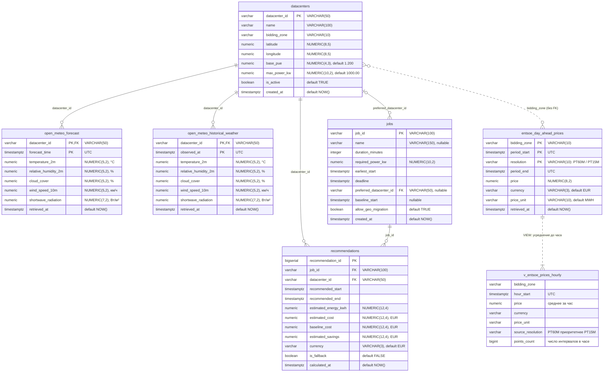

# ER-диаграмма базы данных EcoGrid Flow

| Параметр документа | Значение |
| :--- | :--- |
| **Источник истины** | [`infra/db/init.sql`](../../infra/db/init.sql) — диаграмма описывает схему ровно в том виде, в каком ее создает этот скрипт |
| **СУБД** | PostgreSQL 16 (On-Premise контур) |
| **Объекты** | 6 таблиц + 1 представление (`v_entsoe_prices_hourly`) |
| **Время** | Все метки времени — `TIMESTAMPTZ` в UTC |
| **Деньги** | Цены — `NUMERIC(8, 2)` в EUR/MWh, стоимости — `NUMERIC(12, 4)` в EUR, валюта — код ISO 4217 (`VARCHAR(3)`) |

---

## 1. Диаграмма

---

## 2. Связи

| Связь | Тип | Правило при удалении |
| :--- | :--- | :--- |
| `open_meteo_forecast.datacenter_id` → `datacenters.datacenter_id` | FK, 1 : N | `ON DELETE CASCADE` |
| `open_meteo_historical_weather.datacenter_id` → `datacenters.datacenter_id` | FK, 1 : N | `ON DELETE CASCADE` |
| `jobs.preferred_datacenter_id` → `datacenters.datacenter_id` | FK, 0..1 : N (поле необязательное) | `ON DELETE SET NULL` |
| `recommendations.datacenter_id` → `datacenters.datacenter_id` | FK, 1 : N | `ON DELETE CASCADE` |
| `recommendations.job_id` → `jobs.job_id` | FK, 1 : N (на одну задачу может быть несколько расчетов) | `ON DELETE CASCADE` |
| `datacenters.bidding_zone` ↔ `entsoe_day_ahead_prices.bidding_zone` | Логическая, **без FK**: цены грузятся по зонам независимо от реестра ЦОД | — |

---

## 3. Ключи и индексы

| Таблица | Первичный ключ | Дополнительные индексы |
| :--- | :--- | :--- |
| `datacenters` | `datacenter_id` | — |
| `entsoe_day_ahead_prices` | `(bidding_zone, period_start, resolution)` | `idx_entsoe_prices_period_start (period_start)` |
| `open_meteo_forecast` | `(datacenter_id, forecast_time)` | `idx_open_meteo_forecast_time (forecast_time)` |
| `open_meteo_historical_weather` | `(datacenter_id, observed_at)` | `idx_open_meteo_historical_time (observed_at)` |
| `jobs` | `job_id` | `idx_jobs_created_at (created_at)` |
| `recommendations` | `recommendation_id` | `idx_recommendations_job_id (job_id)`, `idx_recommendations_calculated_at (calculated_at)` |

`resolution` входит в ключ цен, потому что за одни сутки ENTSO-E может опубликовать ряд и с шагом `PT60M`, и с шагом `PT15M`. Расчетное ядро читает цены не из таблицы, а из представления `v_entsoe_prices_hourly` — единой почасовой сетки.

---

## 4. Проверки качества данных

В DDL нет `CHECK`-ограничений на диапазоны значений: проверки выполняет Python-слой (DQ Gate) до записи. Так одна аномальная строка не роняет вставку всей партии, а отклоненная строка попадает в журнал (сценарий 4, `FR-ETL-04`). Диапазоны — в `DR-01…DR-07` ([требования, п. 3](../REQUIREMENTS.md)) и в [S2T-маппингах](s2t/).

---

## 5. Чего еще нет в схеме (план к `DR-01…DR-07`)

| Что | Требование | Статус |
| :--- | :--- | :--- |
| Таблица `entsoe_day_ahead_generation`: `bidding_zone`, `period_start`, `period_end`, `production_type`, `generation_mw`, `resolution` | `DR-02` (Could) | Не создана |
| Партиционирование таблиц временных рядов по месяцам / годам | `DR-01`, `DR-03`, `DR-04`, `DR-07`, `ASR-03` | Отложено, колонки от него не меняются |
| `CHECK`-ограничения справочника `datacenters` | `DR-05` | Не созданы |
| Журнал отклоненных DQ-партий | `FR-ETL-04` | Не создан |
| Журнал запусков ETL | `FR-ETL-01`, `FR-ETL-02` | Не создан |

---

## 6. Описание полей

Типы и ограничения — в диаграмме выше; здесь — смысл полей. Время везде в UTC.

### `datacenters` — справочник ЦОД
Сид в `init.sql` — три синтетических ЦОД, по одному на энергозону: `FI-HELSINKI-01`, `DE-FRANKFURT-01`, `SE-STOCKHOLM-01`.

| Поле | Описание |
| :--- | :--- |
| `datacenter_id` | Идентификатор площадки в формате `СТРАНА-ГОРОД-NN` |
| `name` | Название ЦОД |
| `bidding_zone` | Энергозона ENTSO-E, по которой берутся цены ЦОД |
| `latitude`, `longitude` | Координаты; по ним загружается погода |
| `base_pue` | PUE в режиме free cooling — минимальный для площадки (`FR-ENG-01`) |
| `max_power_kw` | Доступная мощность для задач, кВт |
| `is_active` | Учитывается ли ЦОД в расчетах и при загрузке погоды |
| `created_at` | Когда ЦОД добавлен в справочник |

### `entsoe_day_ahead_prices` — цены Day-Ahead

| Поле | Описание |
| :--- | :--- |
| `bidding_zone` | Энергозона: `DE-LU`, `FI`, `SE3` |
| `period_start`, `period_end` | Интервал действия цены, полуоткрытый: `[period_start; period_end)` |
| `resolution` | Шаг ряда в исходном виде: `PT60M` или `PT15M` |
| `price` | Цена электроэнергии за `price_unit` в валюте `currency` |
| `currency` | Валюта, код ISO 4217 (`EUR`) |
| `price_unit` | За какой объем энергии цена (`MWH`) |
| `retrieved_at` | Когда цена загружена в БД |

### `v_entsoe_prices_hourly` — почасовые цены для ядра (представление)

| Поле | Описание |
| :--- | :--- |
| `bidding_zone` | Энергозона |
| `hour_start` | Начало часа |
| `price` | Цена за час: значение `PT60M` или среднее четырех интервалов `PT15M` |
| `currency`, `price_unit` | Как в таблице цен |
| `source_resolution` | Из какого шага собран час; при наличии обоих берется `PT60M` |
| `points_count` | Сколько интервалов попало в час; меньше 4 при `PT15M` — неполный час |

### `open_meteo_forecast` — прогноз погоды
Повторная загрузка перезаписывает прогноз на тот же час, поэтому в таблице всегда последний прогноз.

| Поле | Описание |
| :--- | :--- |
| `datacenter_id` | ЦОД, для координат которого получен прогноз |
| `forecast_time` | Час, на который прогнозируется погода |
| `temperature_2m` | Температура воздуха на высоте 2 м, °C — вход модели PUE |
| `relative_humidity_2m` | Относительная влажность, % |
| `cloud_cover` | Облачность, % |
| `wind_speed_10m` | Скорость ветра на высоте 10 м, км/ч |
| `shortwave_radiation` | Солнечная радиация, Вт/м² |
| `retrieved_at` | Когда прогноз загружен в БД |

### `open_meteo_historical_weather` — архив погоды
Поля как у прогноза, вместо `forecast_time` — `observed_at` (час фактического наблюдения). Используется для EDA и бэктеста, ядро его не читает.

### `jobs` — задачи клиентов
Запись создается API при каждом запросе рекомендации.

| Поле | Описание |
| :--- | :--- |
| `job_id` | Идентификатор задачи от клиента (например, ID DAG в Airflow) |
| `name` | Человекочитаемое название для UI |
| `duration_minutes` | Сколько непрерывно выполняется задача; дробить нельзя (`FR-ENG-02`) |
| `required_power_kw` | Электрическая мощность задачи, кВт |
| `earliest_start` | Раньше этого момента запускать нельзя |
| `deadline` | К этому моменту задача должна завершиться (`FR-ENG-03`) |
| `preferred_datacenter_id` | ЦОД, где задача запускается сейчас; база для расчета экономии |
| `baseline_start` | Когда задача стартовала бы по текущему расписанию (cron); база для расчета экономии |
| `allow_geo_migration` | Можно ли переносить задачу в другой ЦОД |
| `created_at` | Когда поступил запрос |

### `recommendations` — результаты расчетов

| Поле | Описание |
| :--- | :--- |
| `recommendation_id` | Идентификатор рекомендации |
| `job_id` | Задача, для которой выполнен расчет |
| `datacenter_id` | Рекомендованный ЦОД |
| `recommended_start`, `recommended_end` | Рекомендованное окно запуска; `recommended_end <= deadline` |
| `estimated_energy_kwh` | Энергопотребление с учетом PUE, кВт·ч |
| `estimated_cost` | Стоимость в рекомендованном окне |
| `baseline_cost` | Стоимость в `preferred_datacenter_id` со старта `baseline_start` |
| `estimated_savings` | `baseline_cost − estimated_cost` |
| `currency` | Валюта стоимостей, код ISO 4217 (`EUR`) |
| `is_fallback` | `true` — расчет по медиане цен за 3 недели, потому что свежих цен нет (`FR-ENG-05`) |
| `calculated_at` | Когда выполнен расчет |
