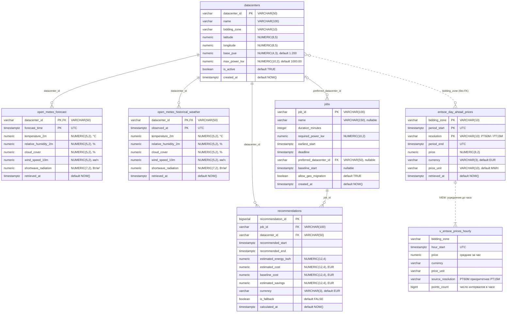

# ER-диаграмма базы данных EcoGrid Flow

| Параметр документа | Значение |
| :--- | :--- |
| **Источник истины** | [`infra/db/init.sql`](../../infra/db/init.sql) — диаграмма описывает схему ровно в том виде, в каком ее создает этот скрипт |
| **СУБД** | PostgreSQL 16 (On-Premise контур) |
| **Объекты** | 6 таблиц + 1 представление (`v_entsoe_prices_hourly`) |
| **Время** | Все метки времени — `TIMESTAMPTZ` в UTC |
| **Деньги** | Цены — `NUMERIC(8, 2)` в EUR/MWh, стоимости — `NUMERIC(12, 4)` в EUR, валюта — код ISO 4217 (`VARCHAR(3)`) |

---

## 1. Диаграмма

---

## 2. Связи

| Связь | Тип | Правило при удалении |
| :--- | :--- | :--- |
| `open_meteo_forecast.datacenter_id` → `datacenters.datacenter_id` | FK, 1 : N | `ON DELETE CASCADE` |
| `open_meteo_historical_weather.datacenter_id` → `datacenters.datacenter_id` | FK, 1 : N | `ON DELETE CASCADE` |
| `jobs.preferred_datacenter_id` → `datacenters.datacenter_id` | FK, 0..1 : N (поле необязательное) | `ON DELETE SET NULL` |
| `recommendations.datacenter_id` → `datacenters.datacenter_id` | FK, 1 : N | `ON DELETE CASCADE` |
| `recommendations.job_id` → `jobs.job_id` | FK, 1 : N (на одну задачу может быть несколько расчетов) | `ON DELETE CASCADE` |
| `datacenters.bidding_zone` ↔ `entsoe_day_ahead_prices.bidding_zone` | Логическая, **без FK**: цены грузятся по зонам независимо от реестра ЦОД | — |

---

## 3. Ключи и индексы

| Таблица | Первичный ключ | Дополнительные индексы |
| :--- | :--- | :--- |
| `datacenters` | `datacenter_id` | — |
| `entsoe_day_ahead_prices` | `(bidding_zone, period_start, resolution)` | `idx_entsoe_prices_period_start (period_start)` |
| `open_meteo_forecast` | `(datacenter_id, forecast_time)` | `idx_open_meteo_forecast_time (forecast_time)` |
| `open_meteo_historical_weather` | `(datacenter_id, observed_at)` | `idx_open_meteo_historical_time (observed_at)` |
| `jobs` | `job_id` | `idx_jobs_created_at (created_at)` |
| `recommendations` | `recommendation_id` | `idx_recommendations_job_id (job_id)`, `idx_recommendations_calculated_at (calculated_at)` |

`resolution` входит в ключ цен, потому что за одни сутки ENTSO-E может опубликовать ряд и с шагом `PT60M`, и с шагом `PT15M`. Расчетное ядро читает цены не из таблицы, а из представления `v_entsoe_prices_hourly` — единой почасовой сетки.

---

## 4. Проверки качества данных

В DDL нет `CHECK`-ограничений на диапазоны значений: проверки выполняет Python-слой (DQ Gate) до записи. Так одна аномальная строка не роняет вставку всей партии, а отклоненная строка попадает в журнал (сценарий 4, `FR-ETL-04`). Диапазоны — в `DR-01…DR-07` ([семинар 4, п. 4](../seminars/seminar_4/readme.md)) и в S2T-документах этой папки.

---

## 5. Чего еще нет в схеме (план к `DR-01…DR-07`)

| Что | Требование | Статус |
| :--- | :--- | :--- |
| Таблица `entsoe_day_ahead_generation` | `DR-02` (Could) | Не создана |
| Партиционирование таблиц временных рядов по месяцам / годам | `DR-01`, `DR-03`, `DR-04`, `DR-07`, `ASR-03` | Отложено, колонки от него не меняются |
| `CHECK`-ограничения справочника `datacenters` | `DR-05` | Не созданы |
| Журнал отклоненных DQ-партий | `FR-ETL-04` (WBS 2.4) | Не создан |
| Журнал запусков ETL | WBS 5.3 | Не создан |
