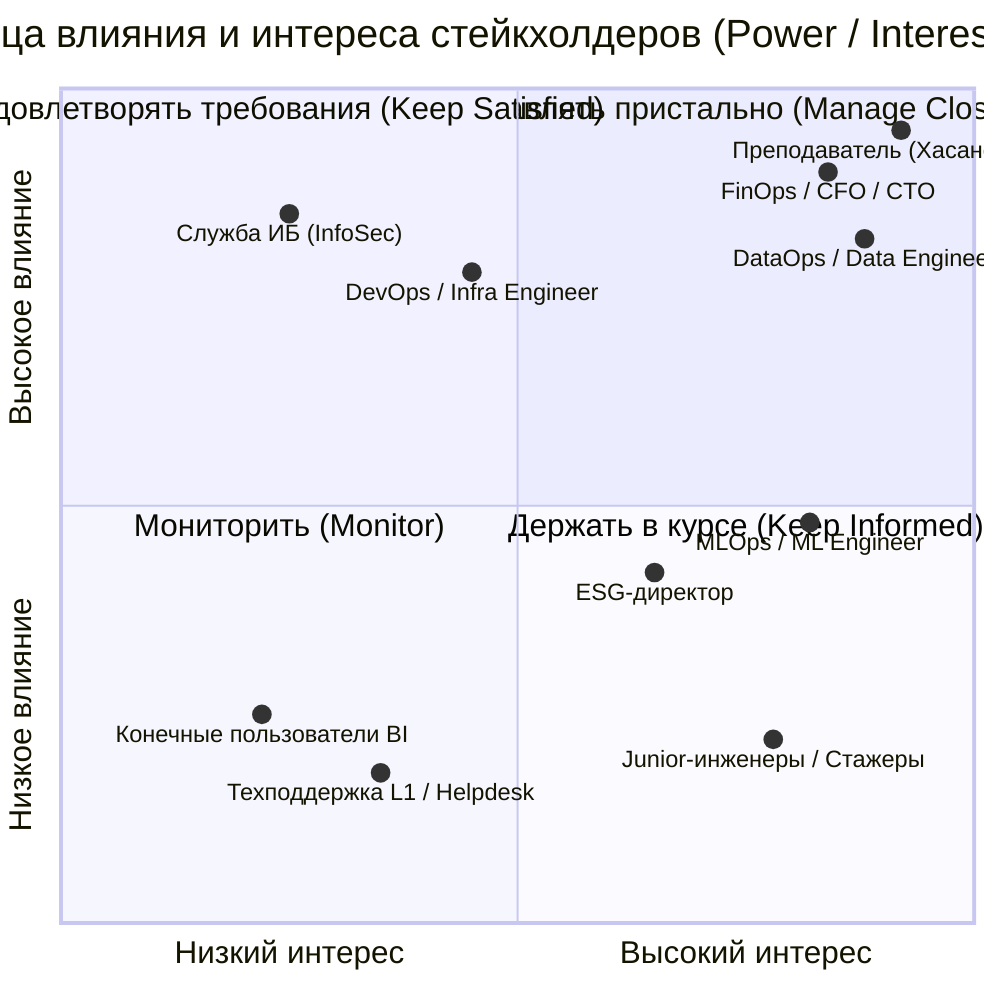
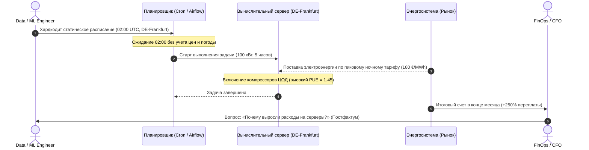
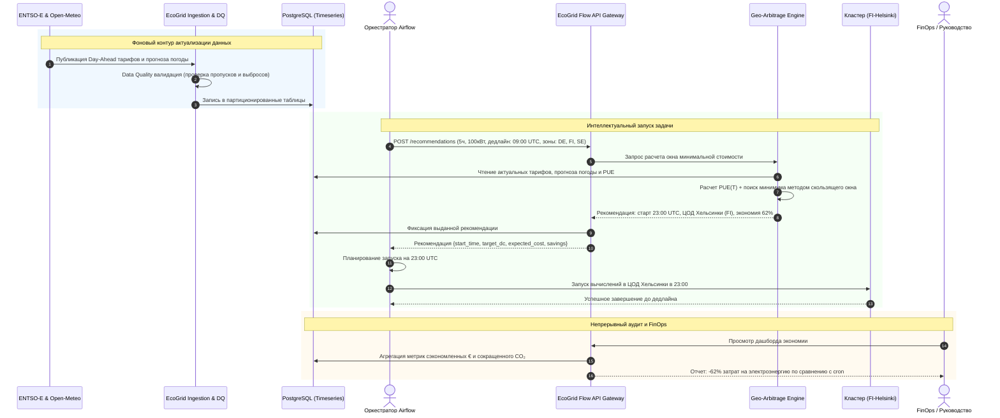
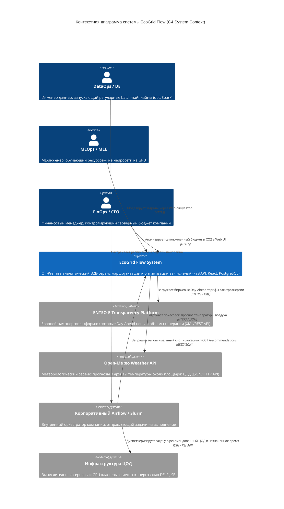

# Семинар 3. Формирование требований при разработке ПО

**Тема:** Выявление требований, контекст системы, моделирование процессов и каталог данных предметной области.  
**Дисциплина:** «Программная инженерия» (профиль «Инженерия данных», 3 курс, 5-й семестр)  
**Преподаватель:** Хасанов И. И.  
**Команда:** «Шпингалеты» (*Shpingalets*)  
**Проект:** **EcoGrid Flow** — On-Premise B2B-сервис оптимизации и пространственной маршрутизации (*Geo-Arbitrage*) ресурсоемких вычислений.  

---

## 🎯 Цель работы
Собрать исходные требования к аналитическому сервису **EcoGrid Flow**, формализовать роли и цели заинтересованных сторон, описать предметную область и глоссарий, построить модели ключевого процесса в нотациях **AS-IS** и **TO-BE**, зафиксировать границы системы через **контекстную диаграмму** и составить структурированный **каталог источников данных**.

---

## 📋 Содержание артефактов семинара
1. [Карта стейкхолдеров и их цели](#1-карта-стейкхолдеров-и-их-цели)
2. [Предметная область и глоссарий](#2-предметная-область-и-глоссарий)
3. [Моделирование ключевого процесса: AS-IS и TO-BE](#3-моделирование-ключевого-процесса-as-is-и-to-be)
4. [Границы системы и внешние взаимодействия](#4-границы-системы-и-внешние-взаимодействия)
5. [Каталог источников данных](#5-каталог-источников-данных)
6. [Бизнес-правила и системные ограничения](#6-бизнес-правила-и-системные-ограничения)
7. [Контекстная диаграмма системы (C4 Context)](#7-контекстная-диаграмма-системы-c4-context)

---

## 1. Карта стейкхолдеров и их цели

В проекте выделены внутренние пользователи компании-клиента (инженерный и управленческий контур), внешние регулирующие роли, а также академический стейкхолдер дисциплины.

### 1.1. Матрица заинтересованных сторон (Роли, интересы, влияние)

| Роль / Стейкхолдер | Категория | Основные интересы и боли | Влияние на проект (Power) | Интерес к результату (Interest) | Ожидания от EcoGrid Flow | Критерии успеха (Success Metrics) |
| :--- | :--- | :--- | :---: | :---: | :--- | :--- |
| **DataOps / Data Engineer** | Первичный пользователь (B2B) | Запуск десятков тяжелых ETL/ELT-пайплайнов (Spark, dbt); риск срыва утреннего дедлайна (SLA витрин DWH). | **Высокое** | **Высокий** | Простой REST API (`/recommendations`) для оркестратора (Airflow); 100% гарантия завершения до дедлайна. | Отсутствие сорванных SLA; задержка API < 200 мс; прозрачная интеграция через Airflow. |
| **FinOps-менеджер / CFO / CTO** | Внутренний заказчик (Бизнес) | Неконтролируемый рост счетов за электроэнергию серверов и облака; отсутствие прозрачной аналитики расходов. | **Высокое** | **Высокий** | Наглядный Web-дашборд со сводкой сэкономленных бюджетов в сравнении со статическим расписанием (cron). | Подтвержденное снижение OPEX на вычисления на 30–75%; детальный финансовый аудит. |
| **Преподаватель дисциплины (Хасанов И. И.)** | Академический стейкхолдер | Контроль соответствия проекта профилю «Инженерия данных» и стандартам программной инженерии. | **Высокое** | **Высокий** | Наличие четких требований, валидации данных, партиционированной БД, соблюдения Agile/Kanban процессов. | Выполнение требований семинаров, обоснованность архитектуры, готовность MVP Release 50%. |
| **Служба информационной безопасности (ИБ / InfoSec)** | Корпоративный контроль | Риск утечки конфиденциальной топологии сети и метаданных во внешний интернет; комплаенс On-Premise. | **Высокое** | **Низкий** | Строгая сетевая изоляция в контуре VPC; отсутствие исходящих запросов с внутренними данными клиентов. | Отсутствие замечаний службы безопасности; zero outbound data leaks; аудит Docker-окружения. |
| **Infrastructure / DevOps Engineer** | Эксплуатация и инфраструктура | Стабильность хостов и серверов; недопустимость перегрузки серверного оборудования и скачков напряжения. | **Высокое** | **Средний** | Поставка в виде автономного Docker Compose; работа без передачи внутренних логов наружу (On-Premise). | Изоляция внутренней инфраструктуры; стабильность контейнеров; предсказуемое потребление ресурсов. |
| **MLOps / ML Engineer** | Первичный пользователь (B2B) | Высокая стоимость обучения LLM / CV-моделей на GPU; необходимость гибкого переноса нагрузки между доступными ЦОД. | **Среднее** | **Высокий** | Рекомендация не только времени, но и локации (Geo-Arbitrage) с оценкой экономии перед стартом. | Снижение затрат на обучение моделей на 40–60%; наглядный симулятор в Web UI. |
| **ESG-директор / Sustainability Compliance** | Корпоративный контроль | Требования европейского и корпоративного ESG-аудита (Scope 2 Emissions, углеродный след вычислений). | **Среднее** | **Средний** | Автоматическая выгрузка отчетов о сокращении выбросов CO₂ за счет сдвига задач в часы зеленой генерации. | Достоверная оценка граммов CO₂/кВт⋅ч на задачу; соответствие ESG-отчетности. |
| **Junior Data / ML-инженеры (Стажеры)** | Внутренние пользователи | Долгое ожидание завершения ресурсоемких экспериментов и обучающих запусков без влияния на инфраструктуру. | **Низкое** | **Высокий** | Быстрый интерфейс симулятора для оценки затрат на экспериментальные прогоны задач. | Понятные подсказки в веб-симуляторе; ускорение валидации гипотез. |
| **Конечные бизнес-пользователи BI-отчетов** | Косвенные пользователи | Своевременность готовности ежедневных аналитических отчетов и витрин к началу рабочего дня (09:00). | **Низкое** | **Низкий** | Гарантированное завершение расчетов до дедлайна; расписание фоновых оптимизаций не должно ломать дашборды. | 100% отчетов готовы вовремя; отсутствие простоев бизнеса. |
| **Дежурная служба техподдержки L1 / Helpdesk** | Эксплуатационное сопровождение | Наплыв ночных инцидентов и ложных алертов при нестандартном сдвиге времени старта вычислительных задач. | **Низкое** | **Низкий** | Прозрачное логирование причин переноса времени старта задачи в Airflow; отсутствие ложных алертов. | Готовый runbook с регламентом работы оптимизатора; отсутствие лишних ночных вызовов дежурных инженеров. |

---

### 1.2. Карта стейкхолдеров (Power / Interest Grid)



---

## 2. Предметная область и глоссарий

Предметная область **EcoGrid Flow** находится на стыке оптовых рынков электроэнергии, физики охлаждения дата-центров и диспетчеризации пакетных вычислений.

### 2.1. Рынок электроэнергии (Energy Market)
* **Day-Ahead Market (Рынок на сутки вперед):** Оптовый рынок электроэнергии, торги на котором закрываются в 12:00–13:00 CET за день до фактической поставки. На каждый час следующих суток формируется фиксированная спотовая цена.
* **Спотовая цена (Spot Price, EUR/MWh):** Рыночная цена одного мегаватт-часа электроэнергии в конкретной ценовой зоне на определенный временной интервал.
* **Отрицательные цены (Negative Pricing):** Рыночная аномалия, возникающая при избыточной выработке солнечной и ветровой энергии (ВИЭ) в сочетании с низким потреблением. В эти часы производители электроэнергии доплачивают потребителям за утилизацию избытка мощности.
* **Ценовая зона (Bidding Zone):** Географическая зона энергосистемы с единой оптовой ценой на электроэнергию (например, `DE-LU` — Германия/Люксембург, `FI` — Финляндия, `SE3` — Швеция Стокгольм).
* **ENTSO-E (European Network of Transmission System Operators for Electricity):** Европейская сеть системных операторов передачи электроэнергии. Предоставляет единую платформу прозрачности (*ENTSO-E Transparency Platform*) с открытыми API котировок и структуры генерации.

### 2.2. Физика и инфраструктура ЦОД (Datacenter & Energy Efficiency)
* **Дата-центр (ЦОД):** Серверная площадка с вычислительным оборудованием клиента. В контексте системы ЦОД характеризуется географическими координатами, доступной мощностью (кВт) и климатическим профилем.
* **PUE (Power Usage Effectiveness):** Коэффициент энергоэффективности дата-центра:  
  `PUE = E_total / E_IT ≥ 1.0`  
  где `E_total` — общая потребляемая энергия дата-центра, `E_IT` — энергия, потребленная вычислительным IT-оборудованием.
* **Динамический PUE (Dynamic PUE):** Модель коэффициента энергоэффективности, зависящая от температуры окружающей среды:
  * *Free Cooling (Фрикулинг):* При низкой уличной температуре (T ≤ 15°C) серверы охлаждаются забортным воздухом. PUE минимален (≈ 1.12 – 1.18).
  * *Mechanical Chiller (Чиллерное охлаждение):* При жаре (T ≥ 25°C) включаются энергоемкие холодильные компрессоры, повышая PUE до 1.40 – 1.55 (+35% к счету за электричество).

### 2.3. Вычислительная нагрузка и оптимизация (Workload & Optimization)
* **Batch-вычисления (Пакетная задача):** Длительная серверная задача (обучение нейросети, построение витрин dbt, бэкап, рендеринг), не требующая мгновенного синхронного ответа пользователю и допускающая сдвиг времени старта при условии завершения к дедлайну.
* **Non-preemptive задача:** Неделимая вычислительная задача, которая после старта должна выполняться непрерывно N часов без пауз и перезапусков.
* **SLA Дедлайн (Deadline):** Предельное время в UTC, до наступления которого задача обязана быть гарантированно завершена.
* **Geo-Arbitrage (Пространственно-временной арбитраж):** Алгоритмический выбор наилучшей комбинации **«Временной слот запуска + Локация дата-центра»** для минимизации совокупных расходов на электроэнергию и охлаждение.

### 2.4. Архитектурный периметр (Architecture & Security)
* **On-Premise контур (VPC):** Развертывание системы в изолированной корпоративной сети клиента. Гарантирует, что данные об оборудовании, проектах и серверных логах не передаются третьим сторонам.

---

## 3. Моделирование ключевого процесса: AS-IS и TO-BE

Ключевой сквозной процесс: **«Планирование, диспетчеризация и запуск ресурсоемких пакетных вычислений (Data/ML pipelines)»**.

---

### 3.1. Процесс AS-IS («Как есть»)

#### Описание текущего состояния:
1. Инженер разрабатывает тяжелый пайплайн (Spark/dbt/PyTorch).
2. Расписание жестко фиксируется в планировщике (`cron` или DAG в Airflow) на статическое «типичное ночное время» (например, 02:00 UTC).
3. Площадка исполнения жестко захардкожена на «домашний» сервер/кластер (например, Франкфурт).
4. Запуск происходит «вслепую» — без учета текущей биржевой ситуации и температуры.
5. Ночью из-за внезапного штиля в Северном море биржевой тариф взлетает до 180 €/МВт⋅ч (включаются пиковые газовые станции).
6. В конце расчетного месяца CFO получает счет за электроэнергию и фиксирует огромный перерасход OPEX без возможности понять, какие задачи стали причиной переплаты.



#### Ключевые проблемы и узкие места процесса AS-IS:
* **Слепой запуск:** Планировщик не имеет данных о биржевых тарифах и прогнозах погоды.
* **Привязка к одной локации:** Полное отсутствие географического маневра между филиалами и доступными ЦОД.
* **Пиковые тарифные ловушки:** Высокие ночные цены при безветрии приводят к переплате до 3–4 раз.
* **Ущерб экологии:** Задачи часто запускаются в часы с преобладанием угольно-газовой генерации.

---

### 3.2. Процесс TO-BE («Как будет» после внедрения EcoGrid Flow)

#### Описание целевого состояния:
1. Фоновый ETL-сервис EcoGrid Flow непрерывно собирает и валидирует Day-Ahead цены ENTSO-E и метеопрогнозы Open-Meteo.
2. При наступлении готовности пайплайна оркестратор Airflow отправляет в EcoGrid Flow API запрос с метаданными: длительность, мощность, крайний дедлайн (SLA) и список разрешенных ЦОД.
3. Оптимизационный движок рассчитывает динамический PUE для каждого ЦОД, сопоставляет часовые тарифы скользящим окном и находит глобальный минимум затрат с гарантией соблюдения дедлайна.
4. Сервис возвращает рекомендацию: запустить задачу в 23:00 в ЦОД Хельсинки (цена 24 €/МВт⋅ч, Free Cooling PUE = 1.15, прогнозируемая экономия 62%).
5. Airflow откладывает запуск до 23:00 и направляет задачу на вычислительный узел в Хельсинки.
6. Факт выполнения и параметры экономии автоматически логируются в изолированной PostgreSQL.
7. FinOps-менеджер в реальном времени видит сэкономленный бюджет и сокращение углеродного следа на дашборде.



---

### 3.3. Содержательное сравнение процессов AS-IS и TO-BE

| Критерий сравнения | Процесс AS-IS | Процесс TO-BE (EcoGrid Flow) | Эффект для бизнеса |
| :--- | :--- | :--- | :--- |
| **Принцип выбора времени старта** | Статический `cron` (жестко заданный час, «вслепую»). | Динамический поиск окна минимальной совокупной цены под SLA дедлайн. | Исключение попадания в часы пиковых биржевых тарифов. |
| **Выбор площадки (ЦОД)** | Захардкоженная домашняя локация (без маневра). | Алгоритмический пространственный арбитраж (**Geo-Arbitrage**) между доступными ЦОД. | Снижение стоимости МВт⋅ч в 2–4 раза за счет разницы тарифов между странами. |
| **Учет физики охлаждения (PUE)** | Игнорируется (принимается как константа). | Динамический расчет `PUE(T_street)` на базе прогноза температуры около ЦОД. | Дополнительная экономия 15–30% на кондиционировании за счет Free Cooling. |
| **Гарантия дедлайна (SLA)** | Не контролируется относительно внешних факторов. | Жесткое ограничение алгоритма: `t_start + t_duration ≤ deadline`. | Исключение срыва утренних бизнес-отчетов и расписаний. |
| **Прозрачность затрат (FinOps)** | Постфактум в общем счете раз в месяц без детализации. | Прозрачный расчет стоимости каждой задачи и подтвержденная экономия в Web UI. | Точный биллинг команд и обоснование ROI перед руководством. |
| **Углеродный след (ESG)** | Случайный, часто в часы грязной генерации. | Смещение задач в часы профицита солнечной и ветровой энергии (ВИЭ). | Сокращение корпоративных выбросов CO₂ (Scope 2) до 50%. |

---

## 4. Границы системы и внешние взаимодействия

Концепция **EcoGrid Flow** базируется на принципе изолированного развертывания (**On-Premise / Private VPC**). Система четко разделяет внутренний контур компании и внешний интернет.

```
┌────────────────────────────────────────────────────────────────────────────────────────┐
│ ВНЕШНИЙ ИНТЕРНЕТ (Публичные открытые сервисы)                                          │
│  [ENTSO-E Transparency Platform API]            [Open-Meteo Weather API]                │
└─────────────────────────────────┬──────────────────────────────────┬───────────────────┘
                                  │ HTTPS (XML)                      │ HTTPS (JSON)
                                  ▼                                  ▼
┌────────────────────────────────────────────────────────────────────────────────────────┐
│ КОРПОРАТИВНЫЙ ON-PREMISE КОНТУР КОМПАНИИ (VPC)                                         │
│                                                                                        │
│   ┌────────────────────────────────────────────────────────────────────────────────┐   │
│   │ ГРАНИЦА СИСТЕМЫ ECOGRID FLOW (Docker Compose)                                  │   │
│   │                                                                                │   │
│   │   [Ingestion Layer] ──► [Data Quality Gate] ──► [PostgreSQL Timeseries]        │   │
│   │   (ETL-воркеры)         (валидация пропусков)    (market & weather data)       │   │
│   │                                                          ▲                     │   │
│   │                                                          │ SQL                 │   │
│   │                                                          ▼                     │   │
│   │   [FastAPI Gateway] ◄─────────────────────────► [Optimization Engine]          │   │
│   │   (/recommendations)                            (Dynamic PUE + Geo-Arbitrage)  │   │
│   │           ▲                                                                    │   │
│   │           │ REST / JSON                                                        │   │
│   │           ▼                                                                    │   │
│   │   [React Web Portal] (Карта цен, симулятор задач, FinOps-дашборд)              │   │
│   └───────────▲────────────────────────────────────────────────────────────────────┘   │
│               │                                                                        │
│               │ REST API / Web                                                         │
│   ┌───────────┴────────────────────────────────────────────────────────────────────┐   │
│   │ ВНУТРЕННИЕ СИСТЕМЫ И ПОЛЬЗОВАТЕЛИ КЛИЕНТА (Out of System Scope)                │   │
│   │   • Оркестраторы: Apache Airflow / Kubeflow / Cron                             │   │
│   │   • Вычислительная инфраструктура: GPU-кластеры и серверы в ЦОД                │   │
│   │   • Пользователи: DataOps, MLOps, FinOps-менеджеры, Руководство                │   │
│   └────────────────────────────────────────────────────────────────────────────────┘   │
└────────────────────────────────────────────────────────────────────────────────────────┘
```

### 4.1. Что входит в границы системы EcoGrid Flow (In-Scope):
1. **Ingestion Layer:** Модули автоматической загрузки и парсинга Day-Ahead котировок (XML) и метеопрогнозов (JSON).
2. **Data Quality Module:** Контроль целостности, фильтрация аномалий, дедупликация и нормализация временных меток к UTC.
3. **Storage Layer:** Локальная база данных PostgreSQL 16 с обязательным партиционированием таблиц временных рядов (7 таблиц: `market_day_ahead_prices`, `market_generation_mix`, `weather_forecast`, `weather_historical`, `client_infrastructure`, `task_parameters`, `task_history`).
4. **Optimization Core:** Вычислительный модуль расчета динамического PUE и алгоритм скользящего окна пространственно-временного арбитража.
5. **API Gateway:** Защищенный внутренний REST API на FastAPI для интеграции с корпоративными планировщиками.
6. **Web UI:** Пользовательский веб-портал на React для визуализации тарифов, ручного моделирования задач и FinOps-отчетности.

### 4.2. Внешние системы и зависимости (External / Out-of-Scope):
* **ENTSO-E Transparency Platform:** Внешний поставщик открытых рыночных данных энергосистемы Европы (доступ по HTTPS через токен).
* **Open-Meteo API:** Внешний открытый метеорологический сервис (доступ по HTTPS по координатам площадок).
* **Корпоративные оркестраторы (Airflow, Slurm):** Внешние по отношению к сервису клиенты, инициирующие запросы на оптимизацию и фактически исполняющие вычисления.
* **Серверная инфраструктура ЦОД:** Физические серверы и GPU-ноды, на которых выполняются целевые задачи. EcoGrid Flow **не управляет питанием серверов напрямую** в рамках MVP, а выдает аналитические рекомендации.

---

## 5. Каталог источников данных

Каталог данных фиксирует внешние публичные и внутренние корпоративные источники, необходимые для функционирования аналитического контура EcoGrid Flow.

> [!TIP]
> Каталог составлен в соответствии с критериями контроля: не ограничивается названиями файлов, детально описывает форматы, частоту, объемы, владельцев данных, способы доступа и механизмы обеспечения качества (Data Quality).

| № | Источник данных | Назначение и используемые атрибуты | Формат данных | Частота получения | Ожидаемый объем | Владелец / Ответственный | Способ доступа | Механизм Data Quality |
| :-: | :--- | :--- | :--- | :--- | :--- | :--- | :--- | :--- |
| **1** | **ENTSO-E Transparency Platform** — Day-Ahead Prices (`market_day_ahead_prices`) | Спотовые цены на электроэнергию по энергозонам. Основной источник для расчёта стоимости выполнения задачи и выбора дешевого окна. Атрибуты: `bidding_zone`, `period_start`, `period_end`, `price`, `currency`, `price_unit`, `resolution`. | `XML` (Publication_MarketDocument), timestamp ISO 8601; в БД: партиционированная таблица PostgreSQL (`RANGE` по `period_start`, шаг — 1 месяц) | 1 раз в сутки (13:00–14:00 CET) с возможностью повторной проверки при задержках | 24–96 записей на зону в сутки (при 15-мин шаге). Для 3–5 зон: ~288–480 записей/день (~105–175 тыс./год) | ENTSO-E / Национальные операторы энергосетей (TSO) | REST Web API по HTTPS с Security Token в заголовке | Проверка полноты 24/96 интервалов; проверка диапазона цен (-500 … +4000 €); контроль валюты (`EUR`) и единиц измерения (`price_unit = MWh`). |
| **2** | **ENTSO-E Transparency Platform** — Generation / Energy Mix (`market_generation_mix`) | Данные о производстве электроэнергии и структуре генерации по зонам для аналитики рынка и оценки углеродоемкости сети. Атрибуты: `bidding_zone`, `period_start`, `period_end`, `production_type`, `generation_mw`, `resolution`. | `XML` (GL_MarketDocument); в БД: партиционированная таблица PostgreSQL (`RANGE` по `period_start`, 1 месяц) | 1–4 раза в сутки по факту публикации операторами | Сотни записей в сутки в зависимости от детальности источников генерации в зоне | ENTSO-E / Национальные системные операторы | REST Web API по HTTPS с Security Token | Валидация неотрицательности выработки (`generation_mw >= 0`); контроль суммы генераций и допустимых типов `production_type`. |
| **3** | **Open-Meteo Forecast API** (`weather_forecast`) | Оперативный метеопрогноз около дата-центров для расчёта динамического PUE и энергопотребления охлаждения. Атрибуты: `datacenter_id`, `latitude`, `longitude`, `forecast_time`, `temperature_2m`, `relative_humidity_2m`, `cloud_cover`, `wind_speed_10m`, `shortwave_radiation`, `retrieved_at`. | `JSON`; в БД: партиционированная таблица PostgreSQL (`RANGE` по `forecast_time`, 1 месяц) | Каждые 3–6 часов (по мере обновления глобальных метеомоделей) | 24 записи в сутки на переменную на каждый ЦОД. Для 3–5 ЦОД: ~200–500 записей в сутки | OpenMeteo GmbH (исходные модели DWD, ECMWF, NOAA) | HTTP GET API по географическим координатам ЦОД (`latitude`, `longitude`) | Валидация физических границ температуры (-50°C … +50°C), влажности (0 … 100%), ветра (0 … 100 м/с); проверка отсутствия пропусков. |
| **4** | **Open-Meteo Historical Weather Archive** (`weather_historical`) | Исторические ряды температуры, влажности, ветра и радиации за 3–5 лет для EDA, калибровки модели PUE и обучения ML-моделей. Атрибуты: `datacenter_id`, `latitude`, `longitude`, `observed_at`, `temperature_2m`, `relative_humidity_2m`, `cloud_cover`, `wind_speed_10m`, `shortwave_radiation`. | `JSON` / `CSV`; в БД: партиционированная таблица PostgreSQL (`RANGE` по `observed_at`, шаг — 1 год) | Разовая первичная загрузка при развертывании; далее периодическое дозаполнение | 1 год ≈ 8,76 тыс. записей на ЦОД. За 5 лет для 3 ЦОД: ~130 тыс. строк | OpenMeteo GmbH / метеослужбы | HTTP GET Historical Weather API с фильтром по координатам и датам | Проверка монотонности временной шкалы; выявление дубликатов; интерполяция единичных пропусков. |
| **5** | **Справочник инфраструктуры клиента** (`client_infrastructure`) | Реестр площадок ЦОД, географических координат, базовых PUE и характеристик серверного парка. Атрибуты: `datacenter_id`, `name`, `bidding_zone`, `latitude`, `longitude`, `max_power_kw`, `base_pue`, `is_active`, `created_at`. | Таблица PostgreSQL / `JSON` (реляционный справочник) | Изменяется редко (при добавлении/изменении ЦОД или оборудования) | Десятки или сотни строк (в зависимости от размера серверного парка компании) | Компания-клиент (Infrastructure / DataOps Lead) | Локальное чтение из PostgreSQL / Внутренний Admin API | Проверка `base_pue >= 1.0`; валидация географических координат; контроль внешнего ключа `bidding_zone` с таблицами рынка. |
| **6** | **Параметры вычислительной задачи от клиента** (`task_parameters`) | Входящие требования к batch-задачам от оркестраторов клиента (SLA, допустимые локации, мощность). Атрибуты: `job_id`, `name`, `duration_minutes`, `required_power_kw`, `earliest_start`, `deadline`, `preferred_datacenter_id`, `allow_geo_migration`, `created_at`. | `JSON` по протоколу HTTP; в БД: таблица `task_parameters` | По событию (при каждом запросе рекомендации от Airflow) | От единиц до сотен/тысяч запросов в сутки; размер payload < 2 КБ | Инженер / Корпоративный оркестратор (DataOps / MLOps) | POST-запрос на внутренний REST API (`/api/v1/recommendations`) | Строгая валидация Pydantic-схемами: `duration_minutes > 0`, `required_power_kw > 0`, `deadline > earliest_start >= now()`. |
| **7** | **Журнал рекомендаций и результатов расчётов** (`task_history`) | Зафиксированные результаты работы оптимизатора: окно запуска, выбранный ЦОД, расчётная стоимость, базовая стоимость без оптимизации, сэкономленный бюджет. Атрибуты: `recommendation_id`, `job_id`, `datacenter_id`, `recommended_start`, `recommended_end`, `estimated_energy_kwh`, `estimated_cost`, `estimated_savings`, `currency`, `calculated_at`. | Партиционированная таблица PostgreSQL (`RANGE` по `calculated_at`, шаг — 1 месяц) | При каждом расчете рекомендации и по факту завершения задачи | ~1 запись на задачу плюс технические логи. При 1 000 задач/день: ~365 тыс. записей/год | EcoGrid Flow (собственный внутренний источник сервиса) | Локальное сохранение через SQLAlchemy / AsyncPG | Контроль целостности внешних ключей (`job_id`, `datacenter_id`); проверка формулы `estimated_savings = baseline - estimated_cost`; `recommended_end <= deadline`. |

---

## 6. Бизнес-правила и системные ограничения

### 6.1. Бизнес-правила (Business Rules)

* **BR-01 (Гарантия соблюдения SLA-дедлайна — Hard Constraint):**  
  Оптимальное окно запуска задачи `[t_start, t_start + duration]` обязано строго завершаться до указанного пользователем дедлайна:  
  `t_start + duration ≤ deadline`  
  Система не имеет права предлагать слот с меньшей стоимостью, если он нарушает дедлайн.

* **BR-02 (Неделимость вычислительной задачи — Non-preemptive Execution):**  
  Пакетная задача длительностью N часов является непрерывной. Поиск окна ведется методом скользящего окна как интеграл непрерывной стоимости за N последовательных часов без разбиения задачи на части.

* **BR-03 (Изоляция корпоративных данных — Zero Outbound Leaks):**  
  Во внешний интернет запрещено передавать любые метаданные клиента (названия серверов, внутренние IP-адреса, имена задач, логи). Разрешены только исходящие GET-запросы за обезличенными публичными котировками и погодой.

* **BR-04 (Модель динамического PUE и энергоэффективности):**  
  Совокупная стоимость вычисления рассчитывается с учетом динамической температуры:  
  `Cost = Σ (P_server × PUE(T_t) × Price_spot(t))`  
  где при `T_t ≤ T_free` действует режим Free Cooling (`PUE = base_pue`), а при `T_t > T_free` добавляются затраты на работу компрессоров.

* **BR-05 (Регламент устаревания данных и аварийный Fallback):**  
  Если свежие Day-Ahead цены не поступили до 14:30 CET из-за сбоя серверов ENTSO-E, система переходит в режим Fallback: выдает рекомендацию на основе скользящего среднего тарифа за аналогичные дни предыдущих 3 недель с обязательным предупреждающим флагом `is_fallback: true`.

* **BR-06 (Порог целесообразности географического арбитража):**  
  Перенос задачи из «домашнего» ЦОД в удаленный рекомендуется только в том случае, если прогнозируемая экономия на электроэнергии превышает порог накладных расходов на сетевую передачу данных между дата-центрами (Egress Data Overhead Threshold):  
  `Savings_EUR > Cost_network_transfer`

---

### 6.2. Системные и нефункциональные ограничения (Constraints)

1. **Архитектурное ограничение:** Развертывание всей инфраструктуры в закрытом контуре через Docker Compose на хосте заказчика (Ubuntu Linux / macOS, Docker Engine 24+).
2. **Требования к производительности:** Время расчета рекомендации для задачи с горизонтом планирования до 48 часов не должно превышать **200 миллисекунд**.
3. **Требования к хранению:** База данных PostgreSQL 16 с обязательным секционированием (партиционированием) таблиц временных рядов по месяцам для обеспечения стабильной скорости аналитических выборок.
4. **Сетевые ограничения:** Доступ во внешнюю сеть строго ограничен белым списком доменов: `transparency.entsoe.eu` и `api.open-meteo.com` по HTTPS (порт 443).

---

## 7. Контекстная диаграмма системы (C4 Context)

Диаграмма контекста описывает границы разрабатываемой системы **EcoGrid Flow**, ее пользователей и внешние взаимодействующие сервисы.




