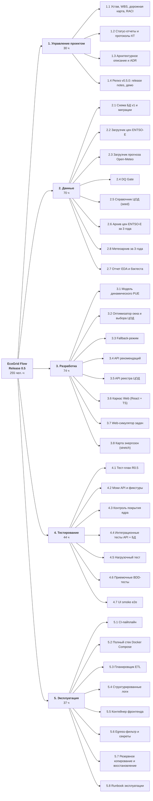
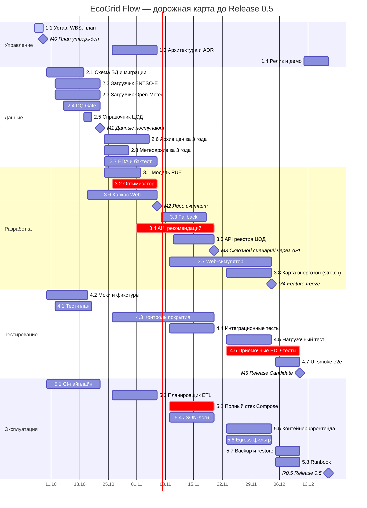
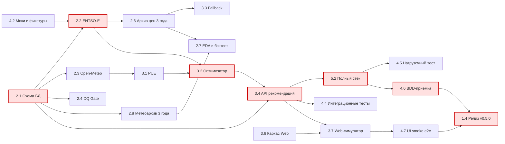

# Семинар 5. Проектное управление EcoGrid Flow: устав, WBS, дорожная карта

**Версия документа:** `v1.2` (07.10.2026)  
**Статус:** На утверждении (до обзора контрольной точки M0 — 09.10.2026)  
**Владелец документа:** Богдан Леонов (Team Lead / PO)

---

## 🎯 Цель работы
Оформить EcoGrid Flow как управляемый проект: зафиксировать цель и ценность, границы первого семестра и критерии **Release 0.5**, декомпозировать работы в **WBS** по результатам, построить **дорожную карту** с контрольными точками, назначить **владельцев результатов**, оценить **ресурсы и зависимости** и согласовать **формат статуса и частоту контроля**.

> [!NOTE]
> **Связь с предыдущими артефактами.** Устав **не повторяет** требования. Содержание продукта задано спецификацией [Требования v1.1.0 (семинар 4)](../seminar_4/readme.md) и указывается здесь только через идентификаторы (`FR-*`, `NFR-*`, `DR-*`, `ASR-*`). Процесс работы (Kanban, статусы доски, WIP-лимиты, DoD) — [семинар 2](../seminar_2/README.md). Стейкхолдеры подробно — [семинар 3, п. 1](../seminar_3/README.md).

**Обозначения в документе:**

| Префикс | Расшифровка | Что обозначает |
| :---: | :--- | :--- |
| `GOAL-n` | Goal | Цель проекта |
| `CONST-n` | Constraint | Ограничение |
| `ASM-n` | Assumption | Допущение |
| `RC-n` | Release Criterion | Критерий приемки Release 0.5 |
| `M0…M5`, `R0.5` | Milestone, Release | Контрольная точка, релиз |
| `DEP-n` | Dependency | Внешняя зависимость |
| `RISK-n` | Risk | Риск |
| `x.y` | — | Пакет работ WBS |

---

## 📋 Содержание
1. [Устав проекта v1.0 (Project Charter)](#1-устав-проекта-v10-project-charter)
2. [Содержание первого семестра и критерии Release 0.5](#2-содержание-первого-семестра-и-критерии-release-05)
3. [WBS — иерархическая структура работ](#3-wbs--иерархическая-структура-работ)
4. [Дорожная карта и контрольные точки до Release 0.5](#4-дорожная-карта-и-контрольные-точки-до-release-05)
5. [Матрица ответственности (RACI)](#5-матрица-ответственности-raci)
6. [Ресурсы, зависимости и ключевые риски](#6-ресурсы-зависимости-и-ключевые-риски)
7. [Формат статуса проекта и частота контроля](#7-формат-статуса-проекта-и-частота-контроля)
8. [Фиксация в репозитории](#8-фиксация-в-репозитории)
9. [Журнал изменений плана](#9-журнал-изменений-плана)

---

## 1. Устав проекта v1.0 (Project Charter)

### 1.1. Паспортные данные

| Поле | Значение |
| :--- | :--- |
| **Название проекта** | EcoGrid Flow — On-Premise сервис оптимизации расписания и площадки запуска ресурсоемких вычислений по цене электроэнергии |
| **Код проекта в «Сфере»** | `ID24_EGF` |
| **Спонсор / академический заказчик** | Преподаватель дисциплины «Программная инженерия» Хасанов И. И. |
| **Руководитель проекта (PM / PO)** | Богдан Леонов |
| **Команда** | «Шпингалеты», 5 человек (группа ИД24) |
| **Срок проекта** | 07.09.2026 – май 2027 (два семестра) |
| **Текущий этап** | 1-й семестр → **Release 0.5**, план 18.12.2026 |
| **Методология** | Kanban с WIP-лимитами и контрольными точками раз в 2 недели (см. семинар 2) |

### 1.2. Обоснование (зачем проект нужен)
Компании, которые сами эксплуатируют ЦОД, запускают тяжелые пакетные вычисления (ETL, обучение моделей, бэкапы) по статическому расписанию cron. Цена электроэнергии на рынке Day-Ahead при этом меняется в течение суток в разы и различается между энергозонами. Запуск без учета цены и погоды (охлаждения ЦОД) приводит к прямым переплатам за электроэнергию и лишним выбросам CO₂. Готового инструмента, который работает внутри закрытого контура и не передает наружу метаданные инфраструктуры, у таких компаний нет (анализ AS-IS — семинар 3, п. 3).

### 1.3. Цели проекта

Цели GOAL-1…GOAL-3 сформулированы по критериям **SMART**: конкретная (*Specific*), измеримая (*Measurable*), достижимая (*Achievable*), значимая для проекта (*Relevant*), ограниченная сроком (*Time-bound*). Поэтому у каждой цели есть способ проверки и срок. GOAL-4 — ориентир на 2-й семестр; измеримой она станет в уставе v2.0.

| ID | Цель | Как проверяется | Срок |
| :---: | :--- | :--- | :---: |
| **GOAL-1** | Выпустить **Release 0.5**: работающий сквозной контур «данные рынка и погоды → расчет рекомендации → REST API → веб-симулятор» для 3 энергозон (`DE-LU`, `FI`, `SE3`) и 3 ЦОД | Выполнены все критерии приемки релиза RC-1–RC-8 (п. 2.3) | 18.12.2026 |
| **GOAL-2** | Подтвердить бизнес-гипотезу на реальных ценах: для эталонной задачи (4 ч, 500 кВт, окно 24 ч) выбор окна сервисом дешевле **лучшего статического расписания** в том же ЦОД (*эффект времени*) в среднем **не менее чем на 10%** на последних 12 месяцах архива. Отдельно измеряется *эффект места* — дополнительная экономия от выбора ЦОД. Порог 10% предварительный и уточняется на M2 | Отчет бэктеста (WBS 2.7) по данным `DR-01`, `DR-04`, методика — ниже | 18.12.2026 |
| **GOAL-3** | Вести проект прозрачно: статус обновляется еженедельно, каждая контрольная точка закрывается решением Go/No-Go | 10 из 10 недельных статусов опубликованы в `docs/status/` | 18.12.2026 |
| **GOAL-4** | Выпустить **Release 1.0** с ML-прогнозом цен и интеграцией с оркестратором (объем 2-го семестра) | Критерии приемки Release 1.0 фиксируются в уставе v2.0 к началу 2-го семестра | май 2027 |

**Методика проверки GOAL-2 (базовый сценарий).** Экономию сравниваем с самым сильным вариантом, который клиент может сделать без сервиса: с cron, поставленным на самый дешевый в среднем час. Тогда любая экономия сверх этого — заслуга сервиса, а не удачно выбранного соперника.
* **Базовый сценарий:** запуск в домашнем ЦОД в фиксированный час, у которого средняя стоимость окна за предыдущие 3 месяца минимальна. Час пересчитывается раз в месяц и выбирается только по прошлым данным, без заглядывания в будущее.
* **Эффект времени (основная метрика):** оптимизатор работает только с домашним ЦОД. Считается для каждого из трех ЦОД (`DE-LU`, `FI`, `SE3`) как домашнего.
* **Эффект места (дополнительная метрика):** оптимизатор выбирает из трех ЦОД. Прирост к эффекту времени показывается отдельно для каждого домашнего ЦОД. В один процент с эффектом времени его не смешиваем: он зависит от того, где находится клиент, а не от качества алгоритма.
* **Сценарий AS-IS из семинара 3 (cron в 02:00 UTC):** используется только как иллюстрация в демо, критерием не является.
* **Порог:** 10% — предварительная оценка. На M2 по отчету EDA порог уточняется и фиксируется в журнале изменений плана (п. 9). Если эффект окажется ниже порога, гипотеза считается опровергнутой, и это допустимый результат (RC-8).

### 1.4. Ценность

| Для кого | Ценность результата |
| :--- | :--- |
| **Компания-клиент (FinOps / CTO)** | Снижение расходов на электроэнергию для пакетных вычислений без изменения самих вычислительных задач; цель — подтвердить гипотезу GOAL-2 |
| **Инженеры DataOps / MLOps** | Решение «когда и где запускать» принимается одним вызовом API вместо ручного подбора; дедлайн задачи соблюдается всегда |
| **ESG / Sustainability** | Количественная основа для отчета о снижении выбросов (полноценная отчетность — Release 1.0) |
| **Служба ИБ** | Данные инфраструктуры не покидают контур клиента (`ASR-01`) |
| **Академический заказчик** | Сквозной проект по инженерии данных: сбор, качество, хранение, расчет, API, тестирование и эксплуатация в одном продукте |
| **Команда** | Практика полного цикла разработки; портфолио: работающий релиз с тестами и CI |

### 1.5. Границы проекта (верхний уровень)
* **Входит:** то, что перечислено в WBS (п. 3). Состав Release 0.5 по требованиям — в п. 2.
* **Не входит в проект в целом:** управление серверами клиента (IPMI / Redfish, старт и остановка ВМ в облаках); торговля электроэнергией; биллинг; мультиарендность (SaaS); мобильные клиенты; энергозоны вне ENTSO-E.

### 1.6. Ограничения (Constraints)

| ID | Ограничение | Следствие для управления |
| :---: | :--- | :--- |
| **CONST-1** | **Срок:** Release 0.5 должен быть сдан до конца 1-го семестра (защита в декабре 2026) | Дата релиза фиксирована. При отставании сокращается объем (сначала Could, затем Should), а не сдвигается дата |
| **CONST-2** | **Люди:** 5 участников с частичной занятостью, в среднем **6 ч/нед** на проект на человека, в неделю сессии — 3 ч | Емкость — 300 чел.-ч на семестр (п. 6.1); WIP ≤ 1 задача на человека |
| **CONST-3** | **Бюджет:** 0 ₽. Только бесплатные API, ПО с открытым исходным кодом и личные ноутбуки | Нет облачных стендов и платных сервисов; нагрузочное тестирование — локально |
| **CONST-4** | **Архитектура:** развертывание только On-Premise через Docker Compose, исходящий трафик только к двум публичным источникам (`ASR-01`, `NFR-SEC-02`) | Нет SaaS-зависимостей (облачная БД, внешний мониторинг, внешние LLM) |
| **CONST-5** | **Стек зафиксирован:** Python 3.11 / FastAPI, PostgreSQL 16, React + TypeScript | Смена стека — только через Change Request (семинар 4, п. 8) |
| **CONST-6** | **Инструменты:** все задачи, знания и код ведутся в «Сфере» (`ID24_EGF`) | Работа, которой нет в «Сфере», не считается выполненной |
| **CONST-7** | **Данные клиента недоступны:** реальной инфраструктуры ЦОД у команды нет | Справочник ЦОД и поток задач — синтетические (WBS 2.5) |

### 1.7. Допущения (Assumptions)
Каждое допущение проверяется. Если оно не подтверждается, это оформляется как риск или Change Request.

| ID | Допущение | Как и когда проверяем | Если не подтвердится |
| :---: | :--- | :--- | :--- |
| **ASM-1** | Security Token ENTSO-E выдан команде и действует весь семестр | BL проверяет тестовым запросом до **13.10.2026** | Разработка идет на фикстурах (WBS 4.2); исторические цены выгружаются вручную в CSV с портала Transparency Platform |
| **ASM-2** | ENTSO-E публикует цены Day-Ahead до 14:00 CET ежедневно, Open-Meteo бесплатно отдает прогноз (лимит 10 000 запросов в сутки при нашей потребности ≈ 24) | Журнал запусков ETL с M1 | Fallback-режим (`FR-ENG-05`) |
| **ASM-3** | Требования v1.1.0 стабильны до Release 0.5; изменения проходят только через CR | Обзор на каждой контрольной точке | Анализ влияния и перепланирование в журнале (п. 9) |
| **ASM-4** | Синтетических параметров 3 ЦОД достаточно, чтобы продемонстрировать ценность и пройти приемку | Согласование с заказчиком на M1 | Добавляем параметры ЦОД из открытых источников (публикуемые PUE операторов) |
| **ASM-5** | Состав команды и доступность (≥ 6 ч/нед) сохраняются до 18.12.2026 | Еженедельно в статусе (измерение «Ресурсы») | Перераспределение пакетов по RACI, сокращение объема |
| **ASM-6** | Ноутбуков команды (≥ 8 ГБ RAM, Docker) хватает для полного стека и нагрузочного теста 50 RPS | Пробный прогон на M3 | Нагрузочный тест — на самой мощной машине команды; результат фиксируется с указанием конфигурации |
| **ASM-7** | Защита Release 0.5 проходит не раньше 18.12.2026 | Уточнить дату у преподавателя до **23.10.2026** | Если раньше — M5 становится релизом, пакеты M5 переносятся в M4 |

### 1.8. Ключевые стейкхолдеры проекта
Полная карта интересов и влияния — семинар 3, п. 1. Здесь указано, **как каждый стейкхолдер участвует в управлении проектом**.

| Стейкхолдер | Роль в проекте | Участие и решения | Канал и частота |
| :--- | :--- | :--- | :--- |
| **Преподаватель (Хасанов И. И.)** | Спонсор, приемка | Утверждает устав и план, принимает Release 0.5, согласует перенос даты | Семинары (еженедельно); статус на каждой контрольной точке |
| **Команда «Шпингалеты»** | Исполнитель | Выполняет WBS, сообщает статус, поднимает риски | Стендапы 3 раза в неделю; «Сфера» |
| **DataOps / MLOps инженер** *(роль, представляет PO)* | Основной пользователь | Сценарии UC-01, UC-02 — основа демонстрации | Через PO; демо на M3 и R0.5 |
| **FinOps / CTO** *(роль, представляет PO)* | Внутренний заказчик ценности | Цель GOAL-2 (экономия) | Отчет бэктеста на M2 и R0.5 |
| **Служба ИБ** *(роль, представляет QA)* | Контроль ограничений | Проверка `ASR-01` / `NFR-SEC-*` перед релизом | Проверка на M4 |
| **Поставщики данных ENTSO-E, Open-Meteo** | Внешняя зависимость | Доступность API и условия использования | Мониторинг журнала ETL |

### 1.9. Роли и полномочия команды

| Участник | Роль | Полномочия в проекте |
| :--- | :--- | :--- |
| **Богдан Леонов** | Team Lead / PO / PM, Data Engineer | Приоритеты бэклога; решение Go/No-Go на контрольных точках; согласование CR (вместе с архитектором); сокращение объема в рамках CONST-1; публикация статуса |
| **Александр Зейферт** | Lead Backend / DevOps, архитектор | Технические решения по API, БД и инфраструктуре; обязательное ревью кода backend и инфраструктуры; право вето на изменения, нарушающие ASR |
| **Арина Антонова** | Data Analyst / ML Engineer | Владелец расчетного ядра и модели PUE; приемка корректности расчетов и данных |
| **Максим Томов** | Frontend Developer | Владелец веб-интерфейса; решения по UI в рамках `FR-UI-*` |
| **Григорий Витрик** | QA Engineer | Владелец качества данных и тестов; **QA sign-off** — обязательное условие Go на M3–R0.5; право остановить релиз при открытом дефекте уровня Critical |

**Правила эскалации:** блокер → в течение 1 рабочего дня в «Сферу» и на стендап → если не снят за 2 дня, решение принимает PO → если затронута дата релиза или объем Must, PO согласует решение с преподавателем.

### 1.10. Ключевые результаты (продукты проекта)
Release 0.5 (код, Docker-композиция, тег `v0.5.0`), наполненное хранилище данных, отчет EDA и бэктеста, комплект тестов и отчет о тестировании, runbook эксплуатации, проектная документация (семинары 1–5). Состав — в WBS (п. 3).

### 1.11. Утверждение устава

| Роль | ФИО | Решение | Дата |
| :--- | :--- | :---: | :---: |
| Спонсор | Хасанов И. И. | ☐ Утверждаю | |
| Руководитель проекта | Богдан Леонов | ☐ Утверждаю | |
| Команда | Зейферт А., Антонова А., Томов М., Витрик Г. | ☐ Ознакомлены, согласны | |

---

## 2. Содержание первого семестра и критерии Release 0.5

### 2.1. Что входит в Release 0.5
Release 0.5 — первый релиз со сквозным контуром «данные → расчет → API → UI». Объем назначен по приоритетам MoSCoW из спецификации v1.1.0 (семинар 4, п. 6). Текст требований здесь не повторяется.

| Группа | Требования в Release 0.5 | Комментарий |
| :--- | :--- | :--- |
| **Must (полностью)** | `FR-API-01…03`, `FR-ENG-02`, `FR-ENG-03`, `FR-ETL-01`, `FR-ETL-04`, `FR-ETL-05`, `NFR-PERF-01`, `NFR-SEC-01…03`, `NFR-MAINT-01`, `DR-01`, `DR-05…07` | 17 требований — обязательны |
| **Should (кроме одного)** | `FR-ENG-01`, `FR-ENG-05`, `FR-ETL-02`, `FR-API-05`, `FR-UI-02`, `NFR-REL-02`, `NFR-REL-03`, `NFR-PERF-02`, `NFR-PERF-04`, `NFR-MAINT-02`, `NFR-MAINT-03`, `DR-03` | 12 из 13. `NFR-REL-01` (99.9% за месяц) нельзя честно измерить на учебном стенде за 4 недели. Это требование переносится в R1.0 |
| **Could (поднято в объем)** | `FR-ETL-03` и `DR-04` — **полностью**: архив цен и погоды за 3 года (с 01.10.2023) | Архив нужен как обучающая выборка для ML-прогноза во 2-м семестре и для бэктеста GOAL-2. Поэтому он собирается заранее, а не в начале R1.0 |
| **Could (stretch)** | `FR-UI-01` | Первым исключается при отставании |
| **Перенос в R1.0** | `FR-API-04`, `FR-UI-03`, `FR-ENG-04`, `NFR-PERF-03`, `NFR-REL-01`, `DR-02` (архив генерации — признак для ML, загружается в начале R1.0 тем же загрузчиком), все Won't (ML-прогноз на 3–7 дней, интеграция с Airflow / Cloud API) | Объем 2-го семестра |

### 2.2. Что команда делает в первом семестре помимо кода
* Проектная документация семинаров 1–5 (и следующих семинаров семестра).
* EDA и бэктест на реальных рыночных данных (цель GOAL-2).
* Инфраструктура разработки: CI, моки внешних API, тестовые фикстуры.
* Эксплуатационные материалы: runbook, резервное копирование, инструкция развертывания.

### 2.3. Критерии приемки Release 0.5 (Definition of Release)
Релиз считается выпущенным, когда выполнены **все** критерии RC-1–RC-8. Проверку проводит QA (GV), итоговое решение Go/No-Go принимает PO (BL) на обзоре R0.5.

| ID | Критерий | Доказательство (артефакт) |
| :---: | :--- | :--- |
| **RC-1** | **Объем:** у 100% требований из п. 2.1 (Must + Should) статус «Реализовано», и у каждого есть хотя бы один автотест в матрице трассируемости | Обновленная матрица трассируемости (семинар 4, п. 8.2) |
| **RC-2** | **Приемка:** BDD-сценарии 1–4 из семинара 4 (п. 5) выполняются в CI на теге релиза | Отчет CI по тегу `v0.5.0` |
| **RC-3** | **Данные:** в БД есть архив цен по `DE-LU`, `FI`, `SE3` и метеоархив по 3 ЦОД с 01.10.2023 по текущую дату. Полнота цен — 100% по `DR-01`, погоды — ≥ 99.5% по `DR-04`; каждый пропуск источника задокументирован в журнале DQ; ETL отработал по расписанию ≥ 14 суток подряд без ручного вмешательства | SQL-отчет полноты; журнал запусков ETL |
| **RC-4** | **Качество:** покрытие ядра ≥ 80% (`NFR-MAINT-02`); 0 открытых дефектов уровня Critical/High; отчет нагрузочного теста подтверждает `NFR-PERF-01` | Отчет coverage; фильтр дефектов в «Сфере»; отчет k6/Locust |
| **RC-5** | **Эксплуатация:** развертывание на чистой машине по инструкции занимает ≤ 15 мин, все healthcheck зеленые; восстановление БД из резервной копии проверено | Протокол прогона развертывания; протокол восстановления |
| **RC-6** | **Безопасность:** egress-проверка показывает исходящие соединения только к двум разрешенным FQDN; сканер секретов не находит секретов в репозитории | Отчет проверки egress; отчет gitleaks |
| **RC-7** | **Релиз-менеджмент:** тег `v0.5.0` на `master`, release notes опубликованы; все пакеты WBS выполнены или переведены в R1.0 по решению PO | Тег, `CHANGELOG.md` |
| **RC-8** | **Демонстрация:** демо по сценариям UC-01, UC-02, UC-05 проведено заказчику; цель GOAL-2 подтверждена или опровергнута отчетом бэктеста | Протокол демо; отчет бэктеста |

---

## 3. WBS — иерархическая структура работ

**Принципы построения:**
* Декомпозиция идет **по результатам** (что должно появиться), а не по действиям. Каждый пакет работ — проверяемый артефакт в репозитории или «Сфере».
* **Правило 100%:** WBS охватывает весь объем Release 0.5. Работа вне WBS не выполняется без CR.
* Уровень 2 охватывает **данные, разработку, тестирование и эксплуатацию** (требование контроля 3), а также управление проектом.
* Пакет работ — 2–16 чел.-ч, ровно один владелец (A в RACI).
* Модульные тесты своего кода пишет автор пакета (DoD, семинар 2). Пакеты ветки 4 — это тестовая инфраструктура и приемка.

### 3.1. Схема WBS

### 3.2. Словарь WBS (пакеты работ)
Обозначения владельцев: **BL** — Богдан Леонов, **AZ** — Александр Зейферт, **AA** — Арина Антонова, **MT** — Максим Томов, **GV** — Григорий Витрик. Оценка — в чел.-ч, экспертная: каждый пакет оценил его владелец по своему опыту (метод трех точек не применялся). Оценки сверяются с фактическими часами в «Сфере» (индикатор KRI-1, семинар 6), а ошибку оценки покрывает резерв 15% (п. 6.1).

| WBS | Результат (deliverable) | Требования | Владелец | Оценка, ч | КТ | Эпик в «Сфере» |
| :---: | :--- | :--- | :---: | :---: | :---: | :---: |
| **1** | **Управление проектом** | | **BL** | **30** | | — |
| 1.1 | Устав v1.0, WBS, дорожная карта, RACI (этот документ) | — | BL | 8 | M0 | — |
| 1.2 | Еженедельные статус-отчеты `docs/status/2026-Wxx.md` и протоколы Go/No-Go | — | BL | 10 | все | — |
| 1.3 | Архитектурное описание (C4 Container) и ADR по ASR-01…04 | `ASR-01…04` | BL | 6 | M2 | — |
| 1.4 | Релиз: `CHANGELOG.md`, тег `v0.5.0`, сценарий демо | RC-7, RC-8 | BL | 6 | R0.5 | — |
| **2** | **Данные** | | | **70** | | `EGF-12`, `EGF-13` |
| 2.1 | Схема БД v1: миграции 7 таблиц, партиционирование по месяцам, CHECK-ограничения | `DR-01…07`, `ASR-03` | AZ | 14 | M1 | `EGF-15` |
| 2.2 | Загрузчик цен Day-Ahead ENTSO-E для `DE-LU`, `FI`, `SE3`: парсер XML, идемпотентная запись | `FR-ETL-01`, `FR-ETL-05` | BL | 14 | M1 | `EGF-14` |
| 2.3 | Загрузчик прогноза погоды Open-Meteo для координат ЦОД | `FR-ETL-02`, `DR-03` | AA | 8 | M1 | `EGF-14` |
| 2.4 | DQ Gate: правила проверки партий и журнал отклоненных партий | `FR-ETL-04` | GV | 10 | M1 | `EGF-14` |
| 2.5 | Справочник ЦОД: seed трех синтетических ЦОД (DE, FI, SE3) | `DR-05` | AZ | 2 | M1 | `EGF-15` |
| 2.6 | Архив цен Day-Ahead ENTSO-E за 3 года (с 01.10.2023) для `DE-LU`, `FI`, `SE3`: пакетная загрузка через загрузчик 2.2 по годовым интервалам, обработка смены шага PT60M → PT15M и переходов на летнее время, прогон через DQ Gate | `FR-ETL-03`, `DR-01` | AA | 10 | M2 | `EGF-14` |
| 2.8 | Метеоархив Open-Meteo Archive за 3 года по координатам 3 ЦОД (таблица `open_meteo_historical_weather`) | `FR-ETL-03`, `DR-04` | AA | 4 | M2 | `EGF-14` |
| 2.7 | Отчет EDA и бэктеста: суточный профиль цен, связь с температурой; бэктест по методике GOAL-2 (лучший статический час, эффекты времени и места по каждому домашнему ЦОД) | GOAL-2 | AA | 8 | M2 | `EGF-11` |
| **3** | **Разработка** | | | **74** | | `EGF-9`, `EGF-10`, `EGF-11` |
| 3.1 | Модуль расчета динамического PUE | `FR-ENG-01` | AA | 6 | M2 | `EGF-11` |
| 3.2 | Оптимизатор: скользящее окно с жестким дедлайном и выбор ЦОД | `FR-ENG-02`, `FR-ENG-03`, `ASR-04` | AA | 12 | M2 | `EGF-11` |
| 3.3 | Fallback-режим по медиане цен за 3 недели | `FR-ENG-05`, `NFR-REL-03` | AA | 5 | M3 | `EGF-11` |
| 3.4 | API рекомендаций: эндпоинт, валидация, Bearer-авторизация, `/health`, OpenAPI, запись `jobs` и `recommendations` | `FR-API-01…03`, `NFR-SEC-03`, `DR-06`, `DR-07` | AZ | 14 | M3 | `EGF-10` |
| 3.5 | API реестра ЦОД | `FR-API-05` | AZ | 5 | M3 | `EGF-10` |
| 3.6 | Каркас Web на Vite + React + TS (перенос текущего `web/`) | — | MT | 8 | M2 | `EGF-17` |
| 3.7 | Web-симулятор: форма задачи, график почасовой стоимости, интеграция с API | `FR-UI-02` | MT | 16 | M4 | `EGF-17` |
| 3.8 | Карта энергозон с текущими ценами (*stretch*) | `FR-UI-01` | MT | 8 | M4 | `EGF-9` |
| **4** | **Тестирование** | | | **44** | | — |
| 4.1 | Тест-план R0.5 и связь тест ↔ требование | RC-1 | GV | 5 | M1 | — |
| 4.2 | Моки ENTSO-E / Open-Meteo и эталонные фикстуры (включая данные сценариев 1–4) | — | GV | 5 | M1 | — |
| 4.3 | Контроль покрытия ядра ≥ 80% в CI, дополнительные тесты DQ и ядра | `NFR-MAINT-02` | GV | 6 | M3 | — |
| 4.4 | Интеграционные тесты API + PostgreSQL | `FR-API-*`, `DR-06`, `DR-07` | GV | 8 | M3 | — |
| 4.5 | Нагрузочный тест 50 RPS и отчет | `NFR-PERF-01`, `NFR-PERF-04` | GV | 6 | M4 | — |
| 4.6 | Приемочные BDD-тесты, сценарии 1–4 (`pytest-bdd`) | RC-2 | GV | 10 | M5 | — |
| 4.7 | Smoke e2e веб-симулятора (Playwright) | `FR-UI-02` | MT | 4 | M5 | — |
| **5** | **Эксплуатация** | | | **37** | | `EGF-12` |
| 5.1 | CI-пайплайн: линтеры, `pytest`, coverage на каждый MR | `NFR-MAINT-02` | AZ | 6 | M1 | `EGF-16` |
| 5.2 | Полный стек Docker Compose (db, api, etl-worker, web) с healthcheck и restart policy | `NFR-MAINT-01`, `NFR-REL-02` | AZ | 8 | M3 | `EGF-16` |
| 5.3 | Планировщик ETL: расписание, повторы, запись в журнал запусков | `FR-ETL-01`, `FR-ETL-02`, `NFR-PERF-02` | BL | 4 | M2 | `EGF-13` |
| 5.4 | Структурированные JSON-логи во всех сервисах | `NFR-MAINT-03` | BL | 3 | M3 | `EGF-10` |
| 5.5 | Контейнер фронтенда (сборка → nginx) в составе стека | `NFR-MAINT-01` | MT | 4 | M4 | `EGF-9` |
| 5.6 | Egress-фильтр (белый список FQDN) и секреты через `.env` | `NFR-SEC-01`, `NFR-SEC-02`, `ASR-01` | AZ | 5 | M4 | `EGF-12` |
| 5.7 | Скрипт резервного копирования БД и проверенная процедура восстановления | RC-5 | GV | 3 | M5 | `EGF-12` |
| 5.8 | Runbook: развертывание, ежедневная проверка ETL, действия при сбое источников и при fallback | RC-5 | MT | 4 | M5 | — |
| | **Итого** | | | **255** | | |

> [!NOTE]
> Ключи `EGF-9…17` — существующие эпики и фичи бэклога (семинар 2), к которым относится пакет.

---

## 4. Дорожная карта и контрольные точки до Release 0.5

Контрольные точки (КТ) — раз в 2 недели, по пятницам. Каждая КТ — это **набор результатов, которые можно проверить**, а не дата. КТ пройдена, если выполнены все ее критерии выхода. Решение Go/No-Go фиксируется в статус-отчете недели.

### 4.1. Диаграмма Ганта

### 4.2. Контрольные точки: результаты и критерии выхода

| КТ | Дата | Название | Результаты (пакеты WBS) | Критерии выхода (проверяемые) | Кто проверяет |
| :---: | :---: | :--- | :--- | :--- | :---: |
| **M0** | 09.10.2026 | **План утвержден** | 1.1 | Документ семинара 5 влит в `develop`; статус W41 опубликован; устав утвержден спонсором | BL, преподаватель |
| **M1** | 23.10.2026 | **Данные поступают** | 2.1–2.5, 4.1, 4.2, 5.1 | Миграции создают 7 таблиц на пустой БД; ETL за один запуск загружает цены D+1 по 3 зонам и прогноз по 3 ЦОД; партия с ценой 9999 EUR/MWh отклоняется (сценарий 4 выполняется на фикстуре); CI зеленый на `develop`; токен ENTSO-E подтвержден (ASM-1) | GV, BL |
| **M2** | 06.11.2026 | **Ядро считает** | 2.6–2.8, 3.1, 3.2, 3.6, 5.3, 1.3 | Оптимизатор на данных сценария 1 выбирает `FI-HELSINKI-01` и не выходит за дедлайн; ETL запускается по расписанию в etl-worker, журнал запусков содержит ≥ 3 суток подряд без ручного запуска; архивы цен и погоды за 3 года загружены и прошли DQ; отчет бэктеста с эффектами времени и места по методике GOAL-2, порог GOAL-2 уточнен и записан в журнал; каркас Web собирается в CI; ADR опубликованы | AA, GV |
| **M3** | 20.11.2026 | **Сквозной сценарий через API** | 3.3, 3.4, 3.5, 4.3, 4.4, 5.2, 5.4 | `docker compose up -d` поднимает db + api + etl-worker, healthcheck зеленые; `POST /api/v1/recommendations` возвращает ответ по контракту `FR-API-03` по реальным данным из БД; 422 / 401 и fallback-флаг покрыты интеграционными тестами; покрытие ядра ≥ 80%; QA sign-off | GV, AZ |
| **M4** | 04.12.2026 | **Feature freeze** | 3.7, 3.8\*, 4.5, 5.5, 5.6 | Веб-симулятор строит рекомендацию через API в составе стека; отчет нагрузочного теста: p95 ≤ 200 мс при 50 RPS; egress-проверка пройдена; **после M4 — только исправление дефектов** | GV, BL |
| **M5** | 11.12.2026 | **Release Candidate `v0.5.0-rc1`** | 4.6, 4.7, 5.7, 5.8 | BDD-сценарии 1–4 и UI smoke проходят в CI; восстановление из резервной копии проверено; runbook проверен на чистой машине; 0 дефектов Critical/High | GV |
| **R0.5** | 18.12.2026 | **Release 0.5** | 1.4 | Выполнены RC-1–RC-8 (п. 2.3); тег `v0.5.0` на `master`; демо проведено | BL, преподаватель |

\* 3.8 — stretch-цель. Если она не готова к M4, пакет переносится в R1.0 и это не блокирует Go.

### 4.3. Критический путь и буфер
Критический путь: **2.1 → 2.2 → 3.2 → 3.4 → 5.2 → 4.6 → 1.4.** Задержка любого из этих пакетов сдвигает релиз. Почти критическая цепочка: **3.4 → 3.7 → 4.7** (запас — одна неделя между M4 и M5). Буфер — неделя между M5 (11.12) и R0.5 (18.12). До фиксированной даты защиты (CONST-1, ASM-7) остается еще около недели. Если буфер израсходован больше чем наполовину, статус «Сроки» становится Red (п. 7.3).

---

## 5. Матрица ответственности (RACI)

**R** — выполняет, **A** — отвечает за результат (ровно один на строку, совпадает с владельцем в WBS), **C** — консультирует, **I** — информируется.

| Ключевой результат (WBS) | BL | AZ | AA | MT | GV | Преподаватель |
| :--- | :---: | :---: | :---: | :---: | :---: | :---: |
| Устав, план, статус-отчеты (1.1, 1.2) | **A/R** | C | C | C | C | I |
| Архитектурное описание и ADR (1.3) | **A/R** | R | C | I | C | I |
| Схема БД, миграции и seed ЦОД (2.1, 2.5) | C | **A/R** | C | I | C | — |
| Загрузка цен ENTSO-E (2.2) | **A/R** | C | I | — | C | — |
| Загрузка прогноза погоды (2.3) | C | I | **A/R** | — | C | — |
| DQ Gate (2.4) | C | I | C | — | **A/R** | — |
| Архивы данных, EDA и бэктест (2.6–2.8) | C | — | **A/R** | — | I | I |
| Расчетное ядро: PUE, оптимизатор, fallback (3.1–3.3) | C | I | **A/R** | — | C | — |
| REST API (3.4, 3.5) | I | **A/R** | C | C | C | — |
| Веб-интерфейс и его контейнер (3.6–3.8, 5.5) | C | C | — | **A/R** | C | — |
| Тестовая инфраструктура и приемка (4.1–4.6) | I | C | C | R | **A/R** | — |
| UI smoke e2e (4.7) | — | — | — | **A/R** | C | — |
| CI и стек Docker Compose (5.1, 5.2) | I | **A/R** | — | C | C | — |
| Планировщик ETL и логирование (5.3, 5.4) | **A/R** | C | I | — | I | — |
| Безопасность контура (5.6) | C | **A/R** | — | — | C | — |
| Резервное копирование и восстановление (5.7) | I | C | — | — | **A/R** | — |
| Runbook эксплуатации (5.8) | C | C | C | **A/R** | C | — |
| Решение Go/No-Go на КТ, релиз v0.5.0 (1.4) | **A/R** | C | C | C | R | C |
| Приемка Release 0.5 | R | I | I | I | R | **A** |

**Проверка матрицы:** у каждой строки ровно один A. Нагрузка A распределена: BL — 5, AZ — 4, AA — 3, MT — 3, GV — 3, преподаватель — 1. У каждого участника есть хотя бы один результат, за который он отвечает.

---

## 6. Ресурсы, зависимости и ключевые риски

### 6.1. Трудовые ресурсы: емкость и загрузка
**Расчет емкости:** с 08.10 по 18.12.2026 — 10 эффективных недель (неделя W41 неполная — 0.5; W42–W50 — 9; неделя сессии W51 — 0.5) × 6 ч/нед = **60 ч на человека**, **300 чел.-ч на команду**.

| Участник | Емкость, ч | План по WBS, ч | Загрузка | Пакеты WBS |
| :--- | :---: | :---: | :---: | :--- |
| Богдан Леонов (BL) | 60 | 51 | 85% | 1.1–1.4, 2.2, 5.3, 5.4 |
| Александр Зейферт (AZ) | 60 | 54 | 90% | 2.1, 2.5, 3.4, 3.5, 5.1, 5.2, 5.6 |
| Арина Антонова (AA) | 60 | 53 | 88% | 2.3, 2.6–2.8, 3.1–3.3 |
| Максим Томов (MT) | 60 | 44 | 73% | 3.6–3.8, 4.7, 5.5, 5.8 |
| Григорий Витрик (GV) | 60 | 53 | 88% | 2.4, 4.1–4.6, 5.7 |
| **Команда** | **300** | **255** | **85%** | Резерв — **45 ч (15%)** |

**Выводы:**
* Резерв 15% покрывает типичную ошибку оценки в R&D-задачах. Если резерв станет меньше 10% (≈ 30 ч), это сигнал к сокращению объема: первыми исключаются 3.8, затем урезается 2.7.
* У MT есть запас 16 ч. Это **ресурс для помощи** на критическом пути: интеграция UI с API (3.7) и UI-часть приемочных тестов. Обучение MT FastAPI на парной работе с AZ снижает риск RISK-4.
* Самая высокая загрузка — у GV и AZ. Их пакеты стоят в конце пути (тестирование, стек), поэтому WIP-лимит и раннее ревью особенно важны.

### 6.2. Технические ресурсы

| Ресурс | Назначение | Ограничение / условие | Стоимость | Статус |
| :--- | :--- | :--- | :---: | :--- |
| Ноутбуки команды (macOS / Linux, ≥ 8 ГБ RAM) + Docker Engine 24+ / Compose v2 | Разработка, локальный стек, нагрузочный тест | Нагрузочный тест — на одной фиксированной машине | 0 ₽ | Доступно |
| «Сфера»: Задачи, Знания, Код (`ID24_EGF`) | Трекер, база знаний, Git-репозиторий | Репозиторий перенесен с `old_sfera` на `origin` (`fa.saas.sferaplatform.ru`) | 0 ₽ | Доступно |
| CI-раннер | Линтеры, тесты, coverage на MR | Если CI «Сферы» недоступен — обязательный локальный `make check` перед MR с приложением лога | 0 ₽ | Настраивается в 5.1 |
| ENTSO-E Transparency Platform API | Цены Day-Ahead (`DR-01`) | Нужен Security Token; лимит частоты запросов на пользователя | 0 ₽ | ⚠ Получение подтвердить до 13.10 (ASM-1) |
| Open-Meteo Forecast / Archive API | Погода (`DR-03`) | Некоммерческое использование, ≈ 10 000 запросов в сутки | 0 ₽ | Доступно |
| Дисковое пространство под PostgreSQL | Архивы за 3 года (≈ 0.2 млн строк цен, ≈ 0.08 млн строк погоды), рекомендации | < 1 ГБ для объема R0.5 | 0 ₽ | Доступно |
| Время преподавателя | Утверждение устава, приемка R0.5 | Семинары | — | По расписанию |

### 6.3. Ключевые зависимости

**Внешние:**

| ID | Зависимость | Что от нее зависит | Срок | Вероятность срыва | Смягчение |
| :---: | :--- | :--- | :---: | :---: | :--- |
| **DEP-1** | Security Token ENTSO-E | 2.2, 2.6 → весь критический путь и обучающая выборка для ML | 13.10 | Средняя | Разработка на фикстурах 4.2; ручная выгрузка CSV с портала |
| **DEP-2** | Доступность API ENTSO-E и Open-Meteo | 5.3, критерий RC-3 (14 суток ETL без сбоев) | постоянно | Низкая | Повторы в планировщике; fallback; сбой источника не считается сбоем ETL, если обработан по runbook |
| **DEP-3** | Дата и формат защиты Release 0.5 | R0.5, буфер | 23.10 | Средняя | Уточнить на семинаре; при сдвиге раньше — см. ASM-7 |
| **DEP-4** | Стабильность требований v1.1.0 | Вся WBS | постоянно | Средняя | Только через CR (семинар 4, п. 8); анализ влияния на план |
| **DEP-5** | Доступность платформы «Сфера» | Учет задач, CI, репозиторий | постоянно | Низкая | Локальные клоны у всех участников; статус дублируется в `docs/status/` |

**Внутренние (finish-to-start):**

**Способ снять зависимость UI от API.** Контракт `FR-API-03` публикуется как OpenAPI-спецификация уже на M2. Работа над 3.7 начинается на моке API и не ждет M3.

### 6.4. Ключевые риски (топ-5)

> [!NOTE]
> Полный реестр рисков (25 рисков, единая шкала P × I, план реагирования, индикаторы и задачи) ведется в [семинаре 6](../seminar_6/README.md). Таблица ниже — исходная версия топ-5 на 07.10.2026.

| ID | Риск | Вер. | Влияние | Владелец | Триггер (ранний сигнал) | Ответные меры |
| :---: | :--- | :---: | :---: | :---: | :--- | :--- |
| **RISK-1** | Задержка или отзыв токена ENTSO-E | Ср. | Выс. | BL | Нет токена к 13.10 | См. DEP-1 |
| **RISK-2** | Падение доступности команды в конце ноября и в декабре (контрольные, сессия) | Выс. | Выс. | BL | Фактические часы < 70% плана две недели подряд | Feature freeze на M4; резерв 53 ч; сокращение объема в порядке «Could → часть Should» |
| **RISK-3** | Нагрузочный тест не укладывается в p95 ≤ 200 мс | Ср. | Ср. | AZ | p95 > 150 мс на интеграционных прогонах M3 | Профилирование на M3; кеш выборки цен на 48 ч; векторизация (ASR-02) |
| **RISK-4** | Пробел в навыках (React + TS, pytest-bdd, партиционирование) | Ср. | Ср. | BL | Пакет в In Progress > 5 дней без MR | Парная работа; помощь MT на критическом пути; примеры от AZ / GV |
| **RISK-5** | Позднее обнаружение дефектов интеграции | Ср. | Выс. | GV | Первый сквозной прогон позже M3 | Сквозной сценарий — критерий M3; BDD-сценарии 2 и 4 автоматизируются раньше, начиная с M1–M3 |

---

## 7. Формат статуса проекта и частота контроля

### 7.1. Контур контроля

| Механизм | Частота | Участники | Вход | Выход (артефакт) |
| :--- | :--- | :--- | :--- | :--- |
| **Стендап** (из семинара 2) | 3 раза в неделю, на парах, 20 мин | Команда | Kanban-доска «Сферы» | Обновленные статусы карточек, блокеры с тегом *Blocker* |
| **Еженедельный статус-отчет** | Каждую пятницу до 20:00; владельцы пакетов обновляют данные до четверга 20:00 | Готовит BL, данные — владельцы пакетов | Доска, CI, журнал ETL, реестр рисков | `docs/status/2026-Wxx.md` |
| **Обзор контрольной точки (Go/No-Go)** | На каждой КТ: M0–M5, R0.5 (раз в 2 недели) | Команда; на M0 и R0.5 — преподаватель | Критерии выхода КТ (п. 4.2) | Решение: **Go** / **Go с условиями** (срок устранения ≤ 1 нед) / **No-Go** (план восстановления) — в статусе недели |
| **Короткая ретроспектива** | Сразу после обзора КТ, 15 мин | Команда | Факт vs план по КТ | 1–2 улучшения процесса в виде задач в «Сфере» |
| **Отчет спонсору** | На семинарах; обязательно на M0, M3, R0.5 | BL → преподаватель | Последний статус-отчет | Ссылка на статус и артефакты КТ |
| **Управление изменениями** | По событию | Инициатор, BL, AZ | Change Request | Решение по CR; запись в журнал плана (п. 9) |

### 7.2. Формат статус-отчета
Шаблон — [`docs/status/TEMPLATE.md`](../status/TEMPLATE.md), первый отчет — [`docs/status/2026-W41.md`](../status/2026-W41.md). Отчет помещается на одну страницу и содержит:

1. **Общий статус (RAG)** и одна фраза-резюме.
2. **RAG по пяти измерениям:** сроки, объем, качество, ресурсы, риски (пороги — п. 7.3).
3. **Прогресс к ближайшей КТ:** таблица пакетов WBS этой КТ — владелец, статус, прогноз даты.
4. **Метрики:**
   * *Освоенный объем* = сумма оценок пакетов WBS в Done / 255 ч, % (против планового % на эту дату);
   * *Пропускная способность* — задачи, закрытые за неделю;
   * *WIP* и *время в работе* (сколько дней карточки находятся в In Progress, медиана и максимум);
   * *Фактические часы* против емкости;
   * *CI*: доля зеленых сборок `develop`, покрытие ядра;
   * *Данные* (с M1): полнота загрузок за неделю, число отклоненных DQ-партий.
5. **Сделано за неделю / план на следующую неделю** — со ссылками на MR и задачи.
6. **Блокеры и нужные решения** — кто и до какой даты решает.
7. **Риски и допущения** — изменения статусов.

### 7.3. Пороговые значения RAG

| Измерение | 🟢 Green | 🟡 Amber | 🔴 Red |
| :--- | :--- | :--- | :--- |
| **Сроки** | Прогноз КТ ≤ плановой даты | Сдвиг КТ на 1–3 рабочих дня, критический путь не задет | Сдвиг > 3 рабочих дней, задержка на критическом пути или израсходовано > 50% буфера R0.5 |
| **Объем** | Все пакеты КТ в плане | Перенесен 1 пакет Could/Should | Под угрозой пакет с требованием Must |
| **Качество** | CI на `develop` зеленый, 0 Critical/High | CI красный ≤ 24 ч или 1–2 открытых High | CI красный > 24 ч или есть открытый Critical |
| **Ресурсы** | Факт ≥ 80% плана часов, загрузка каждого ≤ 90% | Факт 60–80% плана или у одного участника загрузка > 100% | Факт < 60% плана или участник выбыл больше чем на 1 неделю |
| **Риски** | Нет сработавших триггеров | Сработал триггер риска со средним влиянием | Сработал триггер риска с высоким влиянием (RISK-1, RISK-2, RISK-5) |

**Общий статус** равен худшему из пяти измерений. **Реакция:** Amber — владелец предлагает план восстановления на ближайшем стендапе. Red — внеплановая встреча команды в течение 24 ч; PO принимает решение (перераспределение по RACI, сокращение объема, запрос переноса даты у спонсора) и фиксирует его в журнале (п. 9).

---

## 8. Фиксация в репозитории

| Артефакт | Где зафиксирован |
| :--- | :--- |
| Устав v1.0, WBS, дорожная карта, RACI, ресурсы и зависимости, формат статуса | `docs/seminar_5/README.md` (этот документ) |
| Шаблон и первый статус-отчет | `docs/status/TEMPLATE.md`, `docs/status/2026-W41.md` |
| Решения Go/No-Go | Раздел «Решение по КТ» в статус-отчете недели |

---

## 9. Журнал изменений плана

| Версия | Дата | Автор | Статус | Изменения |
| :---: | :---: | :--- | :---: | :--- |
| **v1.0** | 07.10.2026 | Богдан Леонов | Черновик | Первая версия: устав, объем R0.5 и критерии RC-1–RC-8, WBS (34 пакета, 247 ч), дорожная карта M0–R0.5, RACI, ресурсы и зависимости, формат статуса и частота контроля |
| **v1.1** | 07.10.2026 | Богдан Леонов | Черновик | **Изменение объема R0.5:** `FR-ETL-03` и `DR-04` берутся полностью: архив цен ENTSO-E за 3 года (2.6: 6 → 10 ч) и новый пакет 2.8 «Метеоархив» (4 ч). Причина — архив нужен как обучающая выборка для ML-модели во 2-м семестре и для бэктеста GOAL-2 на 12 месяцах. Чтобы удержать загрузку ≤ 90%, 2.5 передан AZ, 5.8 — MT. Итого 35 пакетов, 255 ч, резерв 15% |
| **v1.2** | 07.10.2026 | Богдан Леонов | На утверждении | **Уточнение GOAL-2:** вместо фиксированного cron в 00:00 / 02:00 UTC базовым сценарием стало лучшее статическое расписание в домашнем ЦОД; экономия разложена на эффект времени (основная метрика) и эффект места; порог 15% → 10% (предварительно, уточняется на M2). Добавлена методика проверки (п. 1.3) |
| **v1.3** | 14.10.2026 | Богдан Леонов | На утверждении | **Риски:** реестр рисков перенесен в семинар 6 (25 рисков, KRI-1…KRI-3). Задачи по снижению рисков RT-01…RT-12 добавляют 10 ч сверх WBS (BL +2, MT +7, GV +1): резерв 45 → 35 ч (12%), WBS и контрольные точки не меняются |
| **v1.4** | 22.10.2026 | Богдан Леонов | На утверждении | **Уточнение метода оценки:** убрано упоминание оценки «по аналогии» — оценки экспертные, сверяются с фактическими часами (KRI-1). Числа WBS не меняются |

---

> [!TIP]
> **Контрольный чеклист сдачи артефакта Семинара 5:**
> * [x] 1. Устав не дублирует требования: содержание продукта указано только ссылками на ID из спецификации v1.1.0 (п. 1, п. 2.1).
> * [x] 2. Дорожная карта содержит результаты: у каждой КТ есть пакеты WBS и проверяемые критерии выхода (п. 4.2).
> * [x] 3. WBS охватывает разработку (3), данные (2), тестирование (4) и эксплуатацию (5) (п. 3).
> * [x] 4. Владельцы результатов назначены: ровно один A на результат (п. 5).
> * [ ] 5. Устав утвержден спонсором (критерий M0).
