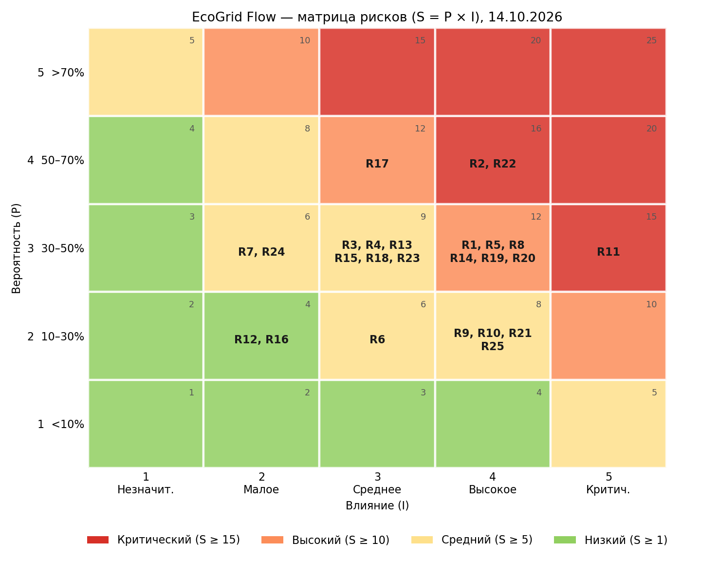

# Семинар 6. Управление рисками EcoGrid Flow: реестр, матрица, план реагирования

**Версия документа:** `v1.2` (15.10.2026)  
**Статус:** На согласовании (обзор на контрольной точке 23.10.2026)  
**Владелец документа:** Богдан Леонов (Team Lead / PO)

---

## 🎯 Цель работы
Найти, оценить и взять под контроль риски, которые могут помешать выпустить **Release 0.5** к 18.12.2026: собрать риски по восьми категориям, отдельно разобрать риски данных, оценить вероятность и влияние каждого, рассчитать приоритет, выбрать стратегию и владельца, задать индикаторы раннего предупреждения и завести задачи по снижению самых опасных рисков.

**Что делает сервис (чтобы было понятно, о чем риски).** Каждый день сервис загружает с биржи ENTSO-E цены на электроэнергию на завтра для трех энергозон — Германия-Люксембург (`DE-LU`), Финляндия (`FI`), Швеция (`SE3`) — и прогноз погоды Open-Meteo для трех дата-центров. Данные проходят проверку качества и сохраняются в PostgreSQL. По ним оптимизатор выбирает, когда и в каком дата-центре дешевле всего запустить тяжелую вычислительную задачу, не нарушая ее дедлайн, и возвращает ответ через API и веб-интерфейс. Если свежих цен нет, сервис считает по запасной схеме — по медиане цен за те же дни трех прошлых недель. Все работает внутри закрытой сети клиента: наружу сервис обращается только к двум источникам данных.

**Как устроен план (из семинара 5).** До релиза проект проходит контрольные точки раз в две недели. На каждой проверяем, что готов определенный результат:

| Дата | Что должно быть готово |
| :---: | :--- |
| 23.10.2026 | Данные поступают: схема базы, загрузчики цен и погоды, проверка качества, CI |
| 06.11.2026 | Расчетное ядро считает: оптимизатор, модель охлаждения, архив за 3 года, расчет экономии на истории |
| 20.11.2026 | Полный сценарий работает через API: весь сервис поднимается в Docker одной командой |
| 04.12.2026 | Заморозка функций: веб-интерфейс готов, нагрузочный тест пройден; дальше только исправление ошибок |
| 11.12.2026 | Кандидат в релиз: приемочные тесты, инструкция по эксплуатации, резервное копирование |
| 18.12.2026 | **Release 0.5** |

Неделя между 11.12 и 18.12 — **запасная**, на непредвиденное.

**Обозначения:**

| Обозначение | Что означает |
| :---: | :--- |
| `RISK-n` (`Rn` на матрице) | Номер риска в реестре. RISK-1…RISK-5 — те же риски, что в семинаре 5, остальные добавлены здесь |
| **P** | Вероятность, что риск наступит до релиза, балл 1–5 |
| **I** | Влияние на проект, если риск наступил, балл 1–5 |
| **S** | Балл риска, S = P × I (от 1 до 25) |
| `KRI-n` | Индикатор раннего предупреждения: число, которое мы регулярно смотрим, чтобы заметить риск заранее |
| `RT-nn` | Задача по снижению риска |

---

## 📋 Содержание
1. [Как оцениваем риски](#1-как-оцениваем-риски)
2. [Реестр рисков](#2-реестр-рисков)
3. [Матрица рисков](#3-матрица-рисков)
4. [План реагирования на риски](#4-план-реагирования-на-риски)
5. [Индикаторы раннего предупреждения](#5-индикаторы-раннего-предупреждения)
6. [Задачи по снижению рисков](#6-задачи-по-снижению-рисков)
7. [Как следим за рисками](#7-как-следим-за-рисками)

---

## 1. Как оцениваем риски

Каждый риск записываем цепочкой **«причина → событие → последствие»**. Так видно, на что действует каждая мера: одни меры убирают причину (риск становится менее вероятным), другие смягчают последствия.

### 1.1. Вероятность (P)
Насколько вероятно, что событие произойдет **до релиза 18.12.2026**, если ничего не делать.

| P | Уровень | Вероятность | Как понять |
| :---: | :--- | :---: | :--- |
| 1 | Очень низкая | < 10% | Не ожидаем; такого у нас не было |
| 2 | Низкая | 10–30% | Может случиться, если не повезет |
| 3 | Средняя | 30–50% | Обычное дело для учебных проектов, или уже были первые признаки |
| 4 | Высокая | 50–70% | Скорее случится: причина уже есть |
| 5 | Очень высокая | > 70% | Почти наверняка; по сути это уже проблема |

### 1.2. Влияние (I)
Насколько плохо станет проекту, если риск наступил. Смотрим на три стороны: сроки, функции и ошибки, данные и безопасность. Если последствия попадают в разные строки, берем **самую тяжелую**.

| I | Уровень | Сроки | Функции и ошибки | Данные и безопасность |
| :---: | :--- | :--- | :--- | :--- |
| 1 | Незначительное | Работа сдвинулась меньше чем на день, контрольная точка не сдвигается | Мелкая недоработка, которую пользователь почти не заметит | Единичный пропуск данных, система восстановила его сама |
| 2 | Малое | Контрольная точка сдвигается на 1–3 рабочих дня, дата релиза не под угрозой | Из релиза выпадает **желательная** функция, например карта энергозон; ошибка мешает, но ее можно обойти | Данные за сутки пропали, их догрузили в течение 24 ч |
| 3 | Среднее | Контрольная точка сдвигается больше чем на 3 рабочих дня, но дату релиза еще можно удержать за счет запасной недели | Из релиза выпадает **важная, но не обязательная** функция, например учет погоды или запасной расчет; сервис работает медленнее заявленного | Неверные данные попали в базу, но их нашли и исправили до того, как по ним что-то посчитали |
| 4 | Высокое | Задерживается работа, от которой напрямую зависит дата релиза, или съедено больше половины запасной недели | Под угрозой **обязательная** функция или один из критериев приемки релиза; ошибка ломает основной сценарий | По неверным данным уже посчитаны рекомендации или отчет; не набираются 14 суток загрузки без ручного вмешательства или не проходит проверка сетевой изоляции |
| 5 | Критическое | Release 0.5 не готов к 18.12.2026 | Пользователь получает неверную рекомендацию, например запуск, который заканчивается позже его дедлайна | Данные клиента уходят за пределы его сети |

**Пояснения к таблице:**
* **Обязательная, важная и желательная функции.** Все требования к сервису разделены по важности. Без обязательных функций релиза нет; важные должны быть, но релиз без них возможен; желательные делаем, если хватит времени.
* **Работы, от которых зависит дата релиза:** схема базы → загрузчик цен → оптимизатор → API рекомендаций → весь сервис в Docker → приемочные тесты → выпуск релиза. Опоздание любой из них сдвигает релиз. Остальные работы можно немного задержать без последствий для даты.
* **Критерии приемки релиза** — условия, при которых преподаватель принимает Release 0.5:
  1. Все обязательные и важные функции сделаны, у каждой есть автотест.
  2. Четыре приемочных сценария проходят автоматически.
  3. В базе есть архив цен и погоды за 3 года, и загрузка новых данных проработала 14 суток подряд без ручного вмешательства.
  4. Ядро покрыто тестами не меньше чем на 80%, открытых серьезных ошибок нет, нагрузочный тест пройден.
  5. Сервис разворачивается на чистой машине по инструкции за 15 минут, восстановление базы из копии проверено.
  6. Сервис обращается наружу только к двум разрешенным сайтам, в репозитории нет секретов.
  7. Релиз оформлен в Git.
  8. Проведено демо заказчику и готов отчет, который подтверждает или опровергает экономию.
* **Серьезность ошибок.** *Critical* — сервис выдает неверный результат или не работает основной сценарий; с такой ошибкой релиз не выпускается. *High* — основной сценарий работает, но важная функция сломана, и обойти это нельзя. Остальные ошибки на оценку рисков не влияют.

### 1.3. Приоритет
**Балл риска S = P × I.** От балла зависит, что мы обязаны делать с риском:

| S | Уровень | Что делаем | Как часто пересматриваем |
| :---: | :--- | :--- | :--- |
| **15–25** | 🔴 **Критический** | Заводим задачи по снижению в «Сфере»; статус риска — в каждом еженедельном отчете; если сработал триггер, руководитель проекта принимает решение в течение 24 ч | Каждую неделю |
| **10–14** | 🟠 **Высокий** | Заводим задачи по снижению в «Сфере»; владелец проверяет триггер каждую неделю | Каждую неделю |
| **5–9** | 🟡 **Средний** | Меры описаны в плане и выполняются в рамках уже запланированных работ | На каждой контрольной точке |
| **1–4** | 🟢 **Низкий** | Принимаем риск и следим за триггером | На каждой контрольной точке |

**Если баллы равны,** выше ставим риск с большим влиянием, а при равном влиянии — тот, который может наступить раньше.

### 1.4. Стратегии

| Стратегия | Когда выбираем | Пример из реестра |
| :--- | :--- | :--- |
| **Избежать** | Причину можно убрать проектным решением, и это дешевле, чем жить с риском | RISK-18: дубли невозможны, если хранить время только в UTC и запретить в базе две цены на один момент времени |
| **Снизить** | Причину не убрать, но можно сделать риск менее вероятным или менее болезненным | RISK-22: держать загрузку данных на постоянно включенном компьютере и догружать пропущенные сутки автоматически |
| **Принять** | Меры обойдутся дороже ущерба, или ущерб допустим. Можно принять *активно* (заранее готов план Б) или *пассивно* (только следим) | RISK-7: если окажется, что сервис экономит меньше 10%, это допустимый итог. Для приемки релиза достаточно честного отчета, неважно, подтверждает он гипотезу или опровергает |
| **Передать** | Есть сторона, которая лучше управляет причиной и отвечает за нее | RISK-24: за работу автоматических проверок (CI) в «Сфере» отвечает поддержка платформы, а не команда |

### 1.5. Владелец риска
У каждого риска ровно **один** владелец. Он следит за триггером, сообщает статус риска в еженедельном отчете и запускает план реагирования. Делать все меры сам владелец не обязан: исполнители задач указаны в разделе 6. Владельцем назначаем того, кто отвечает за соответствующую часть проекта.

**Команда:** Богдан Леонов — руководитель проекта, загрузка данных; Александр Зейферт — бэкенд, база, Docker, CI; Арина Антонова — анализ данных и расчетное ядро; Максим Томов — веб-интерфейс; Григорий Витрик — тестирование и качество данных.

---

## 2. Реестр рисков

**Дата оценки:** 15.10.2026. **Всего рисков:** 25, из них рисков данных — 6, критических — 3, высоких — 7.

### 2.1. Реестр

| ID | Категория | Риск: причина → событие → последствие | P | I | S | Уровень | Стратегия | Владелец | Триггер (ранний сигнал) |
| :---: | :--- | :--- | :---: | :---: | :---: | :---: | :--- | :---: | :--- |
| **RISK-6** | Требования | Появляются новые пожелания (дашборд экономии, учет CO₂, карта) или правки уже согласованных требований → объем работ растет, а план не пересматривается → команда перегружена, контрольные точки сдвигаются | 2 | 3 | 6 | 🟡 Средний | Избежать | Богдан | Кто-то взял в работу задачу, которой нет в плане и которую не согласовали как изменение; больше одного запроса на изменение за 2 недели |
| **RISK-7** | Требования | Цены в течение суток в Германии, Финляндии и Швеции за последний год колеблются меньше, чем мы ожидали → сервис экономит меньше 10% по сравнению с лучшим фиксированным временем запуска → главную бизнес-гипотезу проекта не удается подтвердить, демо выглядит слабее | 3 | 2 | 6 | 🟡 Средний | Принять | Арина | Пробный расчет на 3 месяцах архива показывает экономию меньше 10% |
| **RISK-2** | Команда | Вся команда учится в одной группе, поэтому контрольные, зачеты и экзамены у всех в одни и те же недели конца ноября и декабря → в эти недели проседает вся команда сразу, и подменить друг друга некому → тестирование и подготовка к эксплуатации не готовы к кандидату в релиз 11.12 | 4 | 4 | **16** | 🔴 Критический | Снизить | Богдан | **KRI-1**: две недели подряд отработано меньше 70% запланированных часов |
| **RISK-4** | Команда | Команда мало работала с частью технологий: React и TypeScript, BDD-тесты на `pytest-bdd`, разбиение таблиц PostgreSQL на партиции → задачи долго висят «в работе» → контрольные точки сдвигаются | 3 | 3 | 9 | 🟡 Средний | Снизить | Богдан | **KRI-3**: задача «в работе» больше 5 рабочих дней, а кода на ревью нет |
| **RISK-10** | Команда | Знания сосредоточены у одного человека: у Александра — база, Docker и CI, у Арины — расчетное ядро → если кто-то из них заболеет или выпадет, встает целая часть проекта | 2 | 4 | 8 | 🟡 Средний | Снизить | Александр | Участник недоступен больше 3 рабочих дней; изменения в чьей-то части проекта никто, кроме автора, не проверяет |
| **RISK-8** | Сроки | Сроки на оптимизатор и API рекомендаций оценены на глаз → эти работы занимают больше времени, а от них напрямую зависит дата релиза → контрольные точки 06.11 и 20.11 сдвигаются, запасная неделя тратится | 3 | 4 | 12 | 🟠 Высокий | Снизить | Арина | На середине срока на оптимизатор потрачено больше 150% оценки; прогноз готовности ядра позже 06.11 |
| **RISK-9** | Сроки | Защиту Release 0.5 назначают раньше 18.12 → запасной недели нет → последние работы (приемочные тесты, инструкция, резервное копирование) не успевают | 2 | 4 | 8 | 🟡 Средний | Снизить | Богдан | Преподаватель не подтвердил дату защиты до 23.10 или назначил ее раньше 18.12 |
| **RISK-3** | Технологии | Выборка цен и перебор окон запуска на Python работают медленнее, чем нужно → API отвечает дольше 200 мс при 50 запросах в секунду → не выполняется требование к скорости, а это один из критериев приемки | 3 | 3 | 9 | 🟡 Средний | Снизить | Александр | На тестовых прогонах в ноябре ответ дольше 150 мс |
| **RISK-11** | Технологии | В коде путают время UTC и местное, не учитывают переход на летнее и зимнее время (в такие сутки 23 или 25 часов) или день, когда цены сменили шаг с часа на 15 минут → окно запуска считается со сдвигом → сервис рекомендует запуск, который заканчивается позже дедлайна задачи, или считает стоимость по чужим ценам | 3 | 5 | **15** | 🔴 Критический | Снизить | Арина | Любой тест или расчет, где рекомендованный запуск заканчивается позже дедлайна; за сутки перехода загружено не 23 или 25 часов (92 или 100 интервалов по 15 минут); ближайший переход на зимнее время в живой загрузке — **25.10.2026** |
| **RISK-12** | Технологии | Ноутбукам не хватает мощности, чтобы одновременно держать весь сервис и генератор нагрузки → результат нагрузочного теста искажен | 2 | 2 | 4 | 🟢 Низкий | Принять | Григорий | На пробном прогоне генератор нагрузки загружает процессор больше чем на 80% или выдает ошибки |
| **RISK-1** | Интеграции | Ключ доступа к API ENTSO-E не выдали вовремя, отозвали или заблокировали → загрузчик цен и загрузка архива не получают данных → встает работа, от которой зависит дата релиза | 3 | 4 | 12 | 🟠 Высокий | Снизить | Богдан | Тестовый запрос не возвращает цены; в журнале загрузок ответ «нет доступа» (HTTP 401) |
| **RISK-5** | Интеграции | Части системы (загрузка данных, расчет, API, база) впервые соединяют поздно → ошибки на стыках находятся после 20.11 → не хватает времени исправить их до кандидата в релиз 11.12 | 3 | 4 | 12 | 🟠 Высокий | Снизить | Григорий | К 06.11 нет ни одного автоматического прогона «запрос в API → запись в базу» |
| **RISK-13** | Интеграции | У ENTSO-E есть ограничения: число запросов в минуту на один ключ, не больше года данных за один запрос, временная блокировка при превышении → архив цен за 3 года не загружен к 06.11 → расчет экономии на истории откладывается | 3 | 3 | 9 | 🟡 Средний | Снизить | Арина | Ответ «слишком много запросов» (HTTP 429) или блокировка ключа; за один запуск загружено меньше года по одной зоне |
| **RISK-14** | **Данные** | Источник меняет формат: ENTSO-E выпускает новую версию XML, цены переходят с часового шага на 15-минутный (для цен на сутки вперед это уже произошло 01.10.2025, в архиве есть оба варианта), Open-Meteo переименовывает поля погоды → программа загрузки падает или, что хуже, **молча** записывает неверные значения | 3 | 4 | 12 | 🟠 Высокий | Снизить | Григорий | В журнале загрузок ошибка разбора ответа, неизвестная версия формата или неизвестный шаг цен; проверка качества отклоняет данные источника 2 дня подряд |
| **RISK-15** | **Данные** | ENTSO-E или Open-Meteo не работают, публикуют цены на завтра позже 14:00 по центральноевропейскому времени или отдают пустой ответ → к 14:30 нет цен на завтра → сервис считает рекомендации по запасной схеме; если сбой длится несколько суток, ошибка такой оценки может превысить допустимые 15% | 3 | 3 | 9 | 🟡 Средний | Снизить | Арина | **KRI-2**: к 14:30 нет цен на завтра; прогноз погоды старше 3,5 часа |
| **RISK-16** | **Данные** | С переходом на 15-минутный шаг строк с ценами в 4 раза больше (96 в сутки на зону вместо 24), а таблица рекомендаций при рабочей нагрузке растет до 3,65 млн строк в год → выборка цен за 48 часов идет дольше 10 мс, база занимает больше места | 2 | 2 | 4 | 🟢 Низкий | Принять | Александр | План запроса показывает, что PostgreSQL читает все партиции, а не только нужные; запрос дольше 10 мс на тестовом прогоне; база больше 1 ГБ |
| **RISK-17** | **Данные** | Реальные данные устроены сложнее, чем кажется. ENTSO-E в сжатом формате (кривая A03) не повторяет подряд идущие одинаковые цены, и кажется, что данных не хватает. Отрицательные цены в Германии и Швеции — нормальное явление. В архиве есть рыночные аномалии, например −500 €/МВт·ч в Финляндии в ноябре 2023 из-за ошибочной заявки участника рынка. В погоде бывают выбросы и пропуски → проверка качества либо отклоняет правильные данные, либо пропускает ошибочные → оптимизатор и расчет экономии считают по неверным ценам | 4 | 3 | 12 | 🟠 Высокий | Снизить | Григорий | За неделю отклонено больше 5% партий; партия отклонена как неполная, хотя после восстановления пропущенных повторов в ней есть все интервалы |
| **RISK-18** | **Данные** | Загрузчик запустили повторно или он сам повторил запрос; годовые куски архива пересекаются; осенью при переводе часов один час повторяется, если хранить местное время; за одни сутки пришли цены с двумя разными шагами → в базе дубли цен → медиана для запасного расчета и стоимость окна искажаются | 3 | 3 | 9 | 🟡 Средний | Избежать | Александр | Проверочный запрос находит больше одной цены на одну зону и один момент времени; в сутках больше 100 интервалов |
| **RISK-19** | **Данные** | Загрузка сбоит тихо: плановый запуск не произошел (контейнер остановлен, компьютер выключен), отклоненную партию никто не перезапросил, запись в базу упала без повтора → дыры в данных замечают через несколько дней → цены неполные, и не выполняется критерий приемки о полном архиве и 14 сутках загрузки без ручного вмешательства | 3 | 4 | 12 | 🟠 Высокий | Снизить | Богдан | **KRI-2**: за 7 суток пропущен хотя бы один плановый запуск, или есть сутки с неполными ценами, которые не догружены за 24 ч |
| **RISK-20** | Безопасность | Секреты утекают в репозиторий или логи. Ключ ENTSO-E передается прямо в адресе запроса (параметр `securityToken`) и попадает в лог вместе с адресом. Ключ нашего API и пароль базы могут попасть в коммит. База открыта на всю локальную сеть (порт 5432 на всех интерфейсах) с паролем по умолчанию из `.env.example` → ключ ENTSO-E могут отозвать (см. RISK-1), к базе может подключиться посторонний, проверка безопасности перед релизом не проходит | 3 | 4 | 12 | 🟠 Высокий | Снизить | Александр | Сканер секретов `gitleaks` что-то нашел; в логах встречается `securityToken=`; `docker compose ps` показывает `0.0.0.0:5432` |
| **RISK-21** | Безопасность | Веб-интерфейс подгружает что-то из интернета: библиотеки с CDN, шрифты, подложку для карты → браузер пользователя из закрытой сети клиента обращается к внешним сайтам → нарушается главный принцип продукта (никаких обращений за пределы сети клиента, кроме двух источников данных), проверка сетевой изоляции перед релизом не проходит | 2 | 4 | 8 | 🟡 Средний | Избежать | Максим | В собранном фронтенде или во вкладке Network браузера есть запросы куда-то, кроме нашего сервера |
| **RISK-22** | Эксплуатация | Загрузка данных работает на ноутбуках, которые выключают и закрывают → плановые запуски пропускаются → к релизу не набираются обязательные 14 суток загрузки подряд без ручного вмешательства | 4 | 4 | **16** | 🔴 Критический | Снизить | Максим | **KRI-2**; к 06.11 не выбран компьютер, который работает постоянно |
| **RISK-23** | Эксплуатация | Docker-образы ведут себя по-разному на Mac с процессором Apple и на обычном Linux-сервере, версии образов и библиотек не закреплены, часть шагов установки никто не записал → не получается развернуть сервис на чистой машине за 15 минут без ручных действий, а это критерий приемки | 3 | 3 | 9 | 🟡 Средний | Снизить | Максим | Пробная установка по инструкции на другой машине требует ручного шага или занимает больше 15 минут |
| **RISK-24** | Эксплуатация | Автоматические проверки в «Сфере» (CI) не работают или ограничены → изменения вливаются без тестов → ошибки попадают в основную ветку `develop` | 3 | 2 | 6 | 🟡 Средний | Передать | Александр | Проверки не запускаются больше суток или ждут в очереди больше часа |
| **RISK-25** | Эксплуатация | Данные базы на ноутбуке теряются (сломался диск, кто-то выполнил `docker compose down -v` или переустановил Docker), а резервное копирование по плану появится только в декабре → пропадает загруженный архив за 3 года и журнал загрузок, 14 суток загрузки для релиза приходится набирать заново | 2 | 4 | 8 | 🟡 Средний | Снизить | Григорий | После 06.11 нет копии базы моложе 7 суток |

### 2.2. Риски данных: все аспекты из задания

| Аспект | Риск | Как это выглядит у нас | Главная мера |
| :--- | :---: | :--- | :--- |
| Изменение схемы данных | **RISK-14** | Новая версия XML у ENTSO-E, смена шага цен, переименование полей погоды у Open-Meteo | Тесты программы загрузки на сохраненных настоящих ответах; на незнакомый формат — явная ошибка, данные не записываются (RT-08) |
| Недоступность источника | **RISK-15** | Сбой или поздняя публикация цен, пустой ответ, лимиты Open-Meteo | Повторные запросы до 14:30, затем запасной расчет по медиане трех прошлых недель |
| Рост объема | **RISK-16** | 96 строк цен в сутки на зону вместо 24, рост таблицы рекомендаций | Таблицы разбиты на партиции по месяцам, следим за скоростью запросов |
| Ошибки качества | **RISK-17** | Сжатый формат с пропущенными повторами, отрицательные и аномальные цены, выбросы в погоде | Правила проверки под реальные данные, тесты на настоящих партиях (RT-09) |
| Дубли | **RISK-18** | Повторные запуски, пересечение кусков архива, осенний перевод часов | Время только в UTC, в базе запрещены две цены на один момент, повторная запись обновляет строку, а не добавляет новую |
| Потеря и задержка данных | **RISK-19**, **RISK-22**, **RISK-25** | Пропущенные запуски, неперезапрошенные партии, выключенный компьютер, потеря базы | Журнал запусков, ежедневная сверка полноты и автоматический повтор (RT-10), постоянно включенный компьютер и догрузка пропущенного (RT-04), ранняя копия базы (RT-12) |

### 2.3. Сводка по категориям

| Категория | Риски | Сколько | Самый высокий уровень |
| :--- | :--- | :---: | :---: |
| Требования | RISK-6, RISK-7 | 2 | 🟡 |
| Сроки | RISK-8, RISK-9 | 2 | 🟠 |
| Команда | RISK-2, RISK-4, RISK-10 | 3 | 🔴 |
| Технологии | RISK-3, RISK-11, RISK-12 | 3 | 🔴 |
| Интеграции | RISK-1, RISK-5, RISK-13 | 3 | 🟠 |
| **Данные** | RISK-14 … RISK-19 | **6** | 🟠 |
| Безопасность | RISK-20, RISK-21 | 2 | 🟠 |
| Эксплуатация | RISK-22 … RISK-25 | 4 | 🔴 |
| **Итого** | | **25** | |

**Что изменилось по сравнению с семинаром 5.** Там было пять рисков с оценками «средне / высоко». Теперь они оценены по шкале 1–5: RISK-1 и RISK-5 — 3 × 4, RISK-2 — 4 × 4 (теперь критический), RISK-3 и RISK-4 — 3 × 3. Риски RISK-6…RISK-25 новые.

---

## 3. Матрица рисков

*Рисунок 1. Матрица «вероятность × влияние». По горизонтали — влияние, по вертикали — вероятность. В углу клетки — балл S = P × I, цвет — уровень риска.*

**То же в виде таблицы** (`Rn` = `RISK-n`):

| Вероятность \ Влияние | 1 — Незначит. | 2 — Малое | 3 — Среднее | 4 — Высокое | 5 — Критич. |
| :---: | :---: | :---: | :---: | :---: | :---: |
| **5 (> 70%)** | 🟡 · | 🟠 · | 🔴 · | 🔴 · | 🔴 · |
| **4 (50–70%)** | 🟢 · | 🟡 · | 🟠 **R17** | 🔴 **R2, R22** | 🔴 · |
| **3 (30–50%)** | 🟢 · | 🟡 R7, R24 | 🟡 R3, R4, R13, R15, R18, R23 | 🟠 **R1, R5, R8, R14, R19, R20** | 🔴 **R11** |
| **2 (10–30%)** | 🟢 · | 🟢 R12, R16 | 🟡 R6 | 🟡 R9, R10, R21, R25 | 🟠 · |
| **1 (< 10%)** | 🟢 · | 🟢 · | 🟢 · | 🟢 · | 🟡 · |

### 3.1. Десять самых опасных рисков

| Место | Риск | Кратко | P × I = S | Уровень | Когда может наступить | Владелец | Задачи |
| :---: | :---: | :--- | :---: | :---: | :--- | :---: | :--- |
| 1 | **RISK-22** | Загрузка на ноутбуках не набирает 14 суток без сбоев | 4 × 4 = 16 | 🔴 | С 06.11 до релиза | Максим | RT-04, RT-05 |
| 2 | **RISK-2** | Мало времени у команды в конце семестра | 4 × 4 = 16 | 🔴 | С 04.12 до релиза | Богдан | RT-02 |
| 3 | **RISK-11** | Ошибки со временем нарушают дедлайн | 3 × 5 = 15 | 🔴 | С 23.10 до релиза | Арина | RT-03 |
| 4 | **RISK-1** | Нет ключа ENTSO-E | 3 × 4 = 12 | 🟠 | До 23.10 | Богдан | RT-01 |
| 5 | **RISK-20** | Секреты в репозитории и логах | 3 × 4 = 12 | 🟠 | Уже сейчас и до релиза | Александр | RT-11 |
| 6 | **RISK-14** | Источник меняет формат данных | 3 × 4 = 12 | 🟠 | С 23.10 до релиза | Григорий | RT-08 |
| 7 | **RISK-19** | Тихие потери и задержки данных | 3 × 4 = 12 | 🟠 | С 23.10 до релиза | Богдан | RT-10, RT-05 |
| 8 | **RISK-8** | Оптимизатор и API займут больше времени | 3 × 4 = 12 | 🟠 | Конец октября — 20.11 | Арина | RT-07 |
| 9 | **RISK-5** | Ошибки на стыках частей системы найдутся поздно | 3 × 4 = 12 | 🟠 | 20.11 — 11.12 | Григорий | RT-06 |
| 10 | **RISK-17** | Ошибки качества в реальных данных | 4 × 3 = 12 | 🟠 | 23.10 — 06.11 | Григорий | RT-09 |

**Что видно по матрице:**
* В красной зоне три риска, и все они о том, что релиз «работает на бумаге, но не в жизни»: загрузка данных не живет 14 суток (RISK-22), команде не хватает часов в конце семестра (RISK-2), оптимизатор нарушает дедлайн на переводе часов (RISK-11).
* Больше всего рисков в клетке «вероятность 3, влияние 4» — шесть. Почти все они могут наступить уже после 23.10, когда заработает загрузка данных. Поэтому задачи по ним стоят на 23.10 и 06.11.
* В верхней строке (вероятность 5) пусто: известные проблемы, например смена шага цен и отсутствие постоянного компьютера, уже учтены в плане. Если мера по такому риску не будет выполнена в срок, его вероятность поднимаем до 5.

---

## 4. План реагирования на риски

### 4.1. Критические и высокие риски

По каждому риску расписано три вещи:
* **меры заранее** — что делаем уже сейчас, чтобы риск стал менее вероятным или менее болезненным;
* **план Б** — что делаем, если сработал триггер;
* **оценка после мер** — какими станут вероятность и влияние, когда меры выполнены.

#### 🔴 RISK-22. Загрузка данных на ноутбуках не набирает 14 суток без сбоев — владелец Максим
* **Стратегия:** снизить.
* **Меры заранее:**
  1. До **06.11** выбрать компьютер, который работает постоянно, для загрузки данных и базы: стационарный компьютер кого-то из команды или мини-ПК. Docker стартует сам при включении, сон отключен. Какой это компьютер и как он настроен, записываем в инструкцию по эксплуатации (RT-04).
  2. Научить загрузку догонять пропущенное: после перезапуска она сама догружает все пропущенные сутки. Повторная запись тех же данных не создает дублей, поэтому перерыв в работе компьютера не оставляет дыр (RT-04).
  3. Контейнеры перезапускаются сами после сбоя и регулярно проверяют свое состояние.
  4. Каждый день запускать проверку журнала загрузок `make etl-check` (RT-05), итог за неделю публиковать в еженедельном отчете (KRI-2).
  5. Отсчет 14 суток начать **не позднее 20.11**. Тогда, если отсчет прервется, останется время начать заново до 04.12.
* **План Б:** если отсчет прервался, записываем причину и начинаем заново. Последний день, когда можно начать и успеть к 18.12, — **04.12**. Если к этой дате постоянного компьютера нет или отсчет не начат, руководитель проекта просит преподавателя выделить машину. Если машины нет, обсуждаем с преподавателем, засчитывается ли 14 суток с автоматической догрузкой пропусков.
* **Оценка после мер:** 2 × 4 = 8 (🟡).

#### 🔴 RISK-2. Мало времени у команды в конце ноября и в декабре — владелец Богдан
* **Стратегия:** снизить.
* **Меры заранее:**
  1. Взять расписание контрольных, зачетов и экзаменов группы — оно одно на всю команду. В эти недели закладываем в план меньше часов сразу для всех (RT-02).
  2. Работы, которые по плану попадают на эти недели, по возможности переносим раньше: начинаем их, пока у команды есть время (RT-02).
  3. Резерв часов тратим **до** зачетов, а не в них: в зачетные недели подменить друг друга некому, потому что заняты все.
  4. С 04.12 новых функций не добавляем, только исправляем ошибки (это уже есть в плане).
  5. **Заранее** договариваемся, что выбрасываем первым, если не успеваем: сначала карту энергозон в интерфейсе; затем в отчете об экономии оставляем только выигрыш от выбора времени, без выигрыша от выбора дата-центра; затем автотест интерфейса заменяем ручной проверкой по списку.
* **План Б:** если отработано меньше 70% часов две недели подряд, в течение суток собираемся всей командой. Перераспределять работу бесполезно, поэтому руководитель проекта выбрасывает работы по заранее согласованному порядку и записывает решение в журнал изменений плана семинара 5.
* **Оценка после мер:** 3 × 3 = 9 (🟡).

#### 🔴 RISK-11. Ошибки со временем нарушают дедлайн — владелец Арина
* **Стратегия:** снизить.
* **Меры заранее:**
  1. Правило для всего кода: внутри системы время хранится и считается только в UTC. В местное время переводим только при выдаче наружу: в ответе API и в интерфейсе. Проверяем это на ревью кода ядра.
  2. Автотесты, которые прогоняют оптимизатор на тысяче случайных задач и каждый раз проверяют три вещи (RT-03):
     * запуск заканчивается не позже дедлайна;
     * длина окна равна длительности задачи;
     * окно не разбито на части.
  3. Тесты на настоящих днях перевода часов из архива: 29.10.2023, 31.03.2024, 27.10.2024, 30.03.2025, 26.10.2025, 29.03.2026. Отдельный тест — на 30.09–01.10.2025, когда цены сменили шаг с часа на 15 минут (RT-03).
  4. Последняя проверка перед ответом API: если запуск заканчивается позже дедлайна, рекомендация не отдается, а в лог пишется ошибка.
  5. Отдельно проверить данные живой загрузки за **25–26.10.2026**: это первый перевод часов после запуска загрузчика.
* **План Б:** если хоть раз запуск закончился позже дедлайна, это ошибка уровня Critical, и до ее исправления контрольная точка не пройдена. Исправляем ошибку, добавляем тест на этот случай и заново прогоняем основной приемочный сценарий.
* **Оценка после мер:** 1 × 5 = 5 (🟡).

#### 🟠 RISK-1. Нет ключа доступа к ENTSO-E — владелец Богдан
* **Стратегия:** снизить.
* **Меры заранее:** проверить ключ тестовым запросом цен по трем зонам. Получить **второй ключ** на аккаунт Арины: им загружаем архив, и он же служит запасным для ежедневной загрузки (RT-01). Ключи храним только в файле `.env`, который не попадает в репозиторий (см. RISK-20). Пока доступа нет, разрабатываем на сохраненных примерах ответов.
* **План Б:** если доступа к API нет, архив выгружаем вручную в CSV с сайта ENTSO-E и загружаем через ту же проверку качества. Ежедневную загрузку переключаем на второй ключ.
* **Оценка после мер:** 2 × 4 = 8 (🟡).

#### 🟠 RISK-20. Секреты в репозитории и логах — владелец Александр
* **Стратегия:** снизить.
* **Меры заранее (RT-11):**
  1. Сканер секретов `gitleaks` проверяет каждый коммит на компьютере разработчика и в CI. Подключаем его сейчас, а не в конце ноября, как было в плане.
  2. Логи автоматически скрывают значения `securityToken`, `Authorization` и `password`, в том числе внутри адресов запросов.
  3. Порт базы в `docker-compose.yml` открываем только для своего компьютера (`127.0.0.1`). Пароль из `.env.example` используем только при разработке, на постоянном компьютере для загрузки (RISK-22) ставим сгенерированный.
* **План Б:** если секрет утек, в тот же день отзываем и перевыпускаем ключ ENTSO-E и меняем пароли. Случай записываем в еженедельный отчет.
* **Оценка после мер:** 1 × 4 = 4 (🟢).

#### 🟠 RISK-14. Источник меняет формат данных — владелец Григорий
* **Стратегия:** снизить.
* **Меры заранее:**
  1. Тесты программы загрузки на **сохраненных настоящих ответах** ENTSO-E: часовые цены, 15-минутные, сжатый формат с пропущенными повторами, ответ с несколькими рядами цен, ответ «данных нет». Плюс сохраненный ответ Open-Meteo (RT-08).
  2. Программа загрузки проверяет версию формата и шаг цен. Если они незнакомые, данные не записываются, а в лог пишется понятная ошибка «формат источника изменился» (RT-08).
  3. Адрес API Open-Meteo и список полей погоды хранятся в настройках, а не в коде: при переименовании поля правим только настройку.
* **План Б:** загрузка помечает источник как неисправный, и сервис считает по запасной схеме. Программу загрузки исправляем, добавляем тест на новый формат, пропущенные сутки догружаем.
* **Оценка после мер:** 2 × 3 = 6 (🟡).

#### 🟠 RISK-19. Тихие потери и задержки данных — владелец Богдан
* **Стратегия:** снизить.
* **Меры заранее:**
  1. Журнал запусков загрузки: время, источник, за какой период, успех или ошибка, сколько строк записано, почему отклонено.
  2. Ежедневная сверка полноты: сколько интервалов цен должно быть за сутки по каждой зоне (с учетом шага и перевода часов) и сколько есть на самом деле (RT-10).
  3. Пропущенные и отклоненные сутки запрашиваются заново автоматически, до 3 попыток. Если не вышло, в лог пишется ошибка (RT-10).
  4. Ежедневная проверка `make etl-check` (RT-05), итог — в еженедельном отчете (KRI-2).
* **План Б:** если нашли пропуск, догружаем его командой из инструкции по эксплуатации в течение суток и записываем в журнал качества данных. Каждый пропуск по вине источника должен быть записан, иначе не засчитываются 14 суток загрузки для релиза.
* **Оценка после мер:** 2 × 4 = 8 (🟡).

#### 🟠 RISK-8. Оптимизатор и API займут больше времени — владелец Арина
* **Стратегия:** снизить.
* **Меры заранее:**
  1. До **30.10** сделать быстрый прототип оптимизатора на настоящих ценах за месяц и замерить, сколько времени занимает расчет на 48 часов вперед для трех дата-центров.
  2. По итогам прототипа заново оценить оптимизатор и API тремя цифрами: оптимистично, реалистично, пессимистично. Оценки записать в журнал изменений плана (RT-07).
  3. Работу над оптимизатором разбить на задачи не больше 4 часов.
  4. API начать делать сразу, с заглушкой вместо ядра (RT-06).
* **План Б:** если работа заняла больше 150% оценки, упрощаем: дата-центр выбираем простым перебором всех трех, охлаждение считаем по часам. Тратим резерв часов. Максим делает веб-интерфейс, не дожидаясь готового API.
* **Оценка после мер:** 2 × 3 = 6 (🟡).

#### 🟠 RISK-5. Ошибки на стыках частей системы найдутся поздно — владелец Григорий
* **Стратегия:** снизить.
* **Меры заранее:**
  1. К **06.11** собрать «скелет» всей системы: база и API поднимаются в Docker, запрос на рекомендацию с заглушкой вместо ядра записывает задачу и рекомендацию в базу. Автотест этого сценария работает в CI (RT-06).
  2. К тому же сроку опубликовать точное описание ответа API, чтобы веб-интерфейс делался по нему.
  3. Приемочные сценарии «недостижимый дедлайн» и «аномальная цена» автоматизировать раньше, по мере готовности частей.
* **План Б:** если после 20.11 нашлись серьезные ошибки, новые функции не делаем, пока ошибки не исправлены. Максим подключается к исправлению.
* **Оценка после мер:** 2 × 4 = 8 (🟡).

#### 🟠 RISK-17. Ошибки качества в реальных данных — владелец Григорий
* **Стратегия:** снизить.
* **Меры заранее (RT-09):**
  1. Перед проверкой полноты восстанавливаем пропущенные повторы в сжатом формате ENTSO-E: пропущенная позиция получает цену предыдущей.
  2. Отрицательные цены считаются нормальными, если они в допустимых границах от −500 до +4000 €/МВт·ч.
  3. Проверяем, что валюта — евро, а единица — мегаватт-час. Погоду проверяем на физические границы (температура, влажность, ветер), короткие пропуски до 3 часов заполняем интерполяцией.
  4. Каждую отклоненную партию записываем в журнал с причиной.
  5. В отчете об экономии на истории составляем список известных рыночных аномалий и считаем экономию в двух вариантах: с ними и без них.
* **План Б:** если проверка ошибочно отклонила правильные данные, исправляем правило, добавляем тест на эту партию и догружаем отклоненные сутки. Если в базу попали неверные данные, удаляем партию, загружаем заново и пересчитываем отчет.
* **Оценка после мер:** 2 × 3 = 6 (🟡).

### 4.2. Средние и низкие риски

| Риск | S | Стратегия | Меры заранее | План Б | Владелец | Когда пересматриваем |
| :---: | :---: | :--- | :--- | :--- | :---: | :--- |
| **RISK-4** | 9 | Снизить | Работа в паре: Максим с Александром — по бэкенду на FastAPI, Максим с Григорием — по тестам. Григорий до 06.11 показывает пример BDD-теста, Александр — пример таблицы с партициями | Если задача висит больше 5 дней без кода на ревью, разбираем ее на встрече команды, и помогает тот, у кого есть запас времени | Богдан | На каждой контрольной точке |
| **RISK-13** | 9 | Снизить | Архив грузим кусками по году и по одной зоне, с паузами между запросами; для архива используем второй ключ (RT-01). Прогресс пишем в журнал, чтобы после остановки продолжить с того же места | Если пришло «слишком много запросов» или ключ заблокирован, ждем и продолжаем со следующего куска. Если не успеваем — выгружаем CSV вручную | Арина | 06.11 |
| **RISK-15** | 9 | Снизить | Повторяем запрос до 14:30; затем включается запасной расчет по медиане трех прошлых недель, и в ответе API стоит пометка, что это запасной расчет. Следим по KRI-2 | Если сбой длится больше 3 суток, ставим в отчете желтый статус, на демо показываем работу в запасном режиме. Насколько ошибается запасной расчет, проверяем заранее на архиве | Арина | На каждой контрольной точке |
| **RISK-18** | 9 | Избежать | В базе время только в UTC. В таблице цен запрещены две строки на одну зону и один момент времени, повторная запись обновляет существующую строку. На одну зону и одни сутки — один шаг цен. Куски архива не пересекаются | Если дубли нашлись, удаляем их, исправляем загрузчик и пересчитываем то, что от них зависело | Александр | 23.10, 06.11 |
| **RISK-3** | 9 | Снизить | Замеряем, где тратится время, к 20.11. Цены на 48 часов держим в памяти, расчет делаем векторно (numpy), в базе есть индекс по зоне и времени | Если к 04.12 ответ все еще дольше 200 мс — кешируем ответы на одинаковые запросы и заранее считаем коэффициенты охлаждения | Александр | 20.11, 04.12 |
| **RISK-23** | 9 | Снизить | Закрепить точные версии образов (`postgres:16.x`, `python:3.11-slim`), собирать образы и для Mac на процессоре Apple, и для обычных серверов. К 04.12 развернуть сервис по инструкции на второй машине | Если понадобился ручной шаг или ушло больше 15 минут, автоматизируем этот шаг и повторяем до 11.12 | Максим | 04.12, 11.12 |
| **RISK-9** | 8 | Снизить | До 23.10 уточнить у преподавателя дату и формат защиты | Если защита раньше 18.12, кандидат в релиз становится релизом, а работы последних двух недель сдвигаем на неделю раньше | Богдан | 23.10 |
| **RISK-10** | 8 | Снизить | Каждое изменение проверяет кто-то, кроме автора и не из его части проекта. Инструкция по эксплуатации и описание архитектуры — к 06.11. У каждого модуля есть README | Если участник выпал больше чем на неделю, его задачи переходят к тому, кто был консультантом по этой части | Александр | На каждой контрольной точке |
| **RISK-21** | 8 | Избежать | Все библиотеки и шрифты кладем в сборку фронтенда, без CDN. Для карты используем свой файл с границами зон, без внешней подложки. В nginx запрещаем браузеру загружать что-либо с чужих адресов | Если нашелся внешний запрос, переносим ресурс в сборку до 04.12 и повторяем проверку сетевой изоляции | Максим | 06.11, 04.12 |
| **RISK-25** | 8 | Снизить | Сразу после загрузки архива (к 06.11) делаем копию базы (`pg_dump`), потом раз в неделю до 11.12. Копии храним на двух компьютерах. Один раз проверяем, что база из копии восстанавливается (RT-12) | Если база пропала, восстанавливаем последнюю копию и догружаем недостающие сутки | Григорий | 06.11, 11.12 |
| **RISK-6** | 6 | Избежать | Любое изменение требований — только через оформленный запрос на изменение. После 04.12 новые функции не принимаем, пожелания записываем на второй семестр | Если изменение приняли, оцениваем, сколько часов оно стоит, и выбрасываем из плана столько же | Богдан | На каждой контрольной точке |
| **RISK-24** | 6 | Передать | Если CI не работает, пишем в поддержку «Сферы»: работоспособность платформы — их зона. Запасной вариант — запускать те же проверки локально командой `make check` | Если CI не работает больше суток, изменение вливается только с приложенным результатом `make check` и после проверки вторым участником | Александр | 23.10 |
| **RISK-7** | 6 | Принять (активно) | Способ расчета экономии зафиксирован заранее, до получения результатов: сравниваем с лучшим фиксированным временем запуска. Порог 10% уточняем 06.11. Отдельно считаем выигрыш от выбора дата-центра | Если экономия меньше порога, честно пишем это в отчете, а на демо делаем упор на выбор дата-центра и запасной режим. Критерий приемки при этом выполнен | Арина | 06.11 |
| **RISK-12** | 4 | Принять (пассивно) | Нагрузочный тест запускаем на самом мощном ноутбуке, генератор нагрузки по возможности — на другом. Конфигурацию записываем в отчет | Если генератор загружает процессор больше чем на 80%, повторяем тест с генератором на другой машине | Григорий | 20.11 |
| **RISK-16** | 4 | Принять (пассивно) | Таблицы разбиты на партиции по месяцам. В автотесте проверяем, что запрос за 48 часов читает только нужные партиции | Если запрос дольше 10 мс, добавляем индекс или заранее собираем данные на 48 часов | Александр | 20.11 |

---

## 5. Индикаторы раннего предупреждения

Три числа, по которым риск видно заранее. Они покрывают все критические риски и большинство высоких. Значения публикуем в разделе «Метрики» еженедельного отчета ([шаблон](../../status/TEMPLATE.md)). Цвет индикатора определяет цвет статуса «Риски» в отчете.

| KRI | Что измеряем | Как считаем и откуда берем | Как часто | 🟢 Норма | 🟡 Внимание | 🔴 Тревога | Риски |
| :---: | :--- | :--- | :---: | :--- | :--- | :--- | :--- |
| **KRI-1** | **Сколько времени команда реально тратит на проект** | Отработанные часы делим на запланированные, по каждому участнику и по команде. Часы берем из отметок в задачах «Сферы» | Раз в неделю, в пятницу | 80% и больше | 60–80%, или у одного участника меньше 50% | Меньше 60% за неделю или меньше 70% две недели подряд | RISK-2, RISK-4, RISK-10 |
| **KRI-2** | **Работает ли загрузка данных** | Три числа за 7 суток: (а) сколько суток цены на завтра загружены до 14:30; (б) сколько плановых запусков пропущено; (в) какая доля партий отклонена проверкой качества. Считает `make etl-check` по журналу загрузок и сверке полноты (RT-05, RT-10) | Каждый день автоматически, в отчете — итог за неделю | 7 из 7 суток вовремя, пропусков нет, отклонено не больше 5% | Одно опоздание или один пропуск, исправлен за сутки | Двое и более суток без цен к 14:30, пропуск не исправлен за сутки или отклонено больше 5% | RISK-14, RISK-15, RISK-17, RISK-18, RISK-19, RISK-22 |
| **KRI-3** | **Не отстают ли работы, от которых зависит дата релиза** | (а) Насколько сделанная работа (в часах по плану) отстает от того, что должно быть сделано к этой дате, в процентных пунктах. (б) Сколько рабочих дней самая старая задача из цепочки «схема базы → загрузчик цен → оптимизатор → API → сервис в Docker → приемочные тесты → релиз» находится «в работе». Данные — с доски «Сферы» | Раз в неделю | Отставание до 5 п. п., задача «в работе» до 5 дней | Отставание 5–10 п. п. или задача «в работе» 6–8 дней | Отставание больше 10 п. п., задача «в работе» больше 8 дней или ближайшая контрольная точка сдвигается больше чем на 3 рабочих дня | RISK-4, RISK-5, RISK-8, RISK-9 |

**Правила:**
* KRI-1 и KRI-3 считаем с этой недели. KRI-2 — с 23.10, когда заработает загрузка данных.
* Желтый цвет: владелец связанного риска на ближайшей встрече команды предлагает, что делать. Красный: запускаем план Б этого риска (раздел 4), и руководитель проекта принимает решение в течение суток.

---

## 6. Задачи по снижению рисков

Задачи есть у **всех** критических и высоких рисков, а также у одного среднего (RISK-25): там мера дешевая, а ущерб большой. В «Сфере» задачи заводятся с меткой `risk` и номером риска в описании; ключ задачи вписывается в последний столбец после создания.

| ID | Задача | Риск | Исполнитель | Срок | Как проверить, что сделано | Доп. часы | Ключ в «Сфере» |
| :---: | :--- | :---: | :---: | :---: | :--- | :---: | :---: |
| **RT-01** | Получить второй ключ ENTSO-E на аккаунт Арины, проверить оба ключа запросом цен по трем зонам | RISK-1 | Богдан | 23.10 | Оба ключа возвращают цены по Германии, Финляндии и Швеции; результат записан в еженедельный отчет; ключи только в `.env` | 1 | — |
| **RT-02** | Взять расписание контрольных, зачетов и экзаменов группы, пересчитать часы команды по неделям, перенести работы с этих недель раньше, утвердить порядок сокращения объема | RISK-2 | Богдан | 23.10 | Таблица часов по неделям опубликована в еженедельном отчете; у каждой работы, которая попадает на неделю зачетов или экзаменов, есть решение: перенесена раньше или стоит в списке на сокращение; порядок сокращения записан в журнал изменений плана | 1 | — |
| **RT-03** | Автотесты оптимизатора на случайных задачах и на днях перевода часов и смены шага цен | RISK-11 | Григорий (проверяет Арина) | 06.11 | В CI на каждом прогоне проверяется не меньше 1000 случайных задач по трем правилам из п. 4.1; тесты на 6 днях перевода часов и на 30.09–01.10.2025 проходят | 0 (входит в запланированные тесты ядра) | — |
| **RT-04** | Постоянно включенный компьютер для загрузки данных и базы; автоматическая догрузка пропущенных суток после перезапуска | RISK-22 | Максим (советуют Александр и Богдан) | 06.11 | Компьютер описан в инструкции по эксплуатации. Проверка: компьютер выключен на сутки, после включения пропущенные сутки загрузились без ручных действий, результат записан. Дата начала отсчета 14 суток записана в отчет | 3 | — |
| **RT-05** | Команда `make etl-check`: последний успешный запуск, пропуски за 7 суток, полнота цен на завтра, цвет KRI-2; раздел об этом в инструкции по эксплуатации | RISK-22, RISK-19 | Максим | 06.11 | Команда выдает «норма / внимание / тревога» по правилам KRI-2; итог за неделю попадает в еженедельный отчет | 2 | — |
| **RT-06** | «Скелет» системы: база и API в Docker, запрос на рекомендацию с заглушкой вместо ядра записывает задачу и рекомендацию в базу; автотест | RISK-5 | Александр (тест — Григорий) | 06.11 | Автотест «запрос в API → запись в базу» проходит в CI на ветке `develop` | 0 (входит в работу над API) | — |
| **RT-07** | Прототип оптимизатора на настоящих ценах и новая оценка оптимизатора и API тремя цифрами | RISK-8 | Арина | 30.10 | Прототип посчитан на ценах хотя бы за месяц; время расчета на 48 часов для трех дата-центров записано; оптимистичная, реалистичная и пессимистичная оценки внесены в журнал изменений плана | 0 (входит в работу над оптимизатором) | — |
| **RT-08** | Тесты программы загрузки на сохраненных настоящих ответах ENTSO-E и Open-Meteo; понятная ошибка при незнакомом формате | RISK-14 | Григорий (программа загрузки — Богдан) | 23.10 | Сохранено не меньше 5 ответов ENTSO-E (часовые цены, 15-минутные, сжатый формат, несколько рядов в ответе, «данных нет») и 1 ответ Open-Meteo. На незнакомый формат программа выдает ошибку и ничего не записывает. Тесты в CI | 0 (входит в подготовку тестовых данных) | — |
| **RT-09** | Правила проверки качества под реальные данные: восстановление пропущенных повторов, отрицательные цены, валюта и единицы, причины отклонения в журнале | RISK-17 | Григорий | 23.10 | Тесты на настоящих данных: партия с отрицательными ценами по Германии проходит; партия в сжатом формате проходит после восстановления; партия с ценой 9999 €/МВт·ч отклоняется, причина записана | 0 (входит в работу над проверкой качества) | — |
| **RT-10** | Ежедневная сверка полноты цен (по каждой зоне и суткам: сколько интервалов должно быть и сколько есть) и автоматический повтор пропущенных суток | RISK-19 | Максим (проверяет Богдан) | 06.11 | Сверка учитывает шаг цен и дни перевода часов; пропущенные сутки запрашиваются до 3 раз, потом в лог пишется ошибка; есть тест с искусственно созданным пропуском | 2 | — |
| **RT-11** | Защита секретов: `gitleaks` при коммите и в CI, скрытие ключей в логах, порт базы только для своего компьютера | RISK-20 | Александр | 23.10 | CI падает, если в коммите тестовый секрет; тест логгера: в логе запроса к ENTSO-E нет значения ключа; `docker compose ps` показывает `127.0.0.1:5432` | 0 (входит в настройку CI и безопасности) | — |
| **RT-12** | Копия базы сразу после загрузки архива, затем раз в неделю; один раз проверить восстановление | RISK-25 | Григорий | 06.11 | Копия лежит на двух компьютерах; база восстановлена из копии на пустой машине, число строк совпадает | 1 | — |

### 6.1. Хватит ли на это часов
Шесть задач (RT-03, RT-06…RT-09, RT-11) уже входят в запланированные работы и только уточняют, что значит «готово». Новой работы — **10 часов** (RT-01, RT-02, RT-04, RT-05, RT-10, RT-12). У каждого участника на проект до релиза 60 часов.

| Участник | Было по плану, ч | Задачи по рискам, ч | Стало, ч | Загрузка |
| :--- | :---: | :---: | :---: | :---: |
| Богдан | 51 | 2 | 53 | 88% |
| Александр | 54 | 0 | 54 | 90% |
| Арина | 53 | 0 | 53 | 88% |
| Максим | 44 | 7 | 51 | 85% |
| Григорий | 53 | 1 | 54 | 90% |
| **Команда** | **255** | **10** | **265** | **88%**, в резерве **35 ч (12%)** |

Резерв остается больше 10%. Если бы он упал ниже, по плану семинара 5 пришлось бы сокращать объем. Большую часть новых задач берет Максим: у Максима был самый большой запас. Задачи RT-04, RT-05, RT-10 связаны с инструкцией по эксплуатации, за которую Максим и так отвечает. Все они приходятся на октябрь и начало ноября, до зачетов. Работа в паре с Богданом и Александром заодно снижает RISK-4 и RISK-10.

### 6.2. У каждого высокого риска есть задача

| Риск | Уровень | Задачи | Срок первой задачи |
| :---: | :---: | :--- | :---: |
| RISK-22 | 🔴 | RT-04, RT-05 | 06.11 |
| RISK-2 | 🔴 | RT-02 | 23.10 |
| RISK-11 | 🔴 | RT-03 | 06.11 |
| RISK-1 | 🟠 | RT-01 | 23.10 |
| RISK-20 | 🟠 | RT-11 | 23.10 |
| RISK-14 | 🟠 | RT-08 | 23.10 |
| RISK-19 | 🟠 | RT-10, RT-05 | 06.11 |
| RISK-8 | 🟠 | RT-07 | 30.10 |
| RISK-5 | 🟠 | RT-06 | 06.11 |
| RISK-17 | 🟠 | RT-09 | 23.10 |

---

## 7. Как следим за рисками

| Что делаем | Когда | Кто | Результат |
| :--- | :--- | :--- | :--- |
| Проверить триггер своего риска и обновить его статус | Каждую неделю, до четверга 20:00 | Владелец риска | Статус в реестре: *открыт*, *под наблюдением*, *сработал* или *закрыт* |
| Опубликовать индикаторы и изменения по рискам | Каждую пятницу | Богдан | Разделы «Метрики» и «Риски» в еженедельном отчете `docs/status/2026-Wxx.md` |
| Заново оценить вероятность и влияние всех рисков, поискать новые | На каждой контрольной точке, раз в две недели | Вся команда | Обновленные реестр (раздел 2) и матрица (раздел 3) |
| Запустить план Б | Когда сработал триггер или индикатор стал красным | Владелец риска | Решение в еженедельном отчете; при красном индикаторе руководитель проекта принимает решение в течение суток |
| Добавить новый риск | В любой момент | Любой участник | Новая строка в реестре со следующим номером и оценкой; владельца назначаем на ближайшей встрече команды |

**Если риск наступил, он становится проблемой.** Ставим ему статус *сработал*, план Б оформляем задачей с пометкой *Blocker* и отражаем последствия в статусе недели.

**Когда риск закрывается.** Когда время, в которое он мог наступить, прошло, или когда меры сделали событие невозможным. Например, RISK-1 закрываем, когда оба ключа подтверждены и загрузка стабильно работает после 23.10. Закрытый риск остается в реестре с датой закрытия.

---

> [!TIP]
> **Чеклист сдачи семинара 6:**
> * [x] 1. В реестре не меньше 10 рисков — их 25, по 8 категориям (раздел 2.1).
> * [x] 2. Не меньше 3 рисков данных — их 6: изменение схемы, недоступность источника, рост объема, ошибки качества, дубли, потеря и задержка (раздел 2.2).
> * [x] 3. Построена матрица «вероятность × влияние», приоритет считается как S = P × I (раздел 3).
> * [x] 4. У каждого риска есть стратегия (используются все четыре) и один владелец (разделы 2.1 и 4).
> * [x] 5. Меры конкретные и выполнимые: у каждой задачи есть исполнитель, срок и понятная проверка готовности, часы учтены в плане (раздел 6).
> * [x] 6. У всех критических и высоких рисков есть задачи (раздел 6.2).
> * [x] 7. Есть три индикатора раннего предупреждения с порогами (раздел 5).
> * [ ] 8. Задачи RT-01…RT-12 заведены в «Сфере», ключи вписаны в раздел 6.
