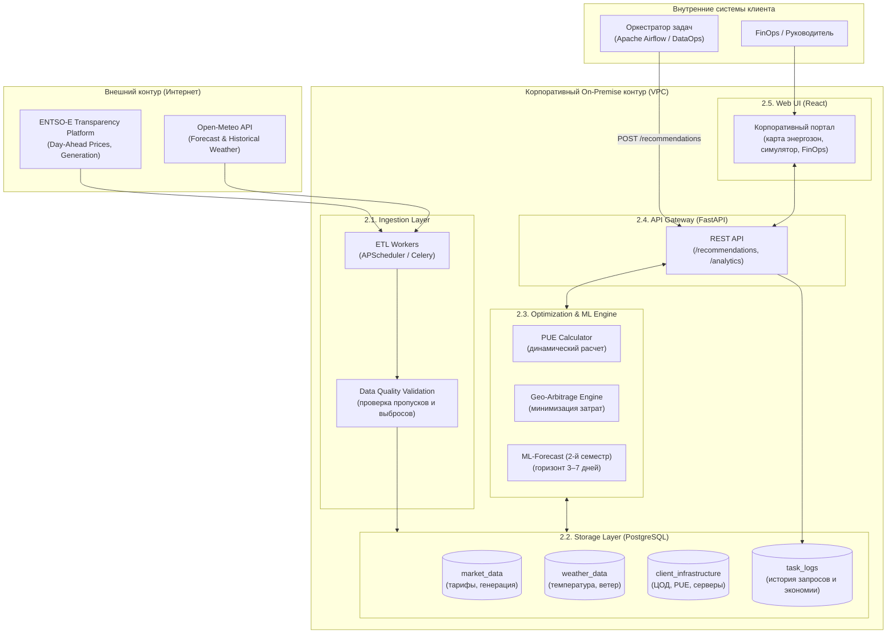
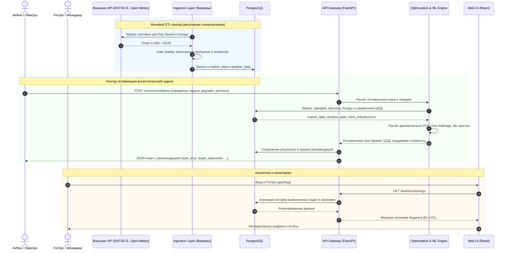

# Архитектура проекта EcoGrid Flow

| Параметр | Значение |
| :--- | :--- |
| **Тип системы** | On-Premise Аналитический B2B-сервис |
| **Стек технологий** | Python 3.11, FastAPI, React, PostgreSQL, Docker Compose, ML (XGBoost / Prophet во 2-м семестре) |

---

## 1. Концепция развертывания (On-Premise)

> [!NOTE]
> **Принцип изоляции данных:** Сервис поставляется как Docker-композиция и разворачивается в закрытом сетевом контуре (VPC) компании-клиента. 
> 
> Это гарантирует безопасность корпоративных данных (списки дата-центров, характеристики оборудования, внутренние логи задач) — они **никогда не покидают периметр компании**. Сервис обращается во внешний интернет исключительно для загрузки публичных котировок электроэнергии и прогноза погоды.

---

## 2. Компоненты системы



---

### 2.1. Ingestion Layer (Сбор данных)

* **Технологии:** `APScheduler` / `Celery Workers`
* **Ключевые функции:**
  * Автоматическая загрузка данных по расписанию и по событиям.
  * Обработка сетевых ошибок, таймаутов и повторные попытки (retry-политики).
  * **Data Quality валидация:** предварительная проверка пропусков, аномалий и выбросов перед сохранением в БД.

#### Каталог источников данных EcoGrid Flow

Каталог фиксирует внешние и внутренние источники данных, необходимые аналитическому сервису EcoGrid Flow. Для каждого источника указаны назначение, формат, частота получения, ожидаемый объём, владелец данных и способ доступа.

> [!TIP]
> Объёмы ниже являются проектной оценкой для MVP и служат для расчёта нагрузки на ETL и PostgreSQL. Фактический объём будет уточняться после подключения API и выбора окончательного набора энергозон и дата-центров.

| № | Источник данных | Назначение и используемые атрибуты | Формат | Частота получения | Ожидаемый объём | Владелец / ответственный | Способ доступа | Этап |
| :-: | :--- | :--- | :--- | :--- | :--- | :--- | :--- | :-: |
| **1** | **ENTSO-E Transparency Platform** — Day-Ahead Prices (`market_day_ahead_prices`) | Спотовые цены на электроэнергию по энергозонам. Поля: `bidding_zone`, `period_start`, `period_end`, `price`, `currency`, `price_unit`, `resolution`. | `XML`, timestamp ISO 8601; в БД: партиционированная таблица PostgreSQL (`RANGE` по `period_start`, 1 мес.) | Автоматическая загрузка после публикации новых Day-Ahead данных; в ETL — не реже 1 раза в сутки с возможностью повторной проверки | При 15-минутном разрешении — до 96 значений на энергозону в сутки. Для 3–5 зон: примерно 288–480 ценовых записей/сутки, около 105–175 тыс. записей/год | ENTSO-E Transparency Platform; первичные данные публикуются участниками европейского энергорынка / TSO | REST/Web API по HTTPS, авторизация через ENTSO-E Security Token | **MVP** |
| **2** | **ENTSO-E Transparency Platform** — Generation / Energy Mix (`market_generation_mix`) | Данные о производстве электроэнергии и структуре генерации по зонам. Поля: `bidding_zone`, `period_start`, `period_end`, `production_type`, `generation_mw`, `resolution`. | `XML`; в БД: партиционированная таблица PostgreSQL (`RANGE` по `period_start`, 1 мес.) | В зависимости от типа публикации; ETL может синхронизировать данные несколько раз в сутки | Сотни записей в сутки для выбранных энергозон в зависимости от числа типов генерации | ENTSO-E / национальные TSO | REST/Web API по HTTPS с Security Token | **MVP** |
| **3** | **Open-Meteo Forecast API** (`weather_forecast`) | Оперативный прогноз температуры, влажности, ветра и радиации около ЦОД для расчета динамического PUE. Поля: `datacenter_id`, `latitude`, `longitude`, `forecast_time`, `temperature_2m`, `relative_humidity_2m`, `cloud_cover`, `wind_speed_10m`, `shortwave_radiation`, `retrieved_at`. | `JSON`; в БД: партиционированная таблица PostgreSQL (`RANGE` по `forecast_time`, 1 мес.) | Плановая синхронизация каждые 3–6 часов либо после появления нового прогноза | Для одного ЦОД при почасовом разрешении: 24 записи/сутки на переменную. Для 3–5 ЦОД и нескольких погодных признаков — сотни значений в сутки | OpenMeteo GmbH; исходные модели предоставляются национальными метеослужбами, включая DWD, ECMWF, NOAA и др. | HTTP GET API по координатам ЦОД; для некоммерческого прототипа API может использоваться без ключа | **MVP** |
| **4** | **Open-Meteo Historical Weather API** (`weather_historical`) | Исторические ряды температуры, влажности, ветра и радиации за 3–5 лет для EDA и ML. Поля: `datacenter_id`, `latitude`, `longitude`, `observed_at`, `temperature_2m`, `relative_humidity_2m`, `cloud_cover`, `wind_speed_10m`, `shortwave_radiation`. | `JSON`, `CSV`; в БД: партиционированная таблица PostgreSQL (`RANGE` по `observed_at`, 1 год) | Разовая первичная историческая загрузка за 3–5 лет; затем периодическое дозаполнение новых данных | 3 года ≈ 26,3 тыс. почасовых записей на один ЦОД на один временной ряд; 5 лет ≈ 43,8 тыс. Для нескольких ЦОД — сотни тысяч строк | OpenMeteo GmbH / поставщики исходных метеоданных | Historical Weather API по HTTP, параметры: координаты, начальная/конечная дата, необходимые погодные переменные | **EDA (1-й сем.), ML (2-й сем.)** |
| **5** | **Справочник инфраструктуры клиента** (`client_infrastructure`) | Реестр дата-центров, доступность, базовый PUE и предел мощности. Поля: `datacenter_id`, `name`, `bidding_zone`, `latitude`, `longitude`, `max_power_kw`, `base_pue`, `is_active`, `created_at`. | `PostgreSQL`, `JSON` | Изменяется редко — при добавлении или изменении дата-центров и оборудования | Небольшой справочник: десятки или сотни записей на одного корпоративного клиента | Компания-клиент; ответственные — Infrastructure / DataOps / FinOps | Внутренняя БД или административный REST API EcoGrid Flow; данные не покидают On-Premise контур | **MVP** |
| **6** | **Параметры вычислительной задачи от внутренних систем клиента** (`task_parameters`) | Входящие требования к batch-задачам от оркестраторов клиента (SLA, допустимые локации, мощность). Поля: `job_id`, `name`, `duration_minutes`, `required_power_kw`, `earliest_start`, `deadline`, `preferred_datacenter_id`, `allow_geo_migration`, `created_at`. | `JSON`; в БД: таблица PostgreSQL `task_parameters` | По событию — каждый раз при запросе рекомендации | Зависит от клиента. Для учебного MVP — от единиц до сотен/тысяч запросов в сутки; одна запись мала по объёму | DataOps / MLOps компании-клиента | POST-запрос во внутренний REST API FastAPI (`/api/v1/recommendations`) | **MVP** |
| **7** | **Внутренние журналы задач и результаты рекомендаций EcoGrid Flow** (`task_history`) | История запросов, выбранное окно запуска, ЦОД, расчётная стоимость, базовая стоимость и экономия. Поля: `recommendation_id`, `job_id`, `datacenter_id`, `recommended_start`, `recommended_end`, `estimated_energy_kwh`, `estimated_cost`, `estimated_savings`, `currency`, `calculated_at`. | Партиционированная таблица PostgreSQL (`RANGE` по `calculated_at`, 1 мес.), API-ответы `JSON` | При каждом запросе оптимизатора / выполнении задачи | Примерно 1 запись на запрос плюс технические логи. При 1 000 задач/сутки — около 365 тыс. бизнес-записей в год | Компания-клиент / EcoGrid Flow | Формируются самим сервисом и хранятся в локальной PostgreSQL | **MVP** |

---

### 2.2. Storage Layer (Хранилище данных)

* **Технологии:** `PostgreSQL 16` (с партиционированием таблиц временных рядов по временным интервалам).
* **Схема хранения данных (в соответствии со спецификацией `PreColumns.md`):**

#### 1. Таблица спотовых цен: `market_day_ahead_prices` (ENTSO-E Transparency Platform — Day-Ahead Prices)
* **Назначение:** спотовые цены на электроэнергию по энергозонам. Основной источник для расчёта стоимости выполнения вычислительной задачи и выбора дешёвого временного окна.
* **Партиционирование:** по временным диапазонам (`RANGE` по полю `period_start`, интервал — 1 месяц).

| Поле | Бизнес-название | Пояснение |
|---|---|---|
| `bidding_zone` | Энергозона | По нему сравниваем географические локации |
| `period_start` | Начало ценового интервала | Начало интервала, для которого действует цена |
| `period_end` | Конец ценового интервала | Конец ценового интервала |
| `price` | Цена | Цена электроэнергии — основной показатель оптимизации |
| `currency` | Валюта | Валюта цены, например EUR |
| `price_unit` | Единица измерения цены | На какую единицу измерения указана цена (например МВт) |
| `resolution` | Шаг временного ряда | Шаг временного ряда, например PT60M или PT15M |

#### 2. Таблица генерации и энергобаланса: `market_generation_mix` (ENTSO-E Transparency Platform — Generation / Energy Mix)
* **Назначение:** данные о производстве электроэнергии и структуре генерации по зонам. Используются для аналитики энергорынка и последующего расчёта/оценки углеродной интенсивности.
* **Партиционирование:** по временным диапазонам (`RANGE` по полю `period_start`, интервал — 1 месяц).

| Поле | Бизнес-название | Пояснение |
|---|---|---|
| `bidding_zone` | Энергозона | Энергозона, к которой относится генерация |
| `period_start` | Начало измерения | Начало интервала измерения |
| `period_end` | Конец измерения | Конец интервала |
| `production_type` | Тип энергии | Источник энергии: solar, wind, nuclear, gas и т. д. |
| `generation_mw` | Вырабатываемая мощность | Фактическая мощность генерации данного типа |
| `resolution` | Временной шаг данных | Временной шаг данных |

#### 3. Таблица прогноза погоды: `weather_forecast` (Open-Meteo Forecast API)
* **Назначение:** оперативный метеопрогноз около дата-центров (температура, влажность, скорость ветра, радиация) для расчёта динамического PUE и затрат на охлаждение.
* **Партиционирование:** по временным диапазонам (`RANGE` по полю `forecast_time`, интервал — 1 месяц).

| Поле | Бизнес-название | Пояснение |
|---|---|---|
| `datacenter_id` | ЦОД | Для какого ЦОД был получен прогноз |
| `latitude` | Широта | Широта |
| `longitude` | Долгота | Долгота |
| `forecast_time` | Время прогноза | На какой момент прогнозируется погода |
| `temperature_2m` | Температура воздуха | Температура воздуха; ключевой погодный фактор для охлаждения |
| `relative_humidity_2m` | Влажность | Влажность; может участвовать в модели эффективности охлаждения |
| `cloud_cover` | Облачность | Облачность, % |
| `wind_speed_10m` | Скорость ветра | Скорость ветра |
| `shortwave_radiation` | Солнечная радиация | Солнечная радиация |
| `retrieved_at` | Время получения | Когда именно мы получили этот прогноз |

#### 4. Таблица исторического метеоархива: `weather_historical` (Open-Meteo Historical Weather)
* **Назначение:** ретроспективные метеопараметры за 3–5 лет для исследовательского анализа (EDA) и обучения ML-моделей оптимизации.
* **Партиционирование:** по временным диапазонам (`RANGE` по полю `observed_at`, интервал — 1 год).

| Поле | Бизнес-название | Пояснение |
|---|---|---|
| `datacenter_id` | ЦОД | Привязка погоды к ЦОД |
| `latitude` | Широта | Широта |
| `longitude` | Долгота | Долгота |
| `observed_at` | Время замера | Время исторического значения |
| `temperature_2m` | Температура | Историческая температура |
| `relative_humidity_2m` | Влажность | Историческая влажность |
| `cloud_cover` | Облачность | Историческая облачность |
| `wind_speed_10m` | Скорость ветра | Историческая скорость ветра |
| `shortwave_radiation` | Солнечная радиация | Историческая солнечная радиация |

#### 5. Справочник инфраструктуры клиента: `client_infrastructure`
* **Назначение:** справочник площадок ЦОД, географических координат, базового PUE и характеристик серверного парка для перевода биржевой цены в затраты на задачу.

| Поле | Бизнес-название | Пояснение |
|---|---|---|
| `datacenter_id` | ЦОД | Уникальный ID вычислительной площадки |
| `name` | Имя ЦОД | Название ЦОД |
| `bidding_zone` | Цена зоны | Связывает ЦОД с ценами ENTSO-E |
| `latitude` | Широта | Широта |
| `longitude` | Долгота | Долгота |
| `max_power_kw` | Предел выч. мощности | Максимальная доступная вычислительная/энергетическая мощность |
| `base_pue` | Эффективность энерготрат | Базовый Power Usage Effectiveness ЦОД |
| `is_active` | Доступность | Можно ли сейчас использовать площадку |
| `created_at` | Регистрация ЦОД | Когда ЦОД зарегистрирован в системе |

#### 6. Журнал параметров вычислительных задач: `task_parameters` (Параметры вычислительной задачи)
* **Назначение:** входящие требования к вычислительным задачам от внутренних систем/планировщиков клиента (длительность, дедлайн, мощность, допустимые ЦОД).

| Поле | Бизнес-название | Пояснение |
|---|---|---|
| `job_id` | Задача | Уникальный идентификатор задачи |
| `name` | Имя задачи | Название задачи |
| `duration_minutes` | Время выполнения | Сколько непрерывно должна выполняться задача |
| `required_power_kw` | Затраты мощности | Оценочная мощность вычислений |
| `earliest_start` | Приемлемый старт | Раньше какого момента запускать нельзя |
| `deadline` | Дедлайн | К какому моменту задача должна завершиться |
| `preferred_datacenter_id` | Предпочтительный ЦОД | Текущая/предпочтительная площадка, если есть |
| `allow_geo_migration` | Статус переноса задачи | Разрешено ли переносить вычисление в другую энергозону |
| `created_at` | Поступление задачи | Когда задача поступила |

#### 7. Журнал рекомендаций и результатов расчётов: `task_history` (Внутренние журналы задач и результаты рекомендаций)
* **Назначение:** история запросов, выбранное окно запуска, выбранный ЦОД, расчётная стоимость, базовая стоимость без оптимизации и достигнутая экономия.
* **Партиционирование:** по временным диапазонам (`RANGE` по полю `calculated_at`, интервал — 1 месяц).

| Поле | Бизнес-название | Пояснение |
|---|---|---|
| `recommendation_id` | Рекомендация | ID рекомендации |
| `job_id` | Задача | Для какой задачи произведён расчёт |
| `datacenter_id` | Центр обработки данных | Какой ЦОД выбран |
| `recommended_start` | Рекомендованное начало | Рекомендованное время запуска |
| `recommended_end` | Рекомендованное окончание | Рекомендованное время остановки |
| `estimated_energy_kwh` | Энергопотребление | Ожидаемое энергопотребление (кВт * ч) |
| `estimated_cost` | Стоимость | Ожидаемая стоимость запуска |
| `estimated_savings` | Экономия | Экономия относительно базового сценария |
| `currency` | Валюта | Валюта расчёта |
| `calculated_at` | Время расчёта | Когда была рассчитана рекомендация |

---

### 2.3. Optimization & ML Engine (Ядро логики)

* **Технологии:** `Python 3.11`, `Pandas`, `NumPy`, `Scikit-learn`
* **Ключевые модули:**
  * **Расчёт динамического PUE:** корректировка базового коэффициента энергоэффективности ЦОД в зависимости от уличной температуры воздуха.
  * **Geo-Arbitrage Engine:** пространственно-временной арбитраж — сравнение совокупной стоимости вычислений между несколькими доступными дата-центрами с учётом почасовых тарифов конкретных стран.
  * **ML-Forecast (2-й семестр):** прогноз спотовых цен и углеродного следа на 3–7 дней вперёд с помощью моделей (XGBoost / Prophet), обученных на 5-летнем историческом архиве.

---

### 2.4. API Gateway (Бэкенд)

* **Технологии:** `FastAPI`, `Uvicorn`, `Pydantic`
* **Функции:**
  * Защищённый внутренний REST API для интеграции с корпоративными планировщиками (Airflow, Kubeflow, Slurm, cron).
  * Валидация входных параметров задач по строгим схемам Pydantic.
  * Выдача рекомендаций оптимального окна: `{start_time, target_datacenter, expected_cost, expected_savings}`.

---

### 2.5. Web UI (Фронтенд)

* **Технологии:** `React`, `TypeScript`, `TailwindCSS`, `Apache ECharts`
* **Функции:**
  * **Карта энергозон:** интерактивная визуализация текущих и прогнозируемых спотовых тарифов по регионам присутствия.
  * **Графики волатильности:** детальная динамика цен, погодных условий и выработки ВИЭ.
  * **Калькулятор-симулятор:** инструмент для ручного моделирования затрат на пакетные задачи и выбора параметров SLA.
  * **FinOps-дашборд:** сводный отчёт об общей экономии бюджета и снижении углеродного следа (CO₂).

---

## 3. Схема потоков данных (Data Flow)

### 3.1. Последовательность обработки данных

1. **Внешний мир:** Биржи электроэнергии (ENTSO-E) и метеорологические службы (Open-Meteo) отдают прогнозы на сутки вперёд (а также исторические архивы для обучения ML).
2. **Сбор (ETL):** Фоновые воркеры забирают данные, проводят Data Quality валидацию, очищают их и сохраняют в партиционированные таблицы `PostgreSQL`.
3. **Запрос на оптимизацию:** Дата-инженер или пайплайн оркестратора (Airflow) отправляет POST-запрос в API:
   ```json
   {
     "task_name": "LLM-Fine-Tuning",
     "task_duration_hours": 5,
     "deadline": "2026-11-10T09:00:00Z",
     "power_consumption_kw": 120,
     "allowed_regions": ["DE", "FI", "SE"]
   }
   ```
4. **Расчет:** Движок оптимизации сканирует тарифы в разрешённых регионах, корректирует энергопотребление на динамический PUE (зависит от уличной температуры), применяет ML-прогноз (если горизонт дедлайна превышает 24 часа).
5. **Ответ сервиса:** API возвращает JSON с оптимальным дата-центром, временным слотом запуска и оценкой экономии:
   ```json
   {
     "task_name": "LLM-Fine-Tuning",
     "recommended_start_time": "2026-11-09T23:00:00Z",
     "target_datacenter": "FI-HELSINKI-01",
     "region": "FI",
     "expected_cost_eur": 42.50,
     "baseline_cost_eur": 89.20,
     "estimated_savings_percent": 52.35
   }
   ```
6. **Визуализация и отчётность:** Руководитель или FinOps-специалист открывает веб-портал и анализирует исторические метрики сэкономленных средств и сокращения выбросов CO₂.

### 3.2. Диаграмма взаимодействия компонентов

